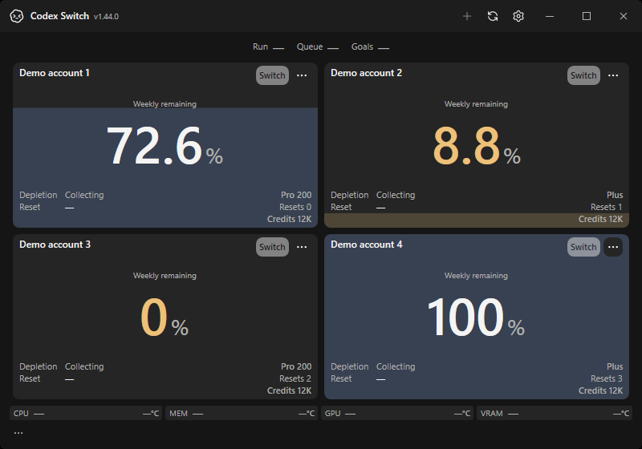
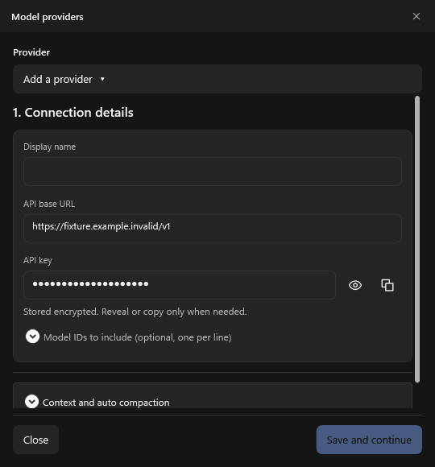
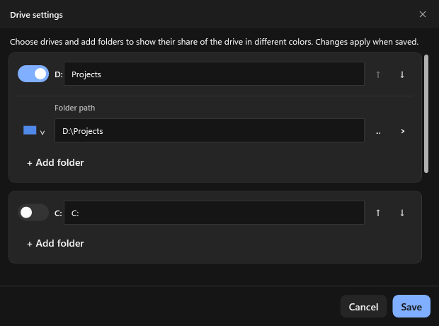
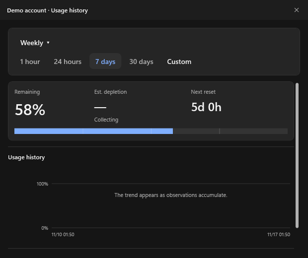
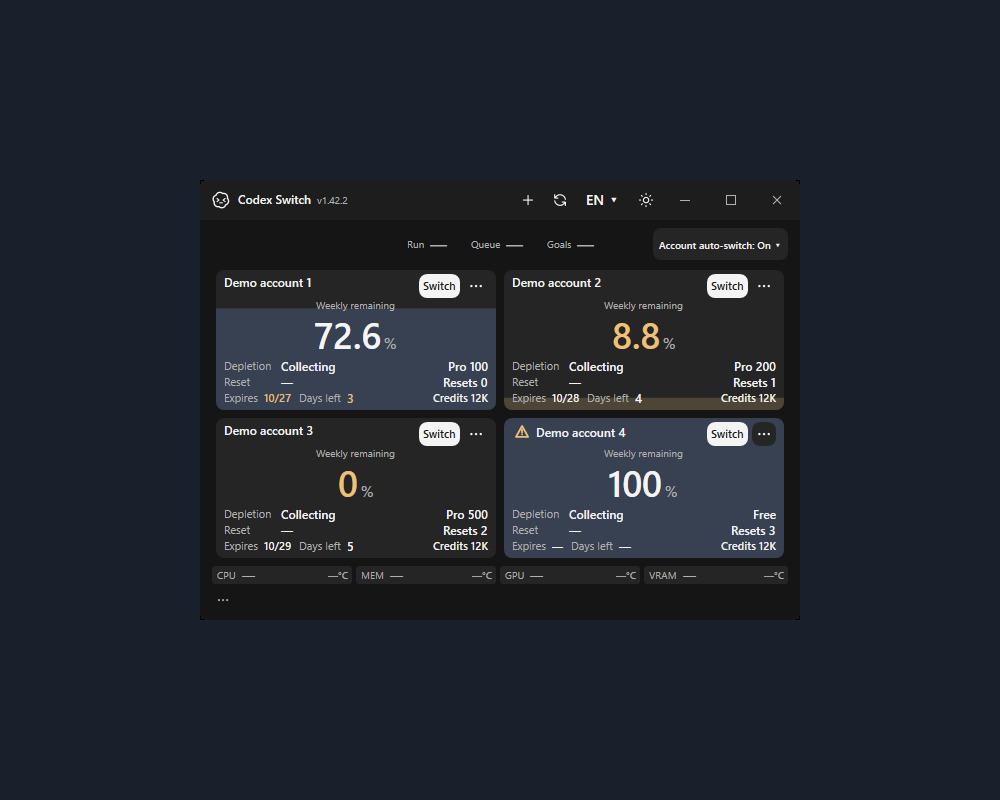
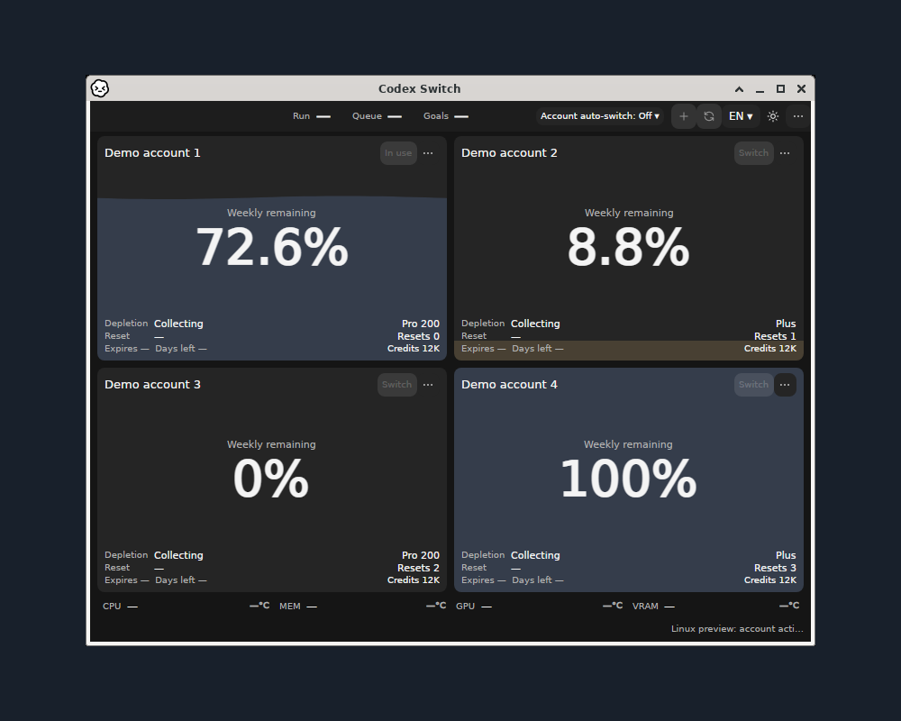

<h1 align="center">Codex Switch: OpenAI Codex account switcher and quota monitor</h1>

  
  
  
  
  

**Codex Switch (`codex-switch`) is an open-source desktop account switcher and usage quota monitor for OpenAI Codex.** See your accounts together, choose the next one, and recover an interrupted handoff. Optional quota-based switching starts **Off**.

[Native desktop model integration](docs/DESKTOP_MODEL_BACKEND.md) places registered custom models in the same Codex model picker while OpenAI connects directly. One initial backend installation restart is required; normal model edits and selection need no restart. The former combined HTTP profile remains retired.

Windows · macOS15+ · Linux preview · MIT open source · **1.45.4**

Windows model settings include **Context and auto compaction**: edit native OpenAI defaults or individual external models, save, and use the new values on the next request without restarting Codex. Empty fields restore defaults; actual model limits and native safety margins remain in effect.

[English](README.md) / [한국어](docs/README.ko.md) / [日本語](docs/README.ja.md) / [简体中文](docs/README.zh-CN.md)

[Download](#download) · [Get started](#get-started) · [Features](#features) · [Screenshots](#actual-app-screenshots) · [Contribute](#contribute) · [Release notes](https://github.com/Gaebabi/codex-switch/releases/tag/v1.45.4)

Actual Windows app with fictional account inputs. [Native screenshots and source verification](docs/evidence/home-simplification/README.md). Credentials stay in a local encrypted vault; **switching restarts Codex**. Independent project, not affiliated with OpenAI.

**Find it useful?** Star this repository or share it with another Codex user.

Release1.45.4 reduces Windows folder-monitor disk reads. Hidden/minimized windows pause folder allocation traversal; visible windows reuse unchanged roots and directory snapshots and refresh affected directories from filesystem notifications. Lightweight drive counters remain active. [Changes and verification](docs/development/RELEASE_1_45_4.md).

The local Windows source follow-up adds current desktop-status compatibility, a shared folder-query budget and more structured settings panels. These changes are separate from the published1.45.4 downloads until a new release is verified.

Earlier release highlights

Release1.42.2 adds account-specific browser sign-in from warnings, default-Off quota-based account switching, optimal/custom priority, durable reopening/recovery, labeled subscription dates and official Pro 100/200/500 tiers. [Behavior and verification scope](docs/development/ACCOUNT_AUTOMATION.md) / [release gates](docs/development/RELEASE_1_42_2.md).

Release1.42.3 recovers Windows usage refresh after Codex replaces its executable, without restarting Switch. Valid paths stay cached; installation gaps keep an explicit warning and requests are never replayed. [Recovery and verification](docs/development/RELEASE_1_42_3.md).

Release1.42.4 keeps the complete Linux account-auto-switch caption visible in the minimum window, without taking space from quota cards or adding dependencies. [Native verification and delivery](docs/development/RELEASE_1_42_4.md).

Release1.42.5 prioritizes eligible subscriptions expiring soon and adds an **Auto Switch** toggle with the next account. It retries a transient handoff up to two additional times while keeping controls busy. The persisted budget and original Continue identities prevent unbounded recovery and duplicate sends. [Behavior and verification](docs/development/RELEASE_1_42_5.md).

Release1.42.6 keeps Auto Switch usable when quota identifiers are duplicated or missing: ambiguous candidates are skipped and ambiguous source observations cannot trigger switching. Original data and valid expiry/custom ordering remain intact. [Behavior and verification](docs/development/RELEASE_1_42_6.md).

Release1.42.7 lets Linux terminal accounts work with the reviewed standalone Codex CLI0.164.0. Exact executable integrity and credential/workspace checks still apply. [Compatibility and verification](docs/development/RELEASE_1_42_7.md).

Release1.43.0 adds separate credit-balance decrease graphs in History and optional safe pause/recovery at zero ordinary quota. Credit use stays allowed by default. Usable past-date subscriptions retain priority, and diagnostic reports identify the actual running version. [Verification](https://github.com/Gaebabi/codex-switch/issues/132).

Release1.43.1 keeps Auto Switch available when a fresh report still shows 0% after its reset time. The next eligible account remains visible, and an available handoff takes priority over a local credit-protection pause. [Verification](https://github.com/Gaebabi/codex-switch/issues/136).

Release1.43.2 preserves browser-login cancellation when a temporary Windows database file stays briefly locked. Cleanup waits asynchronously for up to two seconds; persistent locks and permission failures remain explicit. [Verification](https://github.com/Gaebabi/codex-switch/issues/139).

Release1.43.3 lets you add Responses-compatible model providers and choose their models alongside eligible OpenAI models. It also improves interrupted-switch recovery and adds clearer credit history ranges. The combined desktop picker and individual external providers still need separate compatibility confirmation. [Setup, limits and verification](docs/MODEL_PROVIDERS.md).

## Download

Complete packages include the .NET runtime; no source build or .NET installation is needed. Keep the entire extracted folder or app bundle.

| Platform | Download |
| --- | --- |
| Windows x64 | [ZIP](https://github.com/Gaebabi/codex-switch/releases/download/v1.45.4/CodexSwitch-v1.45.4-win-x64.zip) |
| macOS15+ Apple Silicon | [ZIP](https://github.com/Gaebabi/codex-switch/releases/download/v1.45.4/CodexSwitch-v1.45.4-osx-arm64.zip) |
| macOS15+ Intel | [ZIP](https://github.com/Gaebabi/codex-switch/releases/download/v1.45.4/CodexSwitch-v1.45.4-osx-x64.zip) |
| Linux x64 **preview** | [DEB](https://github.com/Gaebabi/codex-switch/releases/download/v1.45.4/CodexSwitch-v1.45.4-preview-linux-x64.deb) / [RPM](https://github.com/Gaebabi/codex-switch/releases/download/v1.45.4/CodexSwitch-v1.45.4-preview-linux-x64.rpm) / [tar.gz](https://github.com/Gaebabi/codex-switch/releases/download/v1.45.4/CodexSwitch-v1.45.4-preview-linux-x64.tar.gz) |
| Linux ARM64 **preview** | [DEB](https://github.com/Gaebabi/codex-switch/releases/download/v1.45.4/CodexSwitch-v1.45.4-preview-linux-arm64.deb) / [RPM](https://github.com/Gaebabi/codex-switch/releases/download/v1.45.4/CodexSwitch-v1.45.4-preview-linux-arm64.rpm) / [tar.gz](https://github.com/Gaebabi/codex-switch/releases/download/v1.45.4/CodexSwitch-v1.45.4-preview-linux-arm64.tar.gz) |

[Release notes and SHA256 checksums](https://github.com/Gaebabi/codex-switch/releases/tag/v1.45.4). Windows/Linux packages are unsigned. Mac bundles are ad-hoc signed and **not Apple-notarized**; follow [Mac setup](docs/MACOS.md).

Linux is an integration preview. Native storage, installed UI and package tests are distinct from supported account handoff and full desktop acceptance. Desktop integration requires approved OpenAI Linux client26.1007.71326, an existing file credential policy and X11/XWayland; newer clients require review. CLI-only mode needs an explicit executable checksum and does not resume desktop chats. [Requirements and limits](docs/development/LINUX.md) / [Linux installation](docs/development/LINUX_PACKAGES.md)

Warning icons retain full hover details; activate one to sign in again for the selected account. [Actual application evidence](docs/evidence/account-automation/README.md).

**Linux1.45.4 downloads include terminal account switching and saved CLI-session resumption, introduced in source1.41.0.** `CodexSwitch cli` manages the existing encrypted accounts without DISPLAY; `cli switch <account> --resume <CLI-session-UUID>` combines manual switching and official CLI resumption. `--continue` explicitly submits a follow-up; `--exec --continue` selects noninteractive continuation. A verified native CLI and an unlocked supported Secret Service are required. Real two-account contextual CLI resumption is verified on Linux x64; native ARM64/offline tests and full desktop acceptance have separate scopes. [Commands, actual screenshots and exact verification limits](docs/development/LINUX_TERMINAL.md).

## Get started

1. Windows: run `CodexSwitch.exe`. Mac: run `Install.command`, then open the installed **Codex Switch.app**. Linux: install a complete preview package and configure a supported Secret Service provider. [Installation](docs/INSTALL.md)
2. Select **+** for official browser sign-in. If the previous account is automatically selected, use a separate browser profile/private window for the next login. **Settings > Import current account** imports the current Codex login.
3. Compare the cards and select **Switch**. **Account auto-switch is Off by default; enable it explicitly in Settings.** On Linux, use **Settings > Start Codex** before working.

## Features

| Your task | What Codex Switch provides | Guide |
| --- | --- | --- |
| Choose an account | Compare quota, reset times, credits and subscription dates; switch manually or enable quota-based selection | [Account switching](docs/SWITCHING.md) |
| Work with external models on Windows | Keep native OpenAI models alongside registered custom models; edit per-model reasoning and context options | [Native model integration](docs/DESKTOP_MODEL_BACKEND.md) |
| Understand consumption | Inspect account history, selected time ranges, observed use and explicitly labeled forecasts | [Forecasts and limits](docs/FORECAST.md) |
| Monitor Windows resources and storage | Read supported hardware counters, disk I/O and allocated folder sizes with explicit unavailable states | [Folder monitoring](docs/FOLDER_MONITORING.md) |
| Recover an interrupted handoff | Retain encrypted progress and original chat identities; preserve uncertain-send safeguards | [Recovery behavior](docs/development/ACCOUNT_AUTOMATION.md) |

Behavior, platform boundaries and optional features

- **Models from your providers on Windows:** store provider keys locally using the existing protection identity. Registered models join the native picker through the desktop backend; ordinary OpenAI traffic stays direct. The optional separate-terminal profile has its own setup and limits. [Provider setup and compatibility](docs/MODEL_PROVIDERS.md)
- **Manual switch, automatic continuation:** back up the current login and verify date-prefixed chat names, normally close Codex, apply the selected account, reopen the same chat IDs/folders/models/permissions, and send one **Continue** to eligible idle unfinished chats. Running or completed work is left alone.
- **Recover interrupted handoffs:** encrypted checkpoints retain progress. **Resume chats** continues pending work; uncertain sends are never automatically repeated. Naming/shutdown failures stop the login change. Windows waits for child processes so one Switch click can finish the flow. [Switching details](docs/SWITCHING.md)
- **Quota and history:** remaining usage, resets, plans, subscription expiry, reset allowances, credits and consumption forecasts. Open **History** in an account's **...** menu. Card dates use your local time zone; the shared history view explicitly labels its KST axes. Expiry within72hours and reset within48hours use warning colors.
- **Local status and resources:** running/queued/goal counts, resource history and disk space. Windows shows independently colored resource/disk temperatures when supported sensors exist; missing values stay unknown. Linux resource telemetry is currently unavailable. [Sensor support](docs/TEMPERATURES.md)
- **Windows disk I/O (source1.40.6):** thin read/write bars beside disk temperature, exact rates on hover and sustained latency-pressure colors selected from actual backing-device characteristics. Observed scale is explicit; missing capabilities never invent a rated speed or health warning. [How it works](docs/DISK_IO.md)
- **Built-in Windows CPU temperature:** select the visible **download + °C** or **lock + °C** button to install the optional signed driver or authorize the sensor for this session. No separate hardware monitor; the account app keeps normal privileges. No automatic driver/UAC/reboot. [Setup and limits](docs/TEMPERATURES.md#built-in-windows-cpu-sensor) / [actual app before/after](docs/evidence/cpu-setup/README.md).
- **Always-on refresh:** account reads every60seconds, with **↻** or **F5** for an immediate refresh. If startup fails while the keyring/client is unavailable, the same schedule retries initialization automatically after it becomes available.
- **Nine UI languages and local JSON language packs:** English, Korean, Japanese, Simplified/Traditional Chinese, Spanish, French, German and Brazilian Portuguese, with English fallback. Icon theme actions, dark/light themes and shared scrollbars keep compact windows usable. [Translation guide](docs/LOCALIZATION.md)

**Switching restarts Codex** and may affect CLI/IDE clients sharing the login. Remaining Linux authenticated cross-account/continuation and broader desktop/accessibility criteria are tracked in [the support roadmap](docs/PLATFORM_SUPPORT_PLAN.md).

## Actual app screenshots

### Windows source preview

Provider, drive and history panels now share sections, typography and gauge rules. These previews are rendered from production WPF controls with fictional data; they are separate from the current release downloads and native account acceptance. [Source and verification scope](docs/evidence/desktop-polish/README.md).

| Providers | Drives | History |
| --- | --- | --- |
|  |  |  |

Published native app galleries and platform evidence

Actual application titlebars/controls are preserved on a solid background. Captions and source/runtime/hash receipts distinguish fictional UI inputs, ordinary Linux execution and authenticated acceptance. [Current gallery](docs/media/release-1.42.2/README.md)

**Windows x64:** actual WPF app with fictional accounts, numbered Pro tiers and explicit account-auto-switch wording. On is selected only in the demo; the default is Off. No personal account or desktop.

**Linux x64 · X11/Xfwm4:** the actual OS titlebar and four fictional demo account cards were captured together. No titlebar composition or personal login. [Light theme, source/hash receipts and verification scope](docs/media/release-1.42.2/README.md).

**MacBook screenshot:** reserved for the maintainer's real-device capture.
<!-- MacBook screenshot slot: add docs/media/release-1.42.2/macbook.png and its privacy/provenance receipt, then embed here. Never substitute a different OS image or mockup. -->

## Contribute

| Start here | Include |
| --- | --- |
| [Report a bug](https://github.com/Gaebabi/codex-switch/issues/new?template=bug_report.yml) | App/client versions, platform, reproducible steps and sanitized evidence |
| [Suggest an improvement](https://github.com/Gaebabi/codex-switch/issues/new?template=feature_request.yml) | The task that should improve, expected behavior and platform |
| [Translate the UI](docs/LOCALIZATION.md) | A language pack using the existing message IDs and placeholders |
| [Submit code](CONTRIBUTING.md) | A focused change, its behavior and appropriate verification |

Security reports use [private advisories](https://github.com/Gaebabi/codex-switch/security/advisories/new). Please keep tokens, account stores and private chats out of public issues. [Maintainer workflow](docs/development/MAINTAINING.md) explains review and release boundaries.

[Contributing](CONTRIBUTING.md) / [Security](SECURITY.md) / [Architecture](docs/ARCHITECTURE.md) / [CI](docs/CI.md) / [Operations](docs/development/OPERATIONS.md) / [Evidence](docs/evidence/README.md) / [Forecasts](docs/FORECAST.md)

Independent open-source software, not an official OpenAI product. Credentials stay in a local encrypted vault. [MIT](LICENSE) / [Asset notices](licenses/Burn0Assets.LICENSE.txt)
