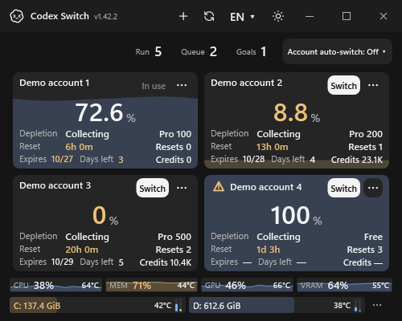
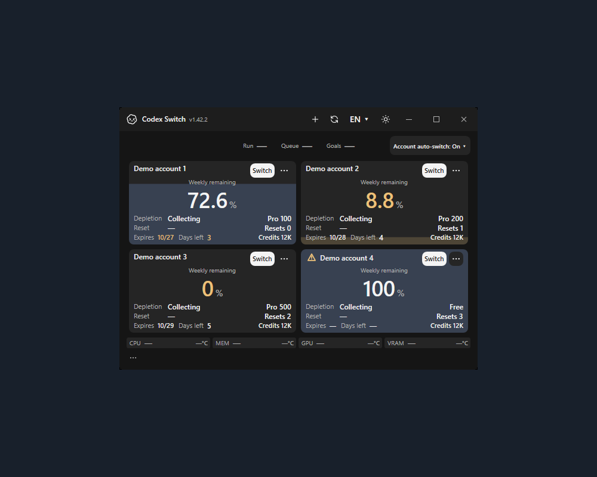
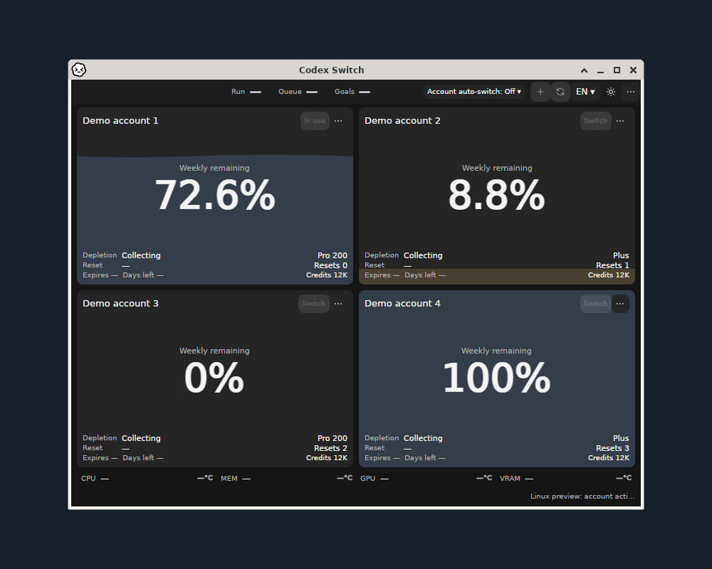

<h1 align="center">Codex Switch</h1>

**A desktop account switcher and quota dashboard for OpenAI Codex.** See your accounts together, choose the next one, and recover an interrupted handoff. Optional quota-based switching starts **Off**.

Windows · macOS15+ · Linux preview · MIT open source · **1.42.2**

[English](README.md) / [한국어](docs/README.ko.md) / [日本語](docs/README.ja.md) / [简体中文](docs/README.zh-CN.md)

[Download](#download) · [Get started](#get-started) · [What's new](https://github.com/Gaebabi/codex-switch/releases/tag/v1.42.2)

Windows UI demo with simulated account and system data. [Demo sources](docs/media/discovery/README.md) / [native verification](docs/evidence/account-automation/README.md). Credentials stay in a local encrypted vault; **switching restarts Codex**. Independent project, not affiliated with OpenAI.

**Find it useful?** Star this repository or share it with another Codex user.

Release1.42.2 adds account-specific browser sign-in from warnings, default-Off quota-based account switching, optimal/custom priority, durable reopening/recovery, labeled subscription dates and official Pro 100/200/500 tiers. [Behavior and verification scope](docs/development/ACCOUNT_AUTOMATION.md) / [release gates](docs/development/RELEASE_1_42_2.md).

## Download

Complete packages include the .NET runtime; no source build or .NET installation is needed. Keep the entire extracted folder or app bundle.

| Platform | Download |
| --- | --- |
| Windows x64 | [ZIP](https://github.com/Gaebabi/codex-switch/releases/download/v1.42.2/CodexSwitch-v1.42.2-win-x64.zip) |
| macOS15+ Apple Silicon | [ZIP](https://github.com/Gaebabi/codex-switch/releases/download/v1.42.2/CodexSwitch-v1.42.2-osx-arm64.zip) |
| macOS15+ Intel | [ZIP](https://github.com/Gaebabi/codex-switch/releases/download/v1.42.2/CodexSwitch-v1.42.2-osx-x64.zip) |
| Linux x64 **preview** | [DEB](https://github.com/Gaebabi/codex-switch/releases/download/v1.42.2/CodexSwitch-v1.42.2-preview-linux-x64.deb) / [RPM](https://github.com/Gaebabi/codex-switch/releases/download/v1.42.2/CodexSwitch-v1.42.2-preview-linux-x64.rpm) / [tar.gz](https://github.com/Gaebabi/codex-switch/releases/download/v1.42.2/CodexSwitch-v1.42.2-preview-linux-x64.tar.gz) |
| Linux ARM64 **preview** | [DEB](https://github.com/Gaebabi/codex-switch/releases/download/v1.42.2/CodexSwitch-v1.42.2-preview-linux-arm64.deb) / [RPM](https://github.com/Gaebabi/codex-switch/releases/download/v1.42.2/CodexSwitch-v1.42.2-preview-linux-arm64.rpm) / [tar.gz](https://github.com/Gaebabi/codex-switch/releases/download/v1.42.2/CodexSwitch-v1.42.2-preview-linux-arm64.tar.gz) |

[Release notes and SHA256 checksums](https://github.com/Gaebabi/codex-switch/releases/tag/v1.42.2). Windows/Linux packages are unsigned. Mac bundles are ad-hoc signed and **not Apple-notarized**; follow [Mac setup](docs/MACOS.md).

Linux is an integration preview. Native storage, installed UI and package tests are distinct from supported account handoff and full desktop acceptance. Desktop integration requires approved OpenAI Linux client26.1007.71326, an existing file credential policy and X11/XWayland; newer clients require review. CLI-only mode needs an explicit executable checksum and does not resume desktop chats. [Requirements and limits](docs/development/LINUX.md) / [Linux installation](docs/development/LINUX_PACKAGES.md)

Warning icons retain full hover details; activate one to sign in again for the selected account. [Actual application evidence](docs/evidence/account-automation/README.md).

**Linux1.42.2 downloads include terminal account switching and saved CLI-session resumption, introduced in source1.41.0.** `CodexSwitch cli` manages the existing encrypted accounts without DISPLAY; `cli switch <account> --resume <CLI-session-UUID>` combines manual switching and official CLI resumption. `--continue` explicitly submits a follow-up; `--exec --continue` selects noninteractive continuation. A verified native CLI and an unlocked supported Secret Service are required. Real two-account contextual CLI resumption is verified on Linux x64; native ARM64/offline tests and full desktop acceptance have separate scopes. [Commands, actual screenshots and exact verification limits](docs/development/LINUX_TERMINAL.md).

## Get started

1. Windows: run `CodexSwitch.exe`. Mac: run `Install.command`, then open the installed **Codex Switch.app**. Linux: install a complete preview package and configure a supported Secret Service provider. [Installation](docs/INSTALL.md)
2. Select **+** for official browser sign-in. If the previous account is automatically selected, use a separate browser profile/private window for the next login. On Windows, right-click **↻** to import the current Codex login.
3. Compare the cards and select **Switch**. **Account auto-switch is Off by default; enable it explicitly in its toolbar menu.** On Linux, use the app's **Start Codex** action before working.

## Features

- **Manual switch, automatic continuation:** back up the current login and verify date-prefixed chat names, normally close Codex, apply the selected account, reopen the same chat IDs/folders/models/permissions, and send one **Continue** to eligible idle unfinished chats. Running or completed work is left alone.
- **Recover interrupted handoffs:** encrypted checkpoints retain progress. **Resume chats** continues pending work; uncertain sends are never automatically repeated. Naming/shutdown failures stop the login change. Windows waits for child processes so one Switch click can finish the flow. [Switching details](docs/SWITCHING.md)
- **Quota and history:** remaining usage, resets, plans, subscription expiry, reset allowances, credits and consumption forecasts. Open **History** in an account's **...** menu. Card dates use your local time zone; the shared history view explicitly labels its KST axes. Expiry within72hours and reset within48hours use warning colors.
- **Local status and resources:** running/queued/goal counts, resource history and disk space. Windows shows independently colored resource/disk temperatures when supported sensors exist; missing values stay unknown. Linux resource telemetry is currently unavailable. [Sensor support](docs/TEMPERATURES.md)
- **Windows disk I/O (source1.40.6):** thin read/write bars beside disk temperature, exact rates on hover and sustained latency-pressure colors selected from actual backing-device characteristics. Observed scale is explicit; missing capabilities never invent a rated speed or health warning. [How it works](docs/DISK_IO.md)
- **Built-in Windows CPU temperature:** select the visible **download + °C** or **lock + °C** button to install the optional signed driver or authorize the sensor for this session. No separate hardware monitor; the account app keeps normal privileges. No automatic driver/UAC/reboot. [Setup and limits](docs/TEMPERATURES.md#built-in-windows-cpu-sensor) / [actual app before/after](docs/evidence/cpu-setup/README.md).
- **Always-on refresh:** account reads every60seconds, with **↻** or **F5** for an immediate refresh. If startup fails while the keyring/client is unavailable, the same schedule retries initialization automatically after it becomes available.
- **Nine UI languages and local JSON language packs:** English, Korean, Japanese, Simplified/Traditional Chinese, Spanish, French, German and Brazilian Portuguese, with English fallback. Icon theme actions, dark/light themes and shared scrollbars keep compact windows usable. [Translation guide](docs/LOCALIZATION.md)

**Switching restarts Codex** and may affect CLI/IDE clients sharing the login. Remaining Linux authenticated cross-account/continuation and broader desktop/accessibility criteria are tracked in [the support roadmap](docs/PLATFORM_SUPPORT_PLAN.md).

## Actual app screenshots

Actual application titlebars/controls are preserved on a solid background. Captions and source/runtime/hash receipts distinguish fictional UI inputs, ordinary Linux execution and authenticated acceptance. [Current gallery](docs/media/release-1.42.2/README.md)

**Windows x64:** actual WPF app with fictional accounts, numbered Pro tiers and explicit account-auto-switch wording. On is selected only in the demo; the default is Off. No personal account or desktop.

**Linux x64 · X11/Xfwm4:** the actual OS titlebar and four fictional demo account cards were captured together. No titlebar composition or personal login. [Light theme, source/hash receipts and verification scope](docs/media/release-1.42.2/README.md).

**MacBook screenshot:** reserved for the maintainer's real-device capture.
<!-- MacBook screenshot slot: add docs/media/release-1.42.2/macbook.png and its privacy/provenance receipt, then embed here. Never substitute a different OS image or mockup. -->

## Contribute

[Contributing](CONTRIBUTING.md) / [Security](SECURITY.md) / [Architecture](docs/ARCHITECTURE.md) / [CI](docs/CI.md) / [Operations](docs/development/OPERATIONS.md) / [Evidence](docs/evidence/README.md) / [Forecasts](docs/FORECAST.md)

Independent open-source software, not an official OpenAI product. Credentials stay in a local encrypted vault. [MIT](LICENSE) / [Asset notices](licenses/Burn0Assets.LICENSE.txt)
