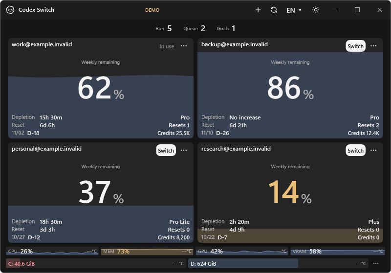

  

<h1 align="center">Codex Switch</h1>

Switch Codex accounts, automatically resume eligible unfinished local chats, and see what is left before you choose the next account. **Windows and macOS / 1.27.6**

[English](README.md) / [한국어](docs/README.ko.md) / [日本語](docs/README.ja.md) / [简体中文](docs/README.zh-CN.md)

*Source 1.30.2 Windows UI with fictional accounts and resources; published downloads remain 1.27.6. [Current screenshots and native Windows/Mac gallery](docs/media/README.md#native-platform-gallery).*

## Get started

**Download:** [Windows x64](https://github.com/Gaebabi/codex-switch/releases/download/v1.27.6/CodexSwitch-v1.27.6-win-x64.zip) / [Mac Apple Silicon](https://github.com/Gaebabi/codex-switch/releases/download/v1.27.6/CodexSwitch-v1.27.6-osx-arm64.zip) / [Mac Intel](https://github.com/Gaebabi/codex-switch/releases/download/v1.27.6/CodexSwitch-v1.27.6-osx-x64.zip)

[Release notes and checksums](https://github.com/Gaebabi/codex-switch/releases/tag/v1.27.6). No source build or .NET installation is needed. Mac packages are not notarized; see [Mac setup](docs/MACOS.md).

**Linux:** planned; no Linux package yet. Follow the [support roadmap](docs/PLATFORM_SUPPORT_PLAN.md) and [issue #1](https://github.com/Gaebabi/codex-switch/issues/1). Contributions across languages, distributions and accessibility needs are welcome.

Source1.39.0 contributors can build the [Linux storage/UI preview](docs/development/LINUX.md) and [complete unsigned installation candidates](docs/development/LINUX_PACKAGES.md). Ordinary account/handoff actions are gated while native authenticated acceptance remains in progress; these are not a supported Linux account-switching release.

Source1.36.0 verifies encrypted KWallet5 storage on native Ubuntu24.04 x64/ARM64 while preserving existing keys and vault data. [Native storage verification and actual app screenshots](docs/evidence/linux-kwallet-storage/README.md). Linux desktop switching and packages remain separate support gates.

Source 1.37.0 adds [verified KWallet6/KSecrets storage](docs/evidence/linux-kde6/README.md) for declared Debian 6.13.0/6.26.0/6.30.0 builds on native x64/ARM64, preserving original keys and vault data. [Package and security contracts](docs/development/KDE_SECRET_SERVICE.md) require the original provider PID and exact native executable checksum; service/version names alone are insufficient.

1. Use a complete Windows or Mac package. Windows: run `CodexSwitch.exe`. Mac: run `Install.command`, then open **Codex Switch.app**. [Build and install](docs/INSTALL.md)
2. Select **+** in the title bar to add accounts. On Windows, right-click **↻** to import the current Codex login.
3. Compare the cards and select **Switch**. Reads refresh every 60 seconds; **↻** or **F5** refreshes immediately.

**Source1.29.3:** automatic refresh is always enabled at60seconds. Its Windows footer switch/caption and Mac settings toggle are removed; an older disabled preference no longer stops reads. [Application comparison and scope](docs/evidence/always-refresh/README.md)

Keep the full package together. Packaged apps need no .NET installation; building current source requires .NET10.0.4xx and installed Codex desktop/CLI. Source1.37.0 uses .NET10 LTS/runtime10.0.13; its current supported Mac baseline is macOS15+. Published1.27.6 downloads remain unchanged until separately released.

## What you can see

- Remaining quota, reset countdown, plan, subscription end date, reset credits and credit balance.
- **Source 1.29.2:** subscription expiry date/D-day within three days and quota reset within two days use the theme warning color, refreshed every second. [Date warning scope and application evidence](docs/evidence/date-warnings/README.md)
- Recent usage and a depletion estimate based on usage history. Open **History** from an account's **...** menu.
- Local running/queued/goal counts, resource trends and configurable drive free space. Hover a gauge for details.
- **Source 1.29.0:** right-aligned resource/disk temperatures with independent normal/caution/high colors when supported sensors are available; missing values show `—°C`. Device-reported limits take precedence over documented display defaults. CPU/RAM may require an existing compatible sensor provider. [Temperature support and scope](docs/TEMPERATURES.md)

The title bar has language and light/dark settings. **Source 1.28.0** adds nine UI languages (English, Korean, Japanese, Simplified/Traditional Chinese, Spanish, French, German and Brazilian Portuguese) and validated local JSON language packs. Current **1.27.6 downloads** still have English/Korean. [Language packs and translation contributions](docs/LOCALIZATION.md)

## Switch and resume

- **Back up before switching:** save active local chat names with a date prefix and verify them, then back up the current login before applying the selected account. Naming or normal-shutdown failures stop the login change.
- **Automatically resume unfinished work:** restart Codex, reopen the same chat IDs with their existing folders/models/permissions, and send one **Continue** to eligible idle chats. Already running or completed work is left alone.
- **Source 1.29.1:** after normal Windows shutdown, wait for child processes to finish before applying the account and reopening Codex in the same manual Switch invocation. Current downloads do not contain this correction.
- **Recover an interrupted handoff:** progress is checkpointed in the encrypted vault. Use **Resume chats** when a handoff remains pending; cancellation is available from the account menu/tray. Unclear sends are not automatically repeated.

**Switching restarts Codex** and can also affect CLI/IDE clients sharing the login. [Switching details](docs/SWITCHING.md)

## More

[Mac setup](docs/MACOS.md) / [Forecast](docs/FORECAST.md) / [Security](SECURITY.md) / [Contributing](CONTRIBUTING.md) / [Roadmap](docs/PLATFORM_SUPPORT_PLAN.md)

Developer reference: [Architecture](docs/ARCHITECTURE.md) / [CI](docs/CI.md) / [Operations](docs/development/OPERATIONS.md) / [Current application comparison](docs/evidence/scrollbars-theme-icons/README.md) / [Evidence index](docs/evidence/README.md).

This is independent open-source software, not an official OpenAI product. Credentials stay in a local encrypted vault. [MIT](LICENSE) / [Asset notices](licenses/Burn0Assets.LICENSE.txt)
