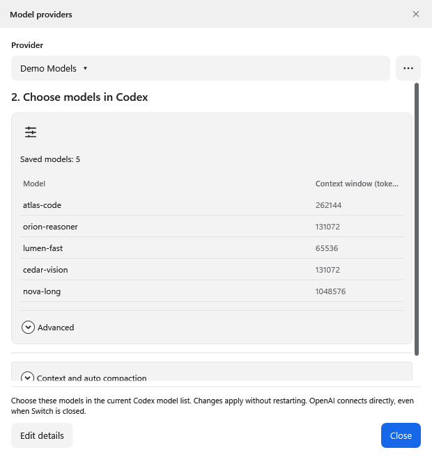
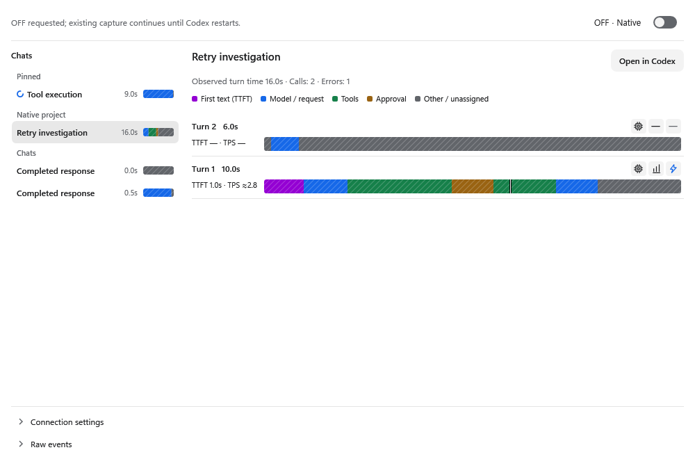
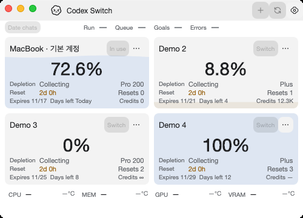
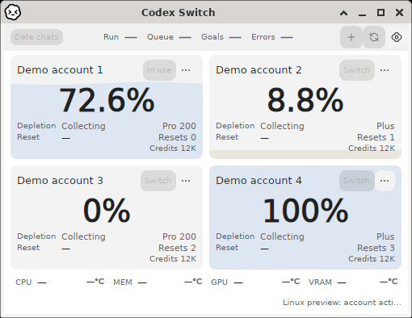

<h1 align="center">Codex Switch</h1>

<strong>Custom models in Codex. Accounts at a glance.</strong>

  
  
  
  

[English](README.md) · [한국어](docs/README.ko.md) · [日本語](docs/README.ja.md) · [简体中文](docs/README.zh-CN.md)

An open-source desktop account switcher and quota monitor, with live custom-model integration for Codex on Windows.

[Download](#download) · [Custom models](#custom-models-live-in-codex) · [Screenshots](#screenshots) · [Contribute](#contribute)

<picture><source media="(prefers-color-scheme: dark)" srcset="docs/media/release-1.45.5/dashboard-en-dark.png" /></picture>

Windows 1.45.5, rendered with fictional demo data. [Capture details](docs/media/release-1.45.5/README.md).

## Custom models, live in Codex

Add a Responses-compatible provider and use its models beside OpenAI models in the **native Codex picker** on Windows.

- **Register, edit and select models without restarting Codex** after initial setup.
- Set reasoning, context size and auto-compaction per model.
- OpenAI traffic stays direct. Model connections keep working when the Switch window closes.

The first backend setup needs one normal Codex restart. Compatibility depends on the Codex build and provider. [Setup and compatibility](docs/DESKTOP_MODEL_BACKEND.md).

<picture><source media="(prefers-color-scheme: dark)" srcset="docs/media/release-1.45.5/models-en-dark.png" /></picture>

## More at a glance

| Task | What you get |
| --- | --- |
| Accounts | Compare quota, resets, credits and subscription dates; switch manually or enable quota-based selection. |
| History | See usage and credit trends, time ranges and labeled forecasts. |
| Windows resources | Monitor hardware, disk I/O and folder allocation with bounded background work. |

## Download

| Platform | Architecture | Package |
| --- | --- | --- |
| Windows | x64 | [ZIP](https://github.com/Gaebabi/codex-switch/releases/download/v1.45.7/CodexSwitch-v1.45.7-win-x64.zip) |
| macOS 15+ | Apple Silicon | [ZIP](https://github.com/Gaebabi/codex-switch/releases/download/v1.45.7/CodexSwitch-v1.45.7-osx-arm64.zip) |
| macOS 15+ | Intel | [ZIP](https://github.com/Gaebabi/codex-switch/releases/download/v1.45.7/CodexSwitch-v1.45.7-osx-x64.zip) |
| Linux preview | x64 | [DEB](https://github.com/Gaebabi/codex-switch/releases/download/v1.45.7/CodexSwitch-v1.45.7-preview-linux-x64.deb) · [RPM](https://github.com/Gaebabi/codex-switch/releases/download/v1.45.7/CodexSwitch-v1.45.7-preview-linux-x64.rpm) · [tar.gz](https://github.com/Gaebabi/codex-switch/releases/download/v1.45.7/CodexSwitch-v1.45.7-preview-linux-x64.tar.gz) |
| Linux preview | arm64 | [DEB](https://github.com/Gaebabi/codex-switch/releases/download/v1.45.7/CodexSwitch-v1.45.7-preview-linux-arm64.deb) · [RPM](https://github.com/Gaebabi/codex-switch/releases/download/v1.45.7/CodexSwitch-v1.45.7-preview-linux-arm64.rpm) · [tar.gz](https://github.com/Gaebabi/codex-switch/releases/download/v1.45.7/CodexSwitch-v1.45.7-preview-linux-arm64.tar.gz) |

The .NET runtime is included. Keep the complete extracted folder or app bundle.

[Release notes and SHA256](https://github.com/Gaebabi/codex-switch/releases/tag/v1.45.7) · [Mac setup](docs/MACOS.md) · [Linux requirements and terminal workflow](docs/development/LINUX_PACKAGES.md). Windows/Linux are unsigned; Mac is ad-hoc signed and not notarized.

## Get started

1. Extract the package. Run `CodexSwitch.exe` on Windows, or `Install.command` on Mac.
2. Use **+** to sign in through the official browser flow, or import the current account from Settings.
3. Choose **Switch** for an account, or open the titlebar **Models** button to set up external models.

Account switching restarts Codex. Quota-based auto-switch is **Off by default**. [Installation](docs/INSTALL.md) · [Switching and recovery](docs/SWITCHING.md).

## Screenshots

<picture><source media="(prefers-color-scheme: dark)" srcset="docs/media/release-1.45.7/diagnostic-relay-dark.png" /></picture>

Windows Diagnostic Relay with fictional chats and timing. [Setup and measurements](docs/DIAGNOSTIC_RELAY.md).

Models, history, folders and native platform captures

Rich fictional fixtures, rendered from the released Windows controls. Native OS-window captures and provenance are recorded separately. [Capture details](docs/media/release-1.45.5/README.md).

| Usage history | Folder settings |
| --- | --- |
| <picture><source media="(prefers-color-scheme: dark)" srcset="docs/media/release-1.45.5/history-en-dark.png" /></picture> | <picture><source media="(prefers-color-scheme: dark)" srcset="docs/media/release-1.45.5/folders-en-dark.png" /></picture> |

| macOS · Apple Silicon | Linux · x64 preview |
| --- | --- |
| <picture><source media="(prefers-color-scheme: dark)" srcset="docs/media/release-1.45.5/native-macos-dark.png" /></picture> | <picture><source media="(prefers-color-scheme: dark)" srcset="docs/media/release-1.45.5/native-linux-dark.png" /></picture> |

## Contribute

Report a bug, suggest an improvement, translate the UI or submit a focused change. [Contribution guide](CONTRIBUTING.md) · [Report a vulnerability privately](https://github.com/Gaebabi/codex-switch/security/advisories/new).

Independent project, not affiliated with OpenAI. Credentials stay in a local encrypted vault. [MIT](LICENSE) · [Asset notices](licenses/Burn0Assets.LICENSE.txt) · [Platform support](docs/PLATFORM_SUPPORT_PLAN.md).
