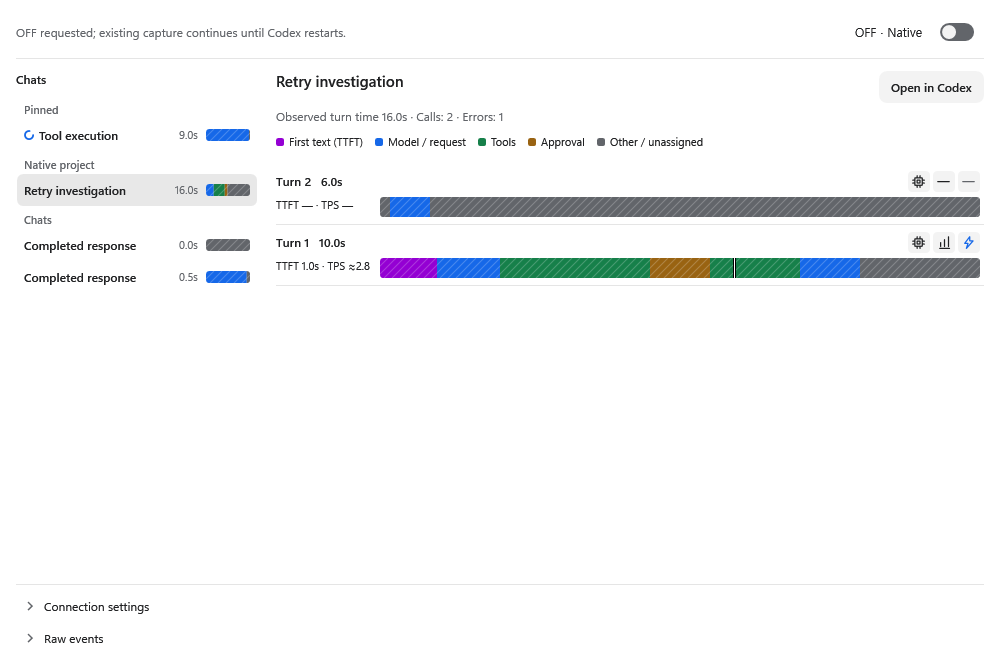
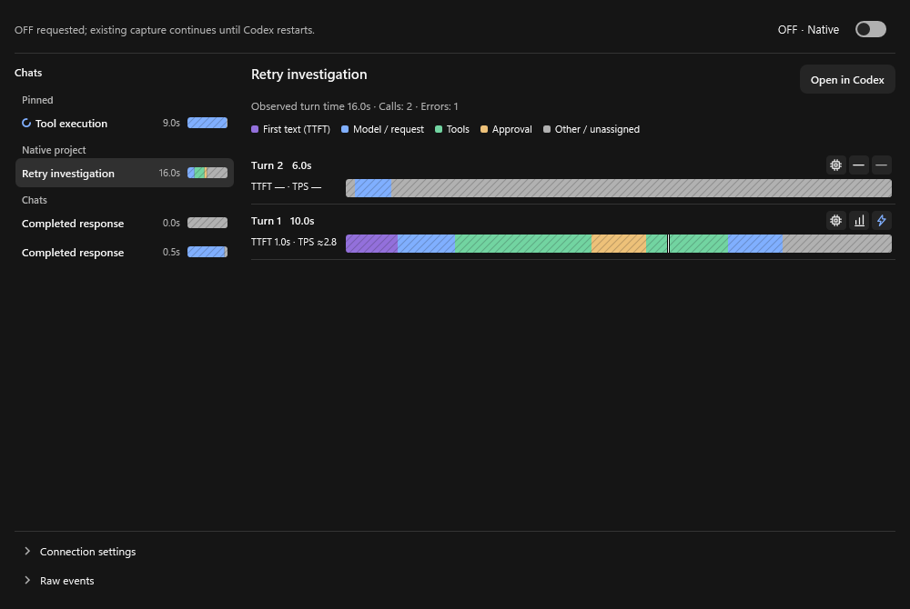

# Diagnostic Relay / 진단 경유 모드

The optional Windows diagnostic executable observes native OpenAI HTTP/Responses WebSocket traffic and existing Switch custom-model traffic. Native traffic still goes to the fixed ChatGPT upstream. Custom traffic goes to the already authenticated paired Switch gateway, which owns provider routing. Diagnostic mode adds no model conversion, inference retries, HTTP fallback, root configuration edits, certificates, or system proxy changes.

## Operation

The Windows package contains `diagnostics/CodexSwitch.Diagnostics.exe`.

```text
CodexSwitch.Diagnostics.exe on <absolute-original-codex.exe>
CodexSwitch.Diagnostics.exe status
CodexSwitch.Diagnostics.exe watch
CodexSwitch.Diagnostics.exe off
CodexSwitch.Diagnostics.exe upgrade
```

ON records the original native executable and previous user launch override before selecting the diagnostic executable through the existing `CODEX_CLI_PATH` mechanism. If a Switch backend was configured, ON uses the paired backend after validating its native executable, home and data directory. Its model list and routes remain available. The relay forwards custom traffic only to a signed loopback endpoint bound to that gateway port. This signature authorizes the target independently of client request headers. Only the native child receives the scoped endpoint change. No owner process is stopped.

State identity is explicit: the executable reads `diagnostics/CodexSwitch.Diagnostics.json` (`StateDirectory`), or derives that directory from the paired `backend/CodexSwitch.Backend.json` Directory before legacy defaults. The editor passes its actual vault directory. Enable/upgrade durably bind this location beside the executable. This avoids MSIX caller-dependent LocalAppData virtualization creating distinct receipts for the same global user launch override. `status` exposes the resolved state directory and receipt executable so ordinary-user and packaged fresh launches can be compared without exposing credentials.

ON/OFF changes require a normal Codex restart when its work is idle. `status` reports the requested next-launch configuration, not proof that an existing desktop has adopted it. An existing desktop can retain its inherited launch environment. An OFF action does not tear down an active response. That already-running diagnostic process retains its route until normal exit.

Windows Switch settings expose **Diagnostic Relay · 진단 경유 모드**, ON, OFF · Native and a live event viewer. The dialog preserves the current Codex home and refuses activation if it differs from the native launch environment: an adapter-free OFF must not silently change homes. CLI users with an explicit home can use `on <native> --home <path>` under the matching `CODEX_HOME` environment. Restart from the updated Switch launch environment or a fresh environment, not a shell retaining an older override.

The diagnostic menu, title, status and helper text use the app's selected language. English shows **Diagnostic Relay**; Korean shows **진단 경유 모드**. All nine bundled catalogs include the diagnostic strings.

For an already configured installation, stage the complete new package and run its diagnostic executable with `upgrade`. This moves only the owned relay launch selection and receipt, retaining requested ON/OFF, native/home identities and original recovery values. OFF remains OFF; ON remains scheduled for the next normal Codex launch. Foreign launch changes are refused. Keep the previous directory while any original backend or relay still uses it. An unconfigured installation needs no migration.

OFF removes the owned **CODEX_CLI_PATH launch override**, restoring the official desktop's bundled native discovery, including when the previous override was a Switch custom-model backend. It does not pin the old original executable path: a Codex update can remove that path, and OFF must still work. Thus the next normally restarted Codex does not need the relay or Switch. Custom Switch models are unavailable in this native mode. The previous override remains in the recovery receipt but is not silently re-enabled. Conflicting external launch changes are refused instead of overwritten. ON requires its recorded original executable to remain available; OFF remains available after an update removes it.

## Observations and limits

The Windows analyzer rendered with fictional chats and timing data.

| Light theme | Dark theme |
| --- | --- |
|  |  |

### Chat and turn statistics

The default inspector groups captured turns by chat and shows exclusive striped time shares: model/request, tools, approval, and other/unassigned. Approval takes precedence over tool spans, then model/request; overlapping work is never summed twice. Chat totals sum observed turn time and exclude idle gaps between turns. Existing chat titles are read through parameterized read-only native metadata queries for display only; they are not added to diagnostic logs. Raw events and connection controls remain available in collapsed sections.

The inspector is a single independent modeless window, so Switch remains usable and can be raised above it. Closing hides the view and pauses replay. Reopening reuses statistics, chat selection and file cursors for the current Switch process. Cold loading prioritizes recent captures and processes backlog in bounded batches without the live polling delay. A source joins the view once it is caught up. Each chat occupies one32px row with title, observed time and mini gauge. Saved chat titles use the native display name, with the exact-ID session index and legacy database title as fallbacks. UUIDs remain in hover details. A matched chat can be opened in Codex through its exact native ID.

The inspector uses the same toggle as model visibility. Its selected state reflects the requested ON/OFF mode. The chat sidebar follows the saved Codex pin order, project grouping, and explicit in-project ordering or native recency. The view filters those lists to captured chats. Running turns and chats update their elapsed displays every 100 ms from the last observed snapshot and use the disk scan spinner. Display interpolation stops at the source freshness deadline. Log polling stays on its separate one-second interval. Connection settings and recent events stay collapsed until opened.

Turn rows keep elapsed time and TTFT/TPS visible. A live turn has a spinner before its turn number. Status details appear on hover. The 20px stripe gauge uses actual turn time from left to right. Its model and unassigned regions before the first visible text use purple, including the measured first-text wait for each subsequent model request. Tool execution and approval retain their own colors. A known live request can show the waiting segment while its TTFT value is still pending. Hover displays a vertical cursor, elapsed time, and the hovered phase or tool interval.

Tool spans use native item start/completion observations, with measured item duration available for recovery when a start event was missed. Concurrent tools keep individual durations and contribute their union to the gauge. Approval takes priority in the phase track even when a tool item remains active. Incomplete tool intervals are marked partial on hover. The recent-event section is bounded to96px and30visible single-line summaries, with metadata on hover. It excludes token deltas, resource polling and pipe chatter; full recorded JSONL files are unchanged.

Turn badges show recorded model, reasoning effort and requested speed. Hover separates the requested model and service tier from what the provider reports. An absent tier is unavailable; a priority tier maps to Fast and an ultrafast tier to UltraFast. The inspector can read recorded turn-start metadata from previous captures. New wire-level reasoning effort requires the updated recorder. Models configured through a recognized Hugging Face endpoint use the official pinned brand PNG when it can be fetched and verified. The icon request carries no model identifiers, credentials or chat data.

Selection and expanded turn details survive live updates. Incomplete JSON lines wait for the next read; rotation transfers the existing cursor instead of replaying the file. Missing starts, ended captures and incomplete attribution remain marked partial. A stopped capture cannot accumulate wall-clock idle time forever. Disk/process counters are not redistributed as exclusive turn phases.

### TTFT, TPS and output gaps

Timing schema2 stamps complete upstream semantic events immediately after receive and before downstream forwarding. WebSocket message records separately retain receive and send-completion ticks. This separates local send/backpressure delay from upstream arrival timing without altering output bytes or retaining delta contents.

- Turn TTFT is observed turn start to first nonempty visible text/refusal delta; each call's TTFT starts at its dispatch. Tool-only output has no visible-text TTFT.
- Stream TPS is explicitly approximate: `(output_tokens - reasoning_tokens) / (response_completion - first_nonreasoning_generated_delta)`. At least two deltas, complete usage and unambiguous association are required. Text, refusal and tool-argument deltas are generated output; reasoning tokens are excluded.
- E2E output TPS uses the same token numerator over request dispatch to response completion and includes the initial wait.
- Maximum and P95 inter-chunk gaps are measured between arrivals. They are not proof of server idle time: token generation, batching, buffering and network delivery can all contribute.

API deltas can contain multiple tokens. No character-to-token estimate, fixed gap threshold, or single-chunk rate is presented as exact server decoding speed. Missing/ambiguous usage, legacy captures, single chunks and incomplete timing remain unavailable rather than zero. A unique completed call can use the native last-usage notification when the sampled completion omits usage; ambiguous candidates remain unresolved. Loading schema2 requires a normal Codex restart after installing the updated collector; historical captures are not relabeled precise.

For Switch custom models, the collector measures the Responses events as they leave the local gateway. The model provider may report usage and chunk output differently from native OpenAI. The inspector uses the observed event boundary and supplied usage for both routes.

Run `watch` for live metadata. Events are private JSONL under the existing application-data directory's `diagnostic-relay` subdirectory. Each native-launch adapter has a unique `events-<pid>-<run>.jsonl` file, so app-server/exec-server instances cannot overwrite each other's buffered output. The viewers merge the latest sixteen files; older files remain available for direct analysis. Events include process identity, request correlation, transport, upstream HTTP status, request ID, Retry-After, remaining request/token headers when present, observed model/tier, numeric usage, stream text-delta timestamps and transport failures. Separate relay IDs represent native retries; the relay performs no retries itself. First body byte is distinct from first text delta and must not be presented as token generation speed.

Only explicit metadata fields are serialized. Authentication, cookies, prompt/history/tool contents, generated text and raw error messages are never written. Error code/type are retained when present in a JSON body or protocol event. HTTP status/error bodies are forwarded unchanged. HTTP compression is not disabled or decoded; compressed bodies can have unavailable metadata. Metadata samples are bounded to 64 KiB per JSON message/line. Oversized WebSocket messages remain fully forwarded and are marked unavailable for metadata. Streaming/binary/control frames preserve their semantics; network framing and scheduling can change in ON mode, so this is not a zero-overhead performance guarantee.

The local listener is loopback-only with a random per-process path and rejects browser-origin requests. Upstream destination is fixed; no arbitrary URL or provider forwarding is accepted. Diagnostic persistence is asynchronous and bounded; dropped events are counted, writer failures are visible on stderr, and inference does not wait for disk writes. Event files rotate at about 64 MiB with one previous file. `watch` observes the current file; exported records do not establish billing or quota policy absent upstream evidence.

## Verification and installation boundary

### Detailed timing

Each event is timestamped when observed, before the asynchronous disk writer, using both UTC and monotonic ticks/frequency. Native JSON-RPC bytes are copied verbatim; a separate bounded observer records dispatch/reply duration, approval/user-input RPC waits, item start/completion and turn start/completion. Tool names/types and IDs are metadata; commands, arguments, output and prompts are excluded. Tool-active union time accounts for concurrent tools without double-counting. The remaining turn interval explicitly includes model/network/approval/unattributed local waits; it is not asserted to be idle, disk wait or server queue time. Nested operations inside an opaque tool are unavailable unless the native protocol exposes their events.

Dispatch registration precedes writing its final bytes so immediate native replies retain their RPC duration. Pipe write/backpressure waits are recorded independently. Native token-usage notifications retain separate last-request and cumulative counts; cached input and reasoning output are subsets, not additional tokens. Response metadata likewise retains input/cached/output/reasoning counts when available. Rate-limit limit/remaining/reset headers, Retry-After, retry-after-ms and upstream processing time are retained when supplied. Missing values remain null; no plan limit or server queue cause is inferred from status alone.

Upstream .NET network events expose DNS, connect, TLS, connection queue and HTTP phases when the runtime emits them. Correlation uses request context and native activity/connection IDs where available; unresolved attribution remains unknown. Only numeric event payloads are recorded, never URLs or raw headers. HTTP upload/body-read waits, response-body read waits, downstream write waits, byte counts and WebSocket message receive/send waits are measured separately. These overlapping spans must not be summed as disjoint phases. A successful WebSocket connection can span multiple turns; its lifetime is not model execution time. The native Rust engine's internal scheduler is not instrumented by these .NET network events.

Every 250 ms, the sampler records actual interval, launched-process CPU time, working set and process read/write operation/byte deltas. The scope marks whether that process is the native engine or the paired Switch backend. Windows process I/O counters include pipes and other I/O, so they are **not** physical disk counters. Separately, Windows PDH PhysicalDisk(_Total) counters measure whole-machine read/write bytes per second, queue length and average read/write latency. They include other processes. Missing/invalid/first-sample counter values remain null. These counters cannot identify exact per-process physical disk waits; that would require a separately authorized kernel trace, not inference from correlations. No driver, privileged trace session, native instrumentation or system policy is installed.

`tests/diagnostic-relay/CodexSwitch.DiagnosticRelay.Tests.csproj` runs disposable local-upstream contracts after build. They cover OFF restoration/idempotence/conflicts, unchanged native config, exact HTTP request/error/SSE bytes, 429/Retry-After, no relay retries, WebSocket fragmentation, large payloads, close-frame acknowledgment, and metadata privacy. Tests neither sign in nor touch the owner's launch override.

Build outputs follow the repository W-only policy. Source/contracts are distinct from package publication, owner installation, native GUI adoption, and real authenticated acceptance. Do not activate the user's mode or restart their Codex merely to test it. Original engine compatibility and the normal restart's observed executable/connection must be verified before claiming that an installed desktop is ON or fully native OFF.
