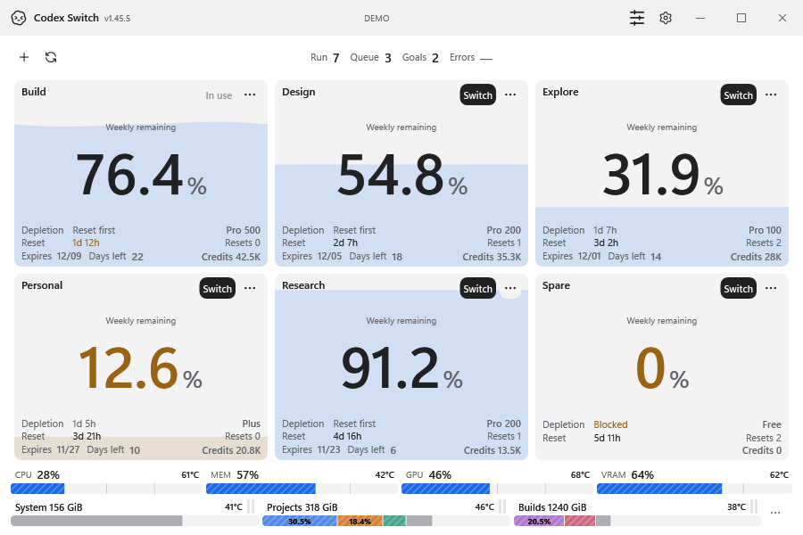
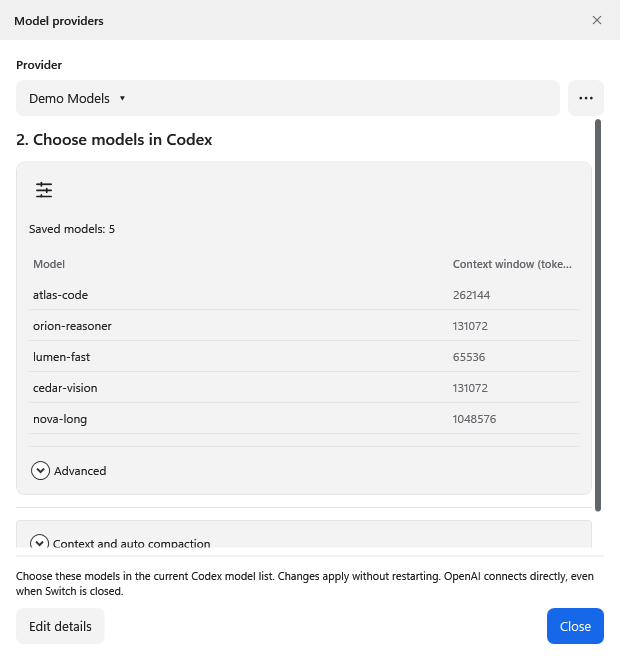
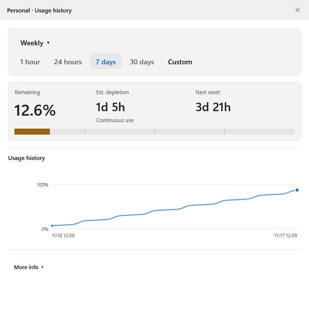
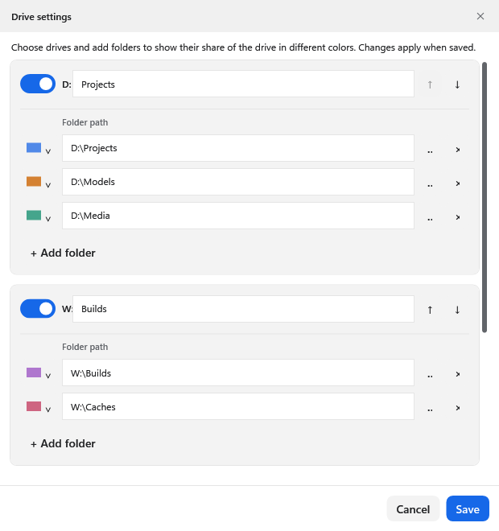
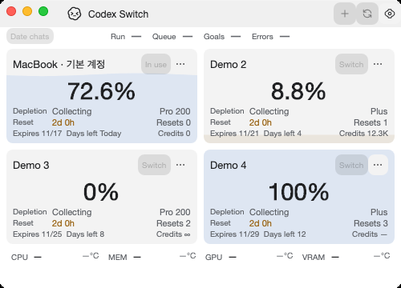
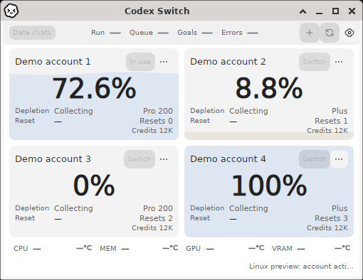

<h1 align="center">Codex Switch</h1>

<strong>カスタムモデルをCodexへ。複数アカウントをひと目で。</strong>

  
  
  
  

[English](../README.md) · [한국어](README.ko.md) · [日本語](README.ja.md) · [简体中文](README.zh-CN.md)

アカウント別の使用枠を比較・切り替え、WindowsのCodexへカスタムモデルをリアルタイムで統合するオープンソースのデスクトップアプリです。

[ダウンロード](#ダウンロード) · [カスタムモデル](#codexへカスタムモデルをすぐに統合) · [スクリーンショット](#スクリーンショット) · [貢献](#貢献)

<picture><source media="(prefers-color-scheme: dark)" srcset="media/release-1.45.5/dashboard-en-dark.png" /></picture>

架空データで描画したWindows 1.45.5の画面です（英語UI）。 [画像の出典](media/release-1.45.5/README.md).

## Codexへカスタムモデルをすぐに統合

Responses互換のプロバイダーを登録すると、Windowsの**標準Codexモデル選択メニュー**でOpenAIモデルと一緒に選べます。

- 初期設定後は**Codexを再起動せずにモデルの登録・編集・選択**を反映。
- 推論レベル、コンテキスト、自動圧縮をモデル別に設定。
- OpenAI通信は直接接続を維持。Switchウィンドウを閉じてもモデル接続は継続。

最初のバックエンド導入時のみ、Codexの通常再起動が1回必要です。Codexビルドとプロバイダーの互換性を確認してください。 [設定と互換性](DESKTOP_MODEL_BACKEND.md).

<picture><source media="(prefers-color-scheme: dark)" srcset="media/release-1.45.5/models-en-dark.png" /></picture>

## その他の主な機能

| 目的 | 機能 |
| --- | --- |
| アカウント | 残量・リセット・クレジット・契約日を比較し、手動または使用枠に基づいて切り替え。 |
| 履歴 | 使用量とクレジットの推移、期間別履歴、明示された予測を確認。 |
| Windowsリソース | ハードウェア・ディスクI/O・フォルダー占有量を表示。フォルダー探索の負荷を制限。 |

## ダウンロード

| プラットフォーム | アーキテクチャ | パッケージ |
| --- | --- | --- |
| Windows | x64 | [ZIP](https://github.com/Gaebabi/codex-switch/releases/download/v1.45.8/CodexSwitch-v1.45.8-win-x64.zip) |
| macOS 15+ | Apple Silicon | [ZIP](https://github.com/Gaebabi/codex-switch/releases/download/v1.45.8/CodexSwitch-v1.45.8-osx-arm64.zip) |
| macOS 15+ | Intel | [ZIP](https://github.com/Gaebabi/codex-switch/releases/download/v1.45.8/CodexSwitch-v1.45.8-osx-x64.zip) |
| Linux プレビュー | x64 | [DEB](https://github.com/Gaebabi/codex-switch/releases/download/v1.45.8/CodexSwitch-v1.45.8-preview-linux-x64.deb) · [RPM](https://github.com/Gaebabi/codex-switch/releases/download/v1.45.8/CodexSwitch-v1.45.8-preview-linux-x64.rpm) · [tar.gz](https://github.com/Gaebabi/codex-switch/releases/download/v1.45.8/CodexSwitch-v1.45.8-preview-linux-x64.tar.gz) |
| Linux プレビュー | arm64 | [DEB](https://github.com/Gaebabi/codex-switch/releases/download/v1.45.8/CodexSwitch-v1.45.8-preview-linux-arm64.deb) · [RPM](https://github.com/Gaebabi/codex-switch/releases/download/v1.45.8/CodexSwitch-v1.45.8-preview-linux-arm64.rpm) · [tar.gz](https://github.com/Gaebabi/codex-switch/releases/download/v1.45.8/CodexSwitch-v1.45.8-preview-linux-arm64.tar.gz) |

.NETランタイムを同梱しています。展開したフォルダー／アプリバンドル全体を保持してください。

[リリースノート・SHA256](https://github.com/Gaebabi/codex-switch/releases/tag/v1.45.8) · [Macの初回起動](MACOS.md) · [Linuxの要件とターミナル操作](development/LINUX_PACKAGES.md). Windows/Linuxは未署名、Macはアドホック署名でAppleの公証はありません。

## 使い始める

1. 展開後、Windowsは`CodexSwitch.exe`、Macは`Install.command`を実行します。
2. **+**から公式ブラウザログインを行うか、設定で現在のアカウントを取り込みます。
3. アカウントは**Switch**、外部モデルはタイトルバーの**モデル**ボタンから設定します。

アカウント切り替えはCodexを再起動します。使用枠に基づく自動切り替えは**初期状態ではオフ**です。 [インストール](INSTALL.md) · [切り替えと復旧](SWITCHING.md).

## スクリーンショット

モデル・履歴・フォルダー設定と各OSの実行画面

配布版Windowsコントロールに豊富な架空データを設定して描画しています。実際のOSウィンドウと出典は別途記録しています。 [画像の出典](media/release-1.45.5/README.md).

| 使用履歴 | フォルダー設定 |
| --- | --- |
| <picture><source media="(prefers-color-scheme: dark)" srcset="media/release-1.45.5/history-en-dark.png" /></picture> | <picture><source media="(prefers-color-scheme: dark)" srcset="media/release-1.45.5/folders-en-dark.png" /></picture> |

| macOS · Apple Silicon | Linux · x64 preview |
| --- | --- |
| <picture><source media="(prefers-color-scheme: dark)" srcset="media/release-1.45.5/native-macos-dark.png" /></picture> | <picture><source media="(prefers-color-scheme: dark)" srcset="media/release-1.45.5/native-linux-dark.png" /></picture> |

## 貢献

バグ報告、改善提案、UI翻訳、コードの貢献を歓迎します。 [貢献ガイド](../CONTRIBUTING.md) · [脆弱性の非公開報告](https://github.com/Gaebabi/codex-switch/security/advisories/new).

OpenAI公式製品ではない独立プロジェクトです。認証情報はローカルに暗号化して保存します。 [MIT](../LICENSE) · [Asset notices](../licenses/Burn0Assets.LICENSE.txt) · [プラットフォームの対応範囲](PLATFORM_SUPPORT_PLAN.md).
