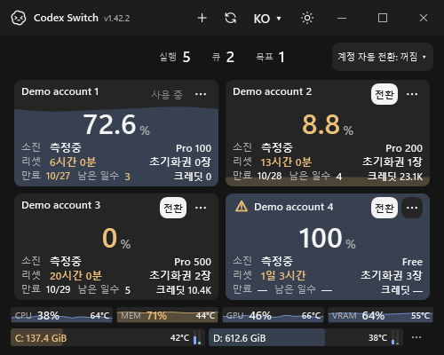

<h1 align="center">Codex Switch</h1>

**OpenAI Codex 계정 전환과 사용량을 한 화면에서 관리하는 데스크톱 앱입니다.** 여러 계정의 잔여량을 비교하고 다음 계정을 선택하세요. 전환이 중단되면 저장된 기록으로 복구할 수 있습니다. 선택적 사용량 기준 자동 전환은 기본 **꺼짐**입니다.

Windows · macOS15+ · Linux 미리보기 · MIT 오픈소스 · **1.42.7**

[English](../README.md) / 한국어 / [日本語](README.ja.md) / [简体中文](README.zh-CN.md)

[다운로드](#다운로드) · [시작하기](INSTALL.md) · [업데이트 내용](https://github.com/Gaebabi/codex-switch/releases/tag/v1.42.7)

계정·시스템 정보를 가상으로 입력한 Windows UI 데모입니다. [데모 출처](media/discovery/README.md) / [네이티브 검증](evidence/account-automation/README.md). 인증정보는 로컬 암호화 저장소에 보관되며 **계정 전환 시 Codex가 재시작됩니다.** OpenAI와 제휴하지 않은 독립 프로젝트입니다.

**유용하다면 GitHub Star로 저장하고 다른 Codex 사용자에게도 알려주세요.**

1.42.2에는 경고 버튼의 해당 계정 브라우저 재로그인, 기본 꺼짐인 계정 자동 전환, 최적 자동 선택/사용자 지정 순위, 재시작 복구 기록, 구독 날짜 제목과 공식 Pro 100/200/500 표기가 포함됩니다. [동작과 검증 범위](development/ACCOUNT_AUTOMATION.md) / [릴리즈 절차](development/RELEASE_1_42_2.md).

1.42.3은 Codex 업데이트로 실행 파일이 교체된 뒤에도 Switch 재시작 없이 사용량 조회를 복구합니다. 유효한 경로는 캐시하고, 설치 중의 실패는 명시적으로 표시하며 요청을 반복 전송하지 않습니다. [복구와 검증](development/RELEASE_1_42_3.md).

1.42.4는 Linux 최소 창에서도 계정 자동 전환 이름과 상태가 잘리지 않도록 개선합니다. 사용량 카드 공간과 창 최소 크기를 유지하며 의존성을 추가하지 않습니다. [네이티브 검증과 전달](development/RELEASE_1_42_4.md).

1.42.5는 만료가 가까운 사용 가능 구독을 우선 선택하고 **Auto Switch** 토글과 다음 전환 계정을 표시합니다. 일시적인 전환 실패를 최대 두 번 더 자동 재시도하며 진행 상태를 유지합니다. 재시도 횟수를 저장하고 기존 Continue 식별자를 보존해 무한 복구와 중복 전송을 막습니다. [동작과 검증](development/RELEASE_1_42_5.md).

1.42.6은 사용량 식별자가 중복되거나 비어 있어도 Auto Switch가 오류로 중단되지 않도록 개선합니다. 모호한 후보는 제외하고 현재 계정의 정보가 모호하면 전환하지 않습니다. 원본 데이터와 기존 만료일·사용자 순위는 유지합니다. [동작과 검증](development/RELEASE_1_42_6.md).

1.42.7에서는 Linux 터미널 계정 명령을 검토된 Codex CLI0.164.0과 함께 사용할 수 있습니다. 실행 파일 무결성과 자격 증명 및 작업 공간 검사는 그대로 유지합니다. [호환성과 검증](development/RELEASE_1_42_7.md).

## 다운로드

- [Windows x64 ZIP](https://github.com/Gaebabi/codex-switch/releases/download/v1.42.7/CodexSwitch-v1.42.7-win-x64.zip)
- macOS15+: [Apple Silicon ZIP](https://github.com/Gaebabi/codex-switch/releases/download/v1.42.7/CodexSwitch-v1.42.7-osx-arm64.zip) / [Intel ZIP](https://github.com/Gaebabi/codex-switch/releases/download/v1.42.7/CodexSwitch-v1.42.7-osx-x64.zip)
- Linux **미리보기** x64·ARM64: [DEB·RPM·tar.gz 및 SHA256](https://github.com/Gaebabi/codex-switch/releases/tag/v1.42.7)

전체 실행 패키지에 .NET 런타임이 포함되어 소스 빌드나 .NET 설치가 필요 없습니다. 폴더·앱 번들 전체를 유지하세요. Windows·Linux는 미서명이며 Mac은 임시 서명으로 **Apple 공증은 없습니다**. [설치](INSTALL.md) / [Mac 최초 실행](MACOS.md)

Linux는 통합 미리보기입니다. 키 모음·설치 UI·패키지 검증과 실제 두 계정 전환·재개 및 전체 데스크톱 지원은 구분합니다. 데스크톱 통합에는 검증된 OpenAI Linux 클라이언트26.1007.71326, 기존 file 인증 정책과 X11/XWayland가 필요하며 새 클라이언트는 별도 검토합니다. 명시적 체크섬의 CLI 전용 모드는 데스크톱 채팅을 재개하지 않습니다. [요구사항](development/LINUX.md) / [Linux 설치](development/LINUX_PACKAGES.md) / [지원 계획](PLATFORM_SUPPORT_PLAN.md)

## 사용과 주요 기능

경고 아이콘에 마우스를 올리면 원인을 보고, 누르면 해당 계정으로 브라우저에서 다시 로그인할 수 있습니다. [실제 앱 검증 화면](evidence/account-automation/README.md).

**Linux1.42.7 다운로드에는 소스1.41.0에서 추가한 CLI 계정 전환과 저장 세션 재개가 포함됩니다.** `CodexSwitch cli`로 화면 서버 없이 기존 암호화 계정을 관리하고, `cli switch <계정> --resume <CLI 세션 UUID>`로 수동 전환과 공식 CLI 재개를 연결합니다. `--continue`는 후속 메시지 전송을 명시하며, `--exec --continue`는 비대화형 실행입니다. 검증된 네이티브 CLI·체크섬과 잠금 해제된 지원 Secret Service가 필요합니다. Linux x64에서 실제 두 계정 전환 후 기존 문맥을 기억하는 CLI 재개를 확인했습니다. ARM64·오프라인 검증과 전체 데스크톱 수용 범위는 구분합니다. [명령·실제 스크린샷·정확한 검증 범위](development/LINUX_TERMINAL.md).

1. Windows는 `CodexSwitch.exe`, Mac은 `Install.command`로 설치한 **Codex Switch.app**을 실행하세요. Linux는 전체 미리보기 패키지와 지원하는 Secret Service 제공자가 필요합니다.
2. **+**로 각 계정을 공식 브라우저 로그인합니다. 이전 계정이 자동 선택되면 별도 브라우저 프로필·비공개 창으로 다음 계정을 로그인하세요. Windows는 **↻** 우클릭으로 현재 로그인을 가져올 수 있습니다.
3. 잔량을 비교한 뒤 **Switch**를 누르세요. **계정 자동 전환은 기본 꺼짐이며 상단 메뉴에서 직접 켤 수 있습니다.** Linux에서는 작업 전에 앱의 **Start Codex**로 시작하세요.

- **수동 전환·자동 재개:** 날짜를 붙인 채팅 이름을 저장·확인하고 기존 로그인을 백업합니다. Codex를 정상 종료하고 선택 계정을 적용한 뒤 같은 채팅 ID·폴더·모델·권한을 열어, 재개 가능한 미완료 idle 채팅에 **Continue**를 한 번 보냅니다. 실행 중·완료된 작업은 중복 실행하지 않습니다.
- **중단 복구:** 암호화한 진행 상태를 **Resume chats**로 이어갑니다. 전송 결과가 불확실하면 자동 재전송하지 않으며 이름 저장·정상 종료 실패 시 로그인 변경을 중단합니다. Windows 자식 프로세스 종료까지 기다려 한 번의 Switch로 진행합니다. [전환 원리](SWITCHING.md)
- **사용량·기록:** 잔량, 리셋, 요금제, 만료일, 초기화권, 크레딧과 사용 추이 예측. **... → History**에서 기록을 확인합니다. 카드 날짜는 사용자 현지 시간대로 표시하고, 공통 기록 화면의 시간축에는 KST를 명시합니다. 만료72시간·리셋48시간 이내에는 경고색을 적용합니다.
- **로컬 상태·자원:** 실행·큐·목표 수, 자원 추이와 디스크 잔량. Windows는 제공되는 자원·디스크 온도에 독립된 색상을 적용하고 값이 없으면 알 수 없음으로 표시합니다. Linux 자원 측정은 아직 미지원입니다. [온도 지원 범위](TEMPERATURES.md)
- **항상 60초 자동 조회**, **↻·F5** 즉시 조회. 처음 키 모음이 잠겨 있거나 클라이언트를 사용할 수 없으면, 잠금 해제·설치 후 같은 주기로 초기화를 자동 재시도합니다.
- **9개 UI 언어와 JSON 언어팩:** 영어·한국어·일본어·중국어 간체/번체·스페인어·프랑스어·독일어·브라질 포르투갈어. 누락 번역은 영어를 사용합니다. 아이콘 테마 버튼, 다크·라이트와 공통 스크롤바를 제공합니다. [번역 기여](LOCALIZATION.md)

전환은 Codex를 재시작하며 같은 로그인을 공유하는 CLI·IDE에도 영향을 줄 수 있습니다. Linux 실제 계정 전환·재개 및 다양한 데스크톱·접근성 지원의 남은 기준은 지원 계획에서 관리합니다.

## 실제 앱 화면

[Windows·Linux 최신 화면과 검증 범위](media/release-1.42.2/README.md). 실제 제목 표시줄을 보존하고 단색 배경을 사용합니다. 가상 UI 입력과 실제 계정 검증은 별도로 명시합니다.

**Windows x64:** 실제 WPF 앱의 가상 계정, 공식 Pro 등급과 계정 자동 전환 문구입니다. 데모에서만 켜짐을 선택했으며 기본은 꺼짐입니다. 개인 계정·바탕화면은 사용하지 않았습니다.

**Linux x64 · X11/Xfwm4:** 실제 OS 타이틀바와 가상 데모 계정 4개를 같은 창에서 함께 촬영했습니다. 타이틀바 합성·개인 로그인 정보는 없습니다. [라이트 테마·출처·해시·검증 범위](media/release-1.42.2/README.md).

**MacBook 실기기 스크린샷 추가 예정.**
<!-- MacBook screenshot slot: media/release-1.42.2/macbook.png; privacy/provenance review required. -->

[개발·기여](../CONTRIBUTING.md) / [보안](../SECURITY.md) / [검증 자료](evidence/README.md) / [예측 방식](FORECAST.md)

OpenAI 공식 제품이 아닌 독립 오픈소스입니다. 인증정보는 로컬 암호화 저장소에 보관합니다. [MIT](../LICENSE) / [리소스 고지](../licenses/Burn0Assets.LICENSE.txt)
