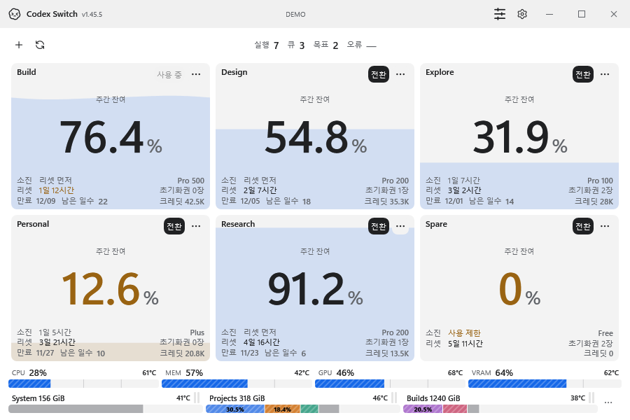
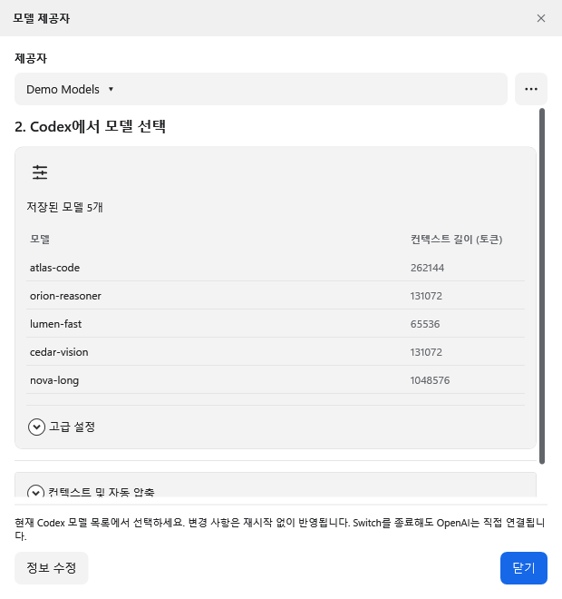
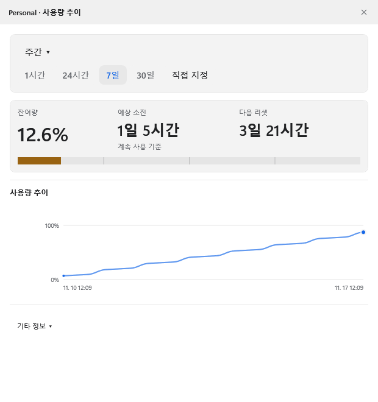
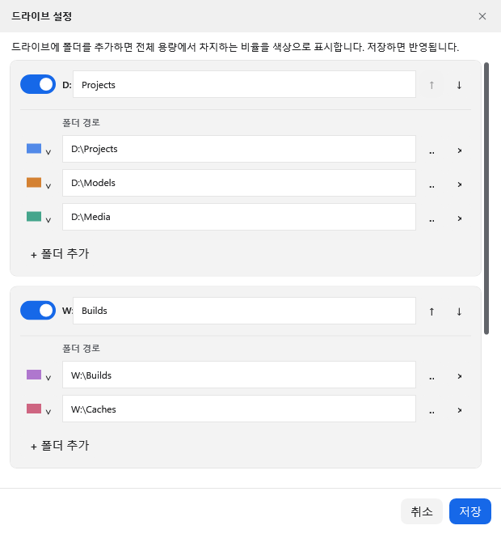
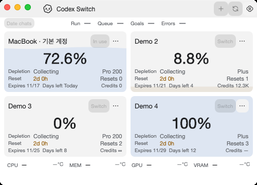
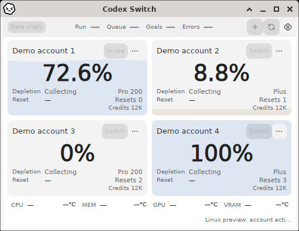

<h1 align="center">Codex Switch</h1>

<strong>커스텀 모델은 Codex에 바로. 여러 계정은 한눈에.</strong>

  
  
  
  

[English](../README.md) · [한국어](README.ko.md) · [日本語](README.ja.md) · [简体中文](README.zh-CN.md)

계정별 사용량을 비교·전환하고, Windows Codex에 커스텀 모델을 실시간 연동하는 오픈소스 데스크톱 앱입니다.

[다운로드](#다운로드) · [커스텀 모델](#codex에-커스텀-모델-즉시-연동) · [스크린샷](#스크린샷) · [기여](#기여)

<picture><source media="(prefers-color-scheme: dark)" srcset="media/release-1.45.5/dashboard-ko-dark.png" /></picture>

가상 데이터로 렌더링한 Windows 1.45.5 화면입니다. [화면 출처](media/release-1.45.5/README.md).

## Codex에 커스텀 모델 즉시 연동

Responses 호환 제공자를 등록하면 Windows의 **기존 Codex 모델 선택창**에서 OpenAI 모델과 함께 선택할 수 있습니다.

- 최초 설정 이후에는 **Codex 재실행 없이 모델 등록·수정·선택**을 반영합니다.
- 모델별 추론 강도·컨텍스트·자동 압축을 독립적으로 설정합니다.
- OpenAI 요청은 직접 연결하며, Switch 창을 닫아도 모델 연결을 유지합니다.

최초 백엔드 설치 시에는 Codex를 한 번 정상 재시작해야 합니다. Codex 빌드와 제공자별 호환 범위를 확인하세요. [연동 방법과 호환 범위](DESKTOP_MODEL_BACKEND.md).

<picture><source media="(prefers-color-scheme: dark)" srcset="media/release-1.45.5/models-ko-dark.png" /></picture>

## 그 밖의 핵심 기능

| 할 일 | 제공 기능 |
| --- | --- |
| 계정 관리 | 잔여량·리셋·크레딧·구독일을 비교하고, 수동 또는 사용량 기준으로 전환합니다. |
| 사용 기록 | 사용량·크레딧 추이, 기간별 기록과 구분된 예측값을 확인합니다. |
| Windows 자원 | 하드웨어·디스크 I/O·폴더 점유량을 확인합니다. 폴더 탐색에는 부하 상한을 둡니다. |

## 다운로드

| 플랫폼 | 아키텍처 | 패키지 |
| --- | --- | --- |
| Windows | x64 | [ZIP](https://github.com/Gaebabi/codex-switch/releases/download/v1.45.5/CodexSwitch-v1.45.5-win-x64.zip) |
| macOS 15+ | Apple Silicon | [ZIP](https://github.com/Gaebabi/codex-switch/releases/download/v1.45.5/CodexSwitch-v1.45.5-osx-arm64.zip) |
| macOS 15+ | Intel | [ZIP](https://github.com/Gaebabi/codex-switch/releases/download/v1.45.5/CodexSwitch-v1.45.5-osx-x64.zip) |
| Linux 미리보기 | x64 | [DEB](https://github.com/Gaebabi/codex-switch/releases/download/v1.45.5/CodexSwitch-v1.45.5-preview-linux-x64.deb) · [RPM](https://github.com/Gaebabi/codex-switch/releases/download/v1.45.5/CodexSwitch-v1.45.5-preview-linux-x64.rpm) · [tar.gz](https://github.com/Gaebabi/codex-switch/releases/download/v1.45.5/CodexSwitch-v1.45.5-preview-linux-x64.tar.gz) |
| Linux 미리보기 | arm64 | [DEB](https://github.com/Gaebabi/codex-switch/releases/download/v1.45.5/CodexSwitch-v1.45.5-preview-linux-arm64.deb) · [RPM](https://github.com/Gaebabi/codex-switch/releases/download/v1.45.5/CodexSwitch-v1.45.5-preview-linux-arm64.rpm) · [tar.gz](https://github.com/Gaebabi/codex-switch/releases/download/v1.45.5/CodexSwitch-v1.45.5-preview-linux-arm64.tar.gz) |

.NET 런타임이 포함되어 별도 설치가 필요 없습니다. 압축을 푼 폴더·앱 번들 전체를 유지하세요.

[업데이트 내용·SHA256](https://github.com/Gaebabi/codex-switch/releases/tag/v1.45.5) · [Mac 최초 실행](MACOS.md) · [Linux 요구사항과 터미널 사용법](development/LINUX_PACKAGES.md). Windows·Linux는 미서명이며, Mac은 임시 서명으로 Apple 공증은 없습니다.

## 시작하기

1. 압축을 풀고 Windows는 `CodexSwitch.exe`, Mac은 `Install.command`를 실행하세요.
2. **+**로 공식 브라우저 로그인을 하거나, 설정에서 현재 계정을 가져오세요.
3. 계정은 **Switch**, 외부 모델은 제목 표시줄의 **모델** 버튼에서 설정하세요.

계정 전환은 Codex를 재시작합니다. 사용량 기준 자동 전환은 **기본 꺼짐**입니다. [설치 안내](INSTALL.md) · [계정 전환·복구](SWITCHING.md).

## 스크린샷

모델·기록·폴더 설정과 플랫폼별 실제 화면

배포된 Windows 컨트롤에 풍부한 가상 데이터를 넣어 렌더링했습니다. 실제 OS 창 캡처와 출처는 별도로 기록했습니다. [화면 출처](media/release-1.45.5/README.md).

| 사용 기록 | 폴더 설정 |
| --- | --- |
| <picture><source media="(prefers-color-scheme: dark)" srcset="media/release-1.45.5/history-ko-dark.png" /></picture> | <picture><source media="(prefers-color-scheme: dark)" srcset="media/release-1.45.5/folders-ko-dark.png" /></picture> |

| macOS · Apple Silicon | Linux · x64 preview |
| --- | --- |
| <picture><source media="(prefers-color-scheme: dark)" srcset="media/release-1.45.5/native-macos-dark.png" /></picture> | <picture><source media="(prefers-color-scheme: dark)" srcset="media/release-1.45.5/native-linux-dark.png" /></picture> |

## 기여

버그 제보, 개선 제안, UI 번역과 코드 기여를 환영합니다. [기여 안내](../CONTRIBUTING.md) · [취약점 비공개 제보](https://github.com/Gaebabi/codex-switch/security/advisories/new).

OpenAI 공식 제품이 아닌 독립 프로젝트입니다. 인증정보는 로컬 암호화 저장소에 보관합니다. [MIT](../LICENSE) · [Asset notices](../licenses/Burn0Assets.LICENSE.txt) · [플랫폼 지원 범위](PLATFORM_SUPPORT_PLAN.md).
