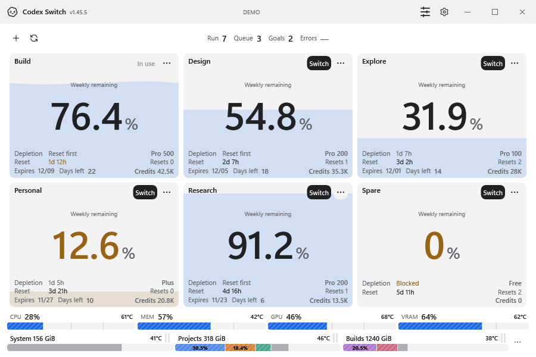
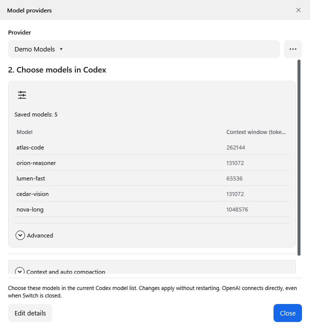
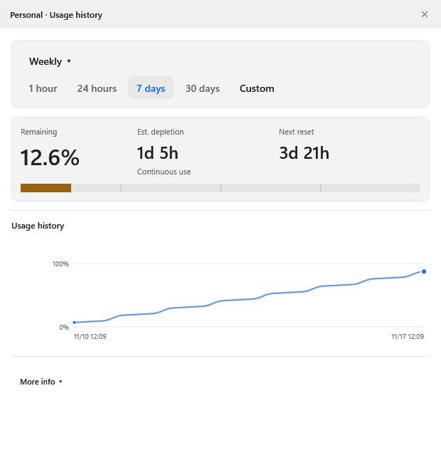
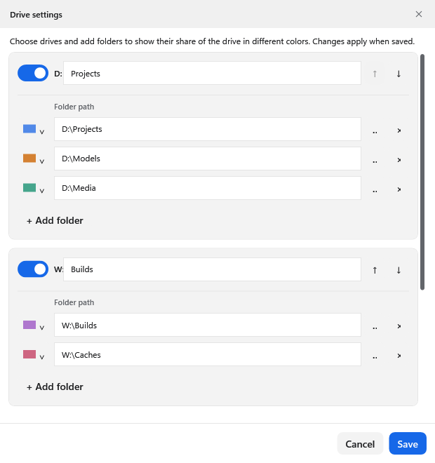
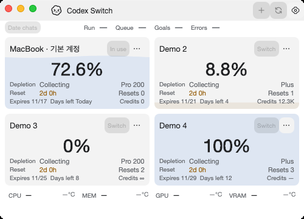
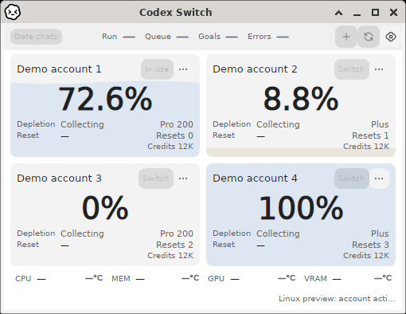

<h1 align="center">Codex Switch</h1>

<strong>自定义模型，即刻接入Codex。多个账号，一目了然。</strong>

  
  
  
  

[English](../README.md) · [한국어](README.ko.md) · [日本語](README.ja.md) · [简体中文](README.zh-CN.md)

开源桌面应用：比较并切换账号额度，在Windows Codex中实时接入自定义模型。

[下载](#下载) · [自定义模型](#在codex中即时接入自定义模型) · [截图](#截图) · [参与贡献](#参与贡献)

<picture><source media="(prefers-color-scheme: dark)" srcset="media/release-1.45.5/dashboard-en-dark.png" /></picture>

使用虚构数据渲染的Windows 1.45.5界面（英语UI）。 [截图来源](media/release-1.45.5/README.md).

## 在Codex中即时接入自定义模型

注册兼容Responses的提供商，即可在Windows的**原生Codex模型选择器**中，与OpenAI模型一起选择。

- 首次设置后，**无需重启Codex即可注册、编辑和选择模型**。
- 按模型单独设置推理强度、上下文和自动压缩。
- OpenAI请求保持直接连接，关闭Switch窗口后模型连接仍可继续。

首次安装后端时，需要正常重启Codex一次。请确认Codex版本及提供商的兼容范围。 [设置与兼容范围](DESKTOP_MODEL_BACKEND.md).

<picture><source media="(prefers-color-scheme: dark)" srcset="media/release-1.45.5/models-en-dark.png" /></picture>

## 其他核心功能

| 任务 | 功能 |
| --- | --- |
| 账号管理 | 比较剩余额度、重置、点数和订阅日期，手动或按额度切换。 |
| 使用历史 | 查看额度、点数趋势、时间范围和明确标注的预测。 |
| Windows资源 | 查看硬件、磁盘I/O和文件夹占用，并限制文件夹扫描负载。 |

## 下载

| 平台 | 架构 | 程序包 |
| --- | --- | --- |
| Windows | x64 | [ZIP](https://github.com/Gaebabi/codex-switch/releases/download/v1.45.5/CodexSwitch-v1.45.5-win-x64.zip) |
| macOS 15+ | Apple Silicon | [ZIP](https://github.com/Gaebabi/codex-switch/releases/download/v1.45.5/CodexSwitch-v1.45.5-osx-arm64.zip) |
| macOS 15+ | Intel | [ZIP](https://github.com/Gaebabi/codex-switch/releases/download/v1.45.5/CodexSwitch-v1.45.5-osx-x64.zip) |
| Linux 预览版 | x64 | [DEB](https://github.com/Gaebabi/codex-switch/releases/download/v1.45.5/CodexSwitch-v1.45.5-preview-linux-x64.deb) · [RPM](https://github.com/Gaebabi/codex-switch/releases/download/v1.45.5/CodexSwitch-v1.45.5-preview-linux-x64.rpm) · [tar.gz](https://github.com/Gaebabi/codex-switch/releases/download/v1.45.5/CodexSwitch-v1.45.5-preview-linux-x64.tar.gz) |
| Linux 预览版 | arm64 | [DEB](https://github.com/Gaebabi/codex-switch/releases/download/v1.45.5/CodexSwitch-v1.45.5-preview-linux-arm64.deb) · [RPM](https://github.com/Gaebabi/codex-switch/releases/download/v1.45.5/CodexSwitch-v1.45.5-preview-linux-arm64.rpm) · [tar.gz](https://github.com/Gaebabi/codex-switch/releases/download/v1.45.5/CodexSwitch-v1.45.5-preview-linux-arm64.tar.gz) |

内含.NET运行时，无需单独安装。请保留解压后的完整文件夹或应用包。

[更新说明与SHA256](https://github.com/Gaebabi/codex-switch/releases/tag/v1.45.5) · [Mac首次启动](MACOS.md) · [Linux要求与终端使用](development/LINUX_PACKAGES.md). Windows/Linux未签名；Mac为临时签名，未经Apple公证。

## 开始使用

1. 解压后，Windows运行`CodexSwitch.exe`，Mac运行`Install.command`。
2. 通过**+**进入官方浏览器登录，或在设置中导入当前账号。
3. 账号通过**Switch**切换；外部模型通过标题栏的**模型**按钮设置。

账号切换会重启Codex。按额度自动切换**默认关闭**。 [安装指南](INSTALL.md) · [切换与恢复](SWITCHING.md).

## 截图

模型、历史、文件夹设置与各平台实际界面

使用丰富的虚构数据渲染已发布的Windows控件。实际操作系统窗口截图及来源另行记录。 [截图来源](media/release-1.45.5/README.md).

| 使用历史 | 文件夹设置 |
| --- | --- |
| <picture><source media="(prefers-color-scheme: dark)" srcset="media/release-1.45.5/history-en-dark.png" /></picture> | <picture><source media="(prefers-color-scheme: dark)" srcset="media/release-1.45.5/folders-en-dark.png" /></picture> |

| macOS · Apple Silicon | Linux · x64 preview |
| --- | --- |
| <picture><source media="(prefers-color-scheme: dark)" srcset="media/release-1.45.5/native-macos-dark.png" /></picture> | <picture><source media="(prefers-color-scheme: dark)" srcset="media/release-1.45.5/native-linux-dark.png" /></picture> |

## 参与贡献

欢迎报告问题、提出建议、翻译UI或提交代码。 [贡献指南](../CONTRIBUTING.md) · [私下报告安全漏洞](https://github.com/Gaebabi/codex-switch/security/advisories/new).

独立开源项目，并非OpenAI官方产品。认证信息在本地加密保存。 [MIT](../LICENSE) · [Asset notices](../licenses/Burn0Assets.LICENSE.txt) · [平台支持范围](PLATFORM_SUPPORT_PLAN.md).
