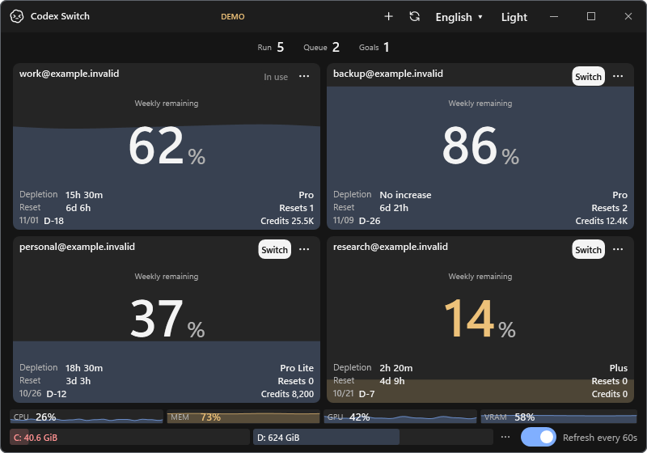

# Application screenshots and verification

## Current source evidence

Source 1.35.0 is the current app; published downloads remain 1.27.6. The dashboard layout gallery retains its original1.30.2 checkpoint. Choose the evidence for the capability being reviewed:

- [Native Linux client inspection and five-target program comparison](linux-client/README.md): source1.34.0, actual x64/ARM64 client94 including native trust14, configuration/managed policy and explicit standalone CLI, plus ten own-window after PNGs. Account/context/IPC/handoff and package acceptance remain separate.

- [Native Linux read-only metadata and five-target app comparison](linux-sqlite/README.md): source1.35.0, actual native x64/ARM64 SQLite/WAL26/protocol7 and existing supported-host regressions, with ten own-window after PNGs. Account/client/handoff and full desktop/package acceptance remain separate.

- [Linux native storage/source preview](linux-vault/README.md): genuine GNOME Keyring x64/ARM64 contracts, actual native X11 source-window confirmation and supported-host comparisons; account/client/handoff remains pending.
- [Shared application/desktop composition](desktop-composition/README.md): native Windows/Mac before/after, common assembly boundaries and actual trayless close/disposal.
- [Hardware provider extraction](hardware-services/README.md): native Windows/Mac before/after, real read-only sampler and wrong-OS refusal contracts.
- [Codex protocol/read-only SQLite extraction](protocol-sqlite/README.md): native Windows/Mac before/after and protocol/unknown/read-only refusal contracts.

- [Native desktop client extraction](desktop-client/README.md): Windows/Mac application before/after and unsupported-lifecycle refusal contracts.

- [Native security project extraction](platform-security/README.md): Windows/Mac application before/after and native private-file/vault contracts.

- [Tooltip style lifetime](tooltip-lifetime/README.md): actual before/after WPF tooltip components and native app confirmation.

- [Latest documentation screenshots and native platform gallery](../media/README.md#native-platform-gallery): fictional inputs, actual Windows/macOS app windows.
- [README screenshot before/after and destination audit](documentation-refresh/README.md): source 1.27.6 illustration replaced by source 1.30.2.
- [Scrollbars and theme actions](scrollbars-theme-icons/README.md): Windows before/after and native Mac menus/history.
- [UI-neutral core extraction](shared-core/README.md): platform before/after and core contracts.
- [Runtime migration](platform-runtime/README.md): original .NET 8/10 comparison and native OS/runtime checks.
- [Language packs](language-packs/README.md), [temperatures](temperatures/README.md), [single-click handoff](single-click-handoff/README.md), [date warnings](date-warnings/README.md), [always-on refresh](always-refresh/README.md): feature-specific results and their original source checkpoints.

## Historical repository foundation

The images and roadmap table below record the original source-reorganization checkpoint, not the latest UI or current completion status. Current gates belong to the linked issues and [development status](../development/STATUS.md).

Related: [roadmap #1](https://github.com/Gaebabi/codex-switch/issues/1), [foundation #2](https://github.com/Gaebabi/codex-switch/issues/2), [PR #8](https://github.com/Gaebabi/codex-switch/pull/8).

The comparison shows the application's actual Windows WPF `MainWindow`/account/resource components, built and rendered from the baseline and reorganized sources with the same isolated fictional inputs. These are application UI images, not repository pages. They are synthetic rendering evidence, not screenshots of live account switching.

| Before: source `0ed757e` | After: source `0545810` |
| --- | --- |
|  |  |

Both exports are 800×560 lossless PNGs, 73,560 bytes and byte-identical. The source move preserves the program's UI. No real identity, private chat, credential or home path is present. The displayed addresses use reserved `example.invalid`; raw personal pixels never enter these exports. Final metadata is inspected. A real-account capture must replace private pixels before blur and must never upload originals.

Git inspection confirms **70 → 11 tracked root files**, 88 source/resource/doc moves and all **63 C# files byte-preserved**. Project/build/resource/link paths match the new structure; product version, executable/namespace, data/key and IPC identities remain unchanged.

## Issue-specific evidence boundary

| Issue | Current application evidence | Required before completion |
| --- | --- | --- |
| [#1 roadmap](https://github.com/Gaebabi/codex-switch/issues/1) | Existing program baseline above | Native Linux functionality and download-ready release confirmation |
| [#2 foundation](https://github.com/Gaebabi/codex-switch/issues/2) | Before/after program UI preserved | Repository checks, architecture builds, isolated tests, PR CI and review |
| [#3 core/platform projects](https://github.com/Gaebabi/codex-switch/issues/3) | Existing program before/after repository organization | After-extraction application screenshots and regression evidence |
| [#4 runtime](https://github.com/Gaebabi/codex-switch/issues/4) | Existing Windows program | Upgraded application/runtime package and regression confirmation |
| [#5 Linux credential/client trust](https://github.com/Gaebabi/codex-switch/issues/5) | Existing supported program | Actual Linux app key-provider states and lock/unlock/restart/tamper tests |
| [#6 Linux handoff](https://github.com/Gaebabi/codex-switch/issues/6) | Existing supported program | Actual Linux switch/recovery/same-chat continuation screenshots and native results |
| [#7 package/coverage](https://github.com/Gaebabi/codex-switch/issues/7) | Existing supported program | Installed Linux app confirmation and clean-machine lifecycle/environment evidence |

Unimplemented features explicitly have pending application confirmation. No repository screenshot or mockup can close a functional acceptance gate. Invisible security/storage behavior also requires automated/native results; a dashboard alone cannot prove it.
