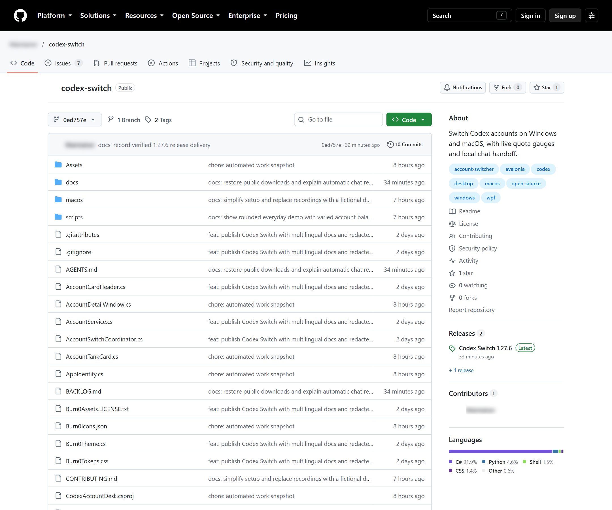

# Repository foundation evidence

Related: [roadmap #1](https://github.com/Gaebabi/codex-switch/issues/1), [foundation #2](https://github.com/Gaebabi/codex-switch/issues/2), [PR #8](https://github.com/Gaebabi/codex-switch/pull/8).

Actual public GitHub pages, captured anonymously as lossless PNGs at 2160×1800. Identity text is replaced before blur/capture, avatars are excluded and exported metadata is empty. No authenticated profile, live account data, private chat or home path is captured.

| Before: source `0ed757e` | After: source `0545810` |
| --- | --- |
|  |  |

Git tree inspection confirms **70 → 11 tracked root files**. 88 tracked files were moved with original hashes checked; all 63 C# sources are unchanged. Project/build/resource/link paths changed to match the structure, while data/key/IPC identities and product version remain 1.27.6.

## Current confirmations

- [Issue metadata and milestones](issues-confirmation.png): seven roadmap/foundation issues with minimal type, area and priority attributes; six native sub-issues are attached to #1.
- [Windows renderer confirmation](windows-confirmation.png): current UI with explicitly fictional example identities/data. New source paths render the same PNG bytes; this is UI-resource/build evidence, not actual login/switch/resume.

## Planned-feature baselines

| Issue | Actual baseline | Pending evidence |
| --- | --- | --- |
| [#3 core/platform projects](https://github.com/Gaebabi/codex-switch/issues/3) | [Original source layout](root-before.png), [organized foundation](root-after.png) | Extracted platform-free projects and native regression acceptance |
| [#4 supported runtime](https://github.com/Gaebabi/codex-switch/issues/4) | [Existing .NET 8 project](runtime-before.png) | Upgraded runtime/package and regression confirmation |
| [#5 Linux credential/client trust](https://github.com/Gaebabi/codex-switch/issues/5) | [Vault rejects unsupported Linux](vault-before.png) | Linux key-provider lock/unlock/restart/tamper acceptance |
| [#6 Linux desktop handoff](https://github.com/Gaebabi/codex-switch/issues/6) | [Unix IPC verifies only Mac peers](ipc-before.png) | Linux authenticated peer, intended shutdown and same-chat continuation |
| [#7 wider packages/environments](https://github.com/Gaebabi/codex-switch/issues/7) | [Current Windows/Mac release](release-before.png) | Native Linux packages and clean-machine lifecycle acceptance |

These screenshots establish current problems and completed repository work. No screenshot claims an unimplemented Linux/runtime feature has passed. Implementation PRs must add before/after or native new-feature confirmation before closing those issues. Automated/CI results are recorded on PR #8; screenshots complement them.
