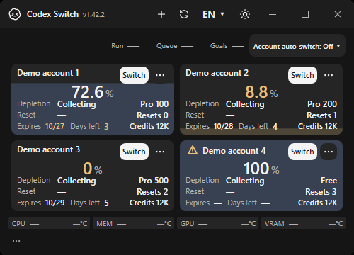
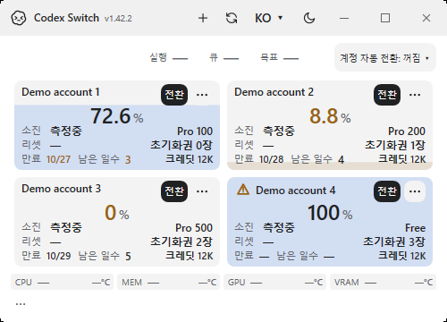
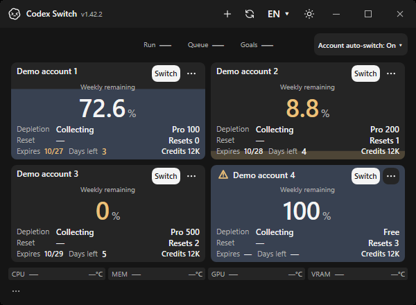
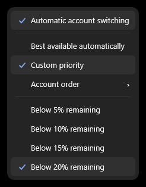
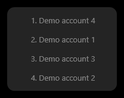

# Account automation: actual native application evidence

Actual Windows app-owned HWNDs and menu popups, fictional accounts/home/vault only, source `d1f483833b1c57aee6bbd923e7f5be3c9067039f` from [native Verify run40086423732](https://github.com/Gaebabi/codex-switch/actions/runs/40086423732). [28 passing assertions and10 original PNG hashes](evidence.json). Metadata is removed without changing original pixels. Offscreen component renders are supplementary.

## Before and after

| Previous native application | Account-specific recovery and explicit automatic-switch control |
| --- | --- |
|  |  |

The before image is the actual Windows x64 app-owned HWND, fictional accounts, source `ddfb44f176c02f81a60b412b56b0724ac5d5c8a0` from [run39616707274](https://github.com/Gaebabi/codex-switch/actions/runs/39616707274). Different fictional profiles exercise all three numbered Pro tiers in the after image; these are not real subscription observations. English/Korean × dark/light500×360 checks require all tier/date metadata to fit and the Off control to remain separate from session counters.

Warning activation requests only the chosen fictional account's sign-in. The existing diagnostic mode intercepts browser intent; identity-mismatch/preservation and restart behavior have separate fictional contracts. No browser login, live account operation, Codex shutdown or Continue is performed here.

## Enabled, threshold and user order

The actual menu action persists On, custom first priority and a20% threshold through encrypted vault reloads. Both the account priority selector and displayed ranking must create real native popups. Reopening the menu must show the saved mode/threshold/order. The ordinary product default remains Off. [Light On state](en-light-account-automation-enabled.png), [light settings menu](en-light-account-automation-menu.png), [light ranking](en-light-account-automation-order.png), [English light minimum](en-light-account-automation-500x360.png), [Korean dark minimum](ko-dark-account-automation-500x360.png).

These native controls and83 fictional identity/quota/restart tests do not establish authenticated two-account active-chat continuation. Mac/Linux native layouts and package checks retain their own provenance in the [release gallery](../../media/release-1.42.2/README.md). Linux desktop handoff support remains separate.
