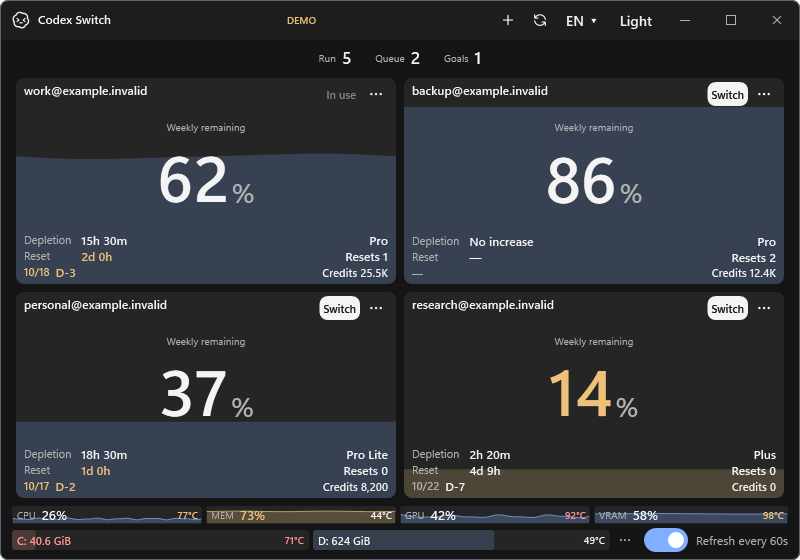
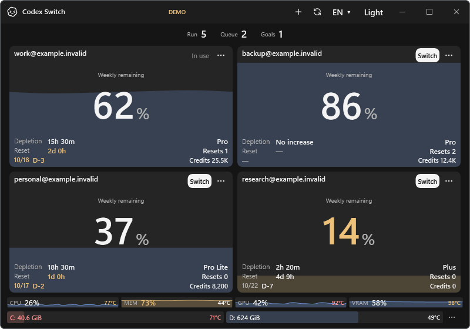
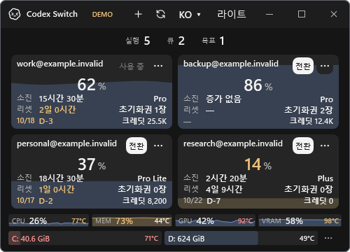
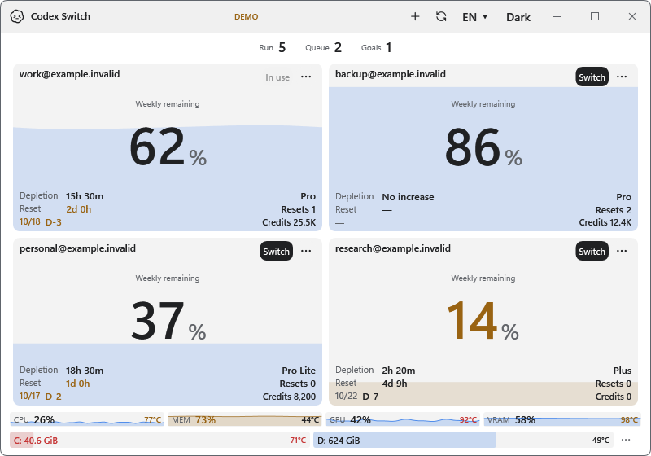

# Always-on automatic refresh

Related [issue #25](https://github.com/Gaebabi/codex-switch/issues/25), source **1.29.3**. Windows removes the footer's automatic-refresh switch and caption. Mac removes its automatic-refresh settings item. Automatic account reads retain the fixed 60-second interval while the initialized utility is running, including when its window is hidden. Manual refresh and existing request coalescing, switch guards and shutdown cancellation remain in place.

The persisted `AutoRefresh` preference and its handlers are retired. The production vault loader accepts older files containing `AutoRefresh:false`, preserves unrelated preferences/account identity, and drops that obsolete field on the next normal save. No vault-version, encryption, directory or credential migration is added. Existing translation IDs remain available for language-pack compatibility, although those controls no longer reference them.

| Before: 1.29.2 program | After: 1.29.3 program |
| --- | --- |
|  |  |

| Korean minimum 500×360 | Light theme |
| --- | --- |
|  |  |

These are actual Windows WPF application components with matching fictional account/session/sensor/deadline inputs. No private original pixels, recoverable blur or personal metadata enter the exports. The freed footer width is used by existing drive gauges; screenshots were inspected at native size. They do not certify native Mac GUI or real-account observations.

Private verification uses the production encrypted vault loader/save with an older disabled preference and valid fictional authentication. The actual WPF timer runs at its unchanged 60-second interval through the existing refresh callback and service/coalescing path. Its endpoint counts local fixture reads; it performs no network/account/Codex action. Manual refresh availability is observed through the existing UI probe. JSON receipts remain ignored.

Windows isolated93/93, disposable SQLite/WAL23/23, Mac compilation and nine×353 catalogue checks are retained. Issue #25 records the final exact-head CI, author review and owner-authorized merge. Current public binary Release remains1.27.6; no installed-app replacement is included.
