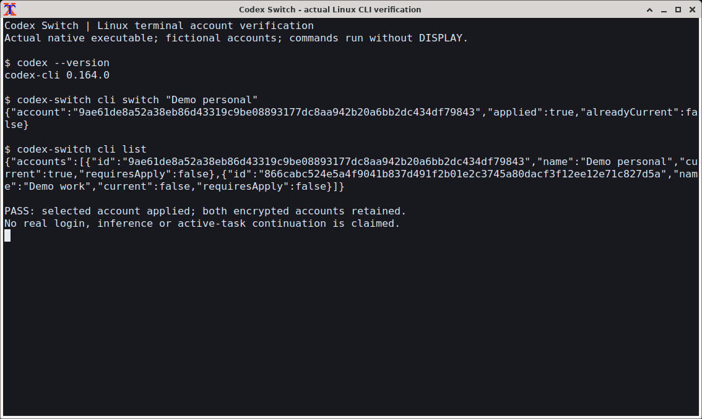
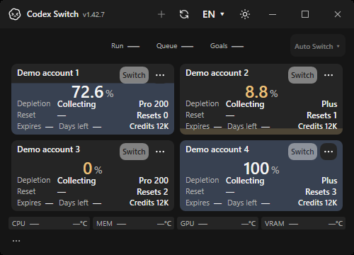

# Reviewed standalone CLI0.164.0

| Original1.42.6 / reviewed0.163.0 | Current native x64 / reviewed0.164.0 |
| --- | --- |
|  |  |

Both actual native exports show codex --version reporting0.164.0, followed by the real published application's headless account switch/list commands. Two fictional encrypted accounts are retained. Each architecture passes all16 original terminal contracts, including actual initialization/effective file policy and original configuration/credential preservation. The independently declared expected version is never inferred from the observed response. Both pictures are byte-identical deterministic exports from separate native executions; neither frame is composed or edited.

The baseline is the original healthy1.42.6 owned Xfwm4 terminal using reviewed0.163.0. [Original byte/hash receipt](before.json). The separate [PR123 native failure](https://github.com/Gaebabi/codex-switch/actions/runs/40635080996) identifies the correct unreviewed-version refusal for0.164.0 before this review; the baseline is not a screenshot of that exception.

Capture source `d89fc0455ceae74e123ec98a3cadbf6fd5f959ed` / [native workflow](https://github.com/Gaebabi/codex-switch/actions/runs/40742235657). [Source/PNG hashes and scope](evidence.json) bind original own-terminal PID/direct-parent OS frame/root exclusion, metadata-free exports and unchanged desktop manifest/credential parser. Later documentation commits must retain these implementation hashes.136 portable contracts cover exact accepted versions, adjacent unknown versions and wrong home/platform/client identity; actual native Linux behavior is a separate gate.

These are fictional/offline native integration checks. They do not certify real authentication, inference, active-chat Continue, full desktop/Wayland/ARM64 account acceptance or a maintainer MacBook device. Final-source six protected jobs, author review/merge and public package verification remain in [issue125](https://github.com/Gaebabi/codex-switch/issues/125) / [release gates](../../development/RELEASE_1_42_7.md). No owner account/home/input or installation is used.

## Windows package regression

| Original1.42.6 / WMI10.0.13 | Current1.42.7 / WMI10.0.14 |
| --- | --- |
|  |  |

Original native own-WPF-window exports retain the compact account/resource geometry and unknown sensor values. Account/resource inputs are fictional; these pictures do not establish physical temperature/WMI availability. Existing native hardware22 read-only/identity/wrong-OS contracts and complete package/runtime tests have a separate scope. Both exports run reviewed .NET10.0.13; only the existing WMI/CodeDom package patches change. Source/version/hash receipts are included above; no owner desktop or account is used.
