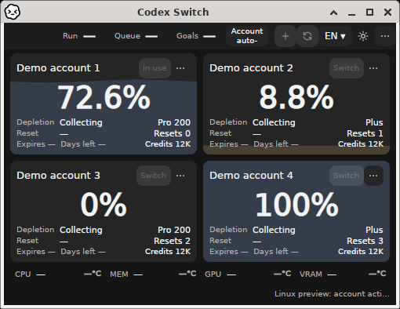
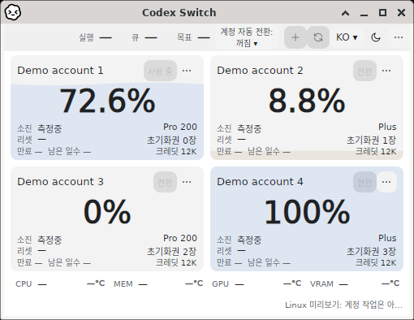
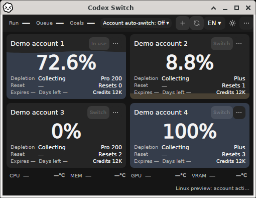
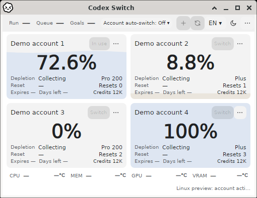
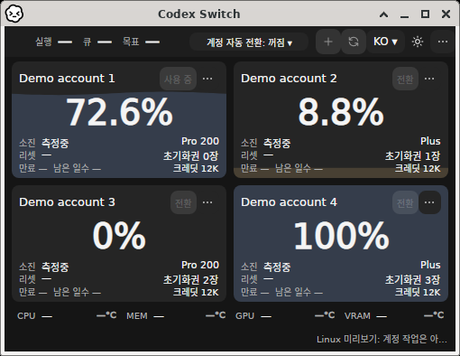

# Compact Linux header

The original1.42.3 images below retain the exact app-owned X11 window and direct-parent Xfwm4 frame, with fictional accounts and no pixel changes. [Original source/image hashes](before.json).

At500×360, the native titlebar shares its remaining width with fixed actions. Equal star columns around the session counts waste space on the empty cancel side and constrain the automatic-switch label to a narrow remainder. The1.42.4 change uses content-sized cancel/automatic columns and the remaining space for counters, with smaller counter gaps. Minimum size,34px header height and account viewport remain unchanged. Native assertions require complete rendered caption/state height/width and no action/counter overlap.

Actual x64/ARM64 confirmation at `26ef26951e8438eeb684e5eb7b42370a84bbfc5d` passes all12 language/theme/size cases on each architecture, including full caption bounds and no other action/counter overlap. Both captures completed the owned-writer/temp-home cleanup. All eight minimum-window after frames were individually inspected. [New source/image receipt](after.json). Mac/Windows regressions and protected final-head checks are separate gates. This does not establish supported Linux account handoff or authenticated continuation. [Issue115](https://github.com/Gaebabi/codex-switch/issues/115).

## Native minimum-window after frames

|Language/theme|Linux x64|Linux ARM64|
|---|---|---|
|en/dark|||
|en/light|||
|ko/dark|||
|ko/light|||
