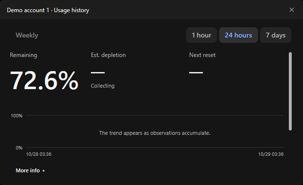
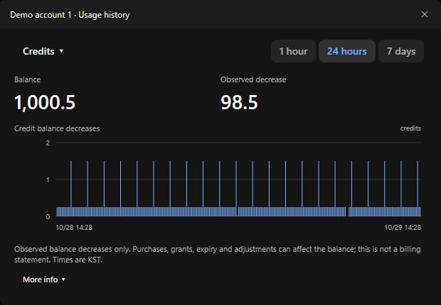
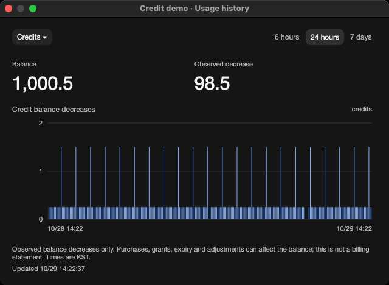
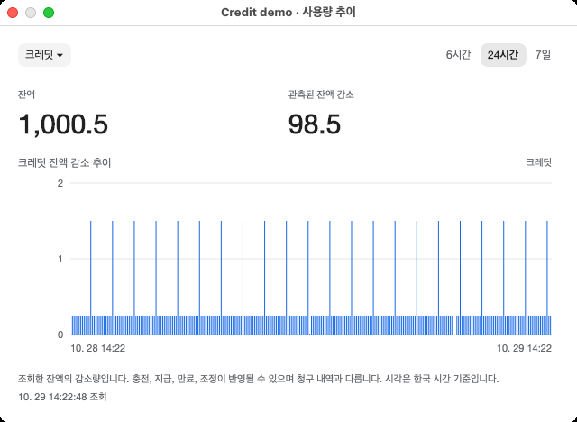
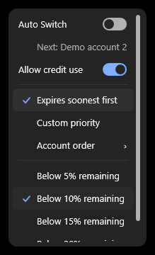
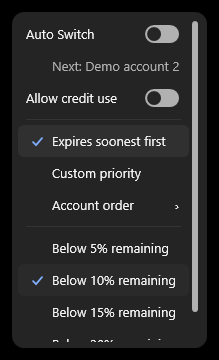
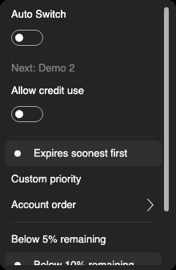
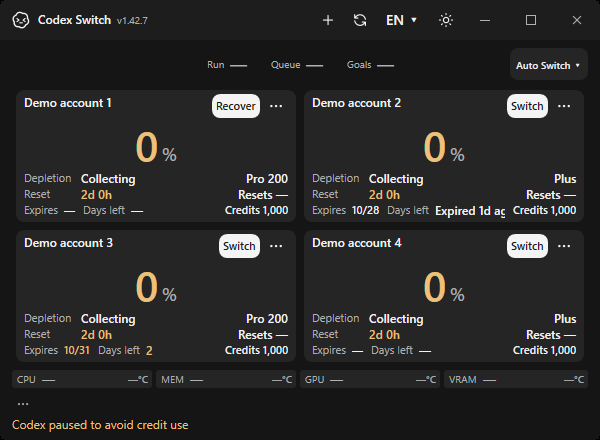
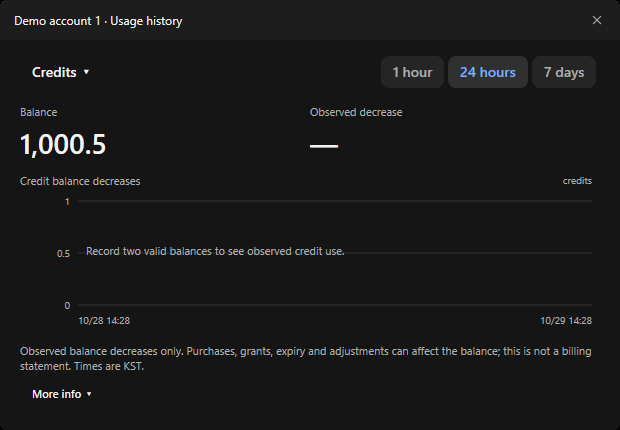
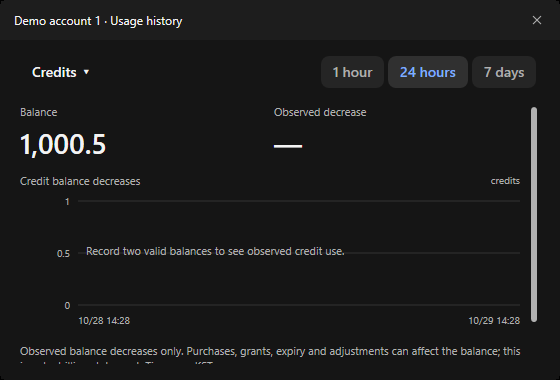

# Credit history and quota protection

[Feature129](https://github.com/Gaebabi/codex-switch/issues/129) / [bug130](https://github.com/Gaebabi/codex-switch/issues/130) / [PR131](https://github.com/Gaebabi/codex-switch/pull/131).

The new History metric separates observed credit-balance decreases from quota percentages. Credit use stays allowed by default. Turning it Off tries an eligible automatic account at fresh0% ordinary quota; if that is unavailable, it saves chats and normally pauses local Codex. [Data, recovery and billing boundaries](../../development/CREDIT_HISTORY.md).

| Original1.42.7 quota History | Windows credit History |
| --- | --- |
|  |  |

The baseline is an original1.42.7 own-WPF-window export with fictional quota inputs. Its history renderer sources are identical to the feature's parent. It shows the previous quota view, not a screenshot of the ranking failure. The past-date policy failure is reproduced separately in the regression suite. No old percentage data is converted into fictional historical credit spend.

| Native Mac ARM64 | Native Mac Intel |
| --- | --- |
|  |  |
|  |  |

All credit values are fictional observations. The graph shows balance decreases, not an authoritative billing statement. Grants, top-ups, expiry, adjustments, shared-product activity and collection gaps can affect the result. Unknown intervals remain unknown. Mac runs use software rendering on hosted native workers and do not certify a maintainer MacBook, Metal or live-account acceptance.

## Permission and paused recovery

| Default credit use allowed | Credit use disabled |
| --- | --- |
|  |  |
|  |  |

These actual application windows/popups use a fictional persisted paused checkpoint. They verify presentation and the actual setting handlers, not a live Codex shutdown. The separate native Windows parent/child test exercises production normal shutdown and verifies no credential application, relaunch or Continue during intentional credit pause. No owner account, home, Codex session or billing setting is used.

## Still-usable past subscription dates

The fixture's past-date account has fresh eligible quota and explicit ordinary-use permission. Both the policy result and actual next-account menu must name it before the future-date account. Date priority cannot override server denial, spend/limit restrictions, stale or invalid data, custom order or headroom requirements. The utility never extends a subscription date or infers payment status from it.

## Empty and minimum views

| One balance cannot imply consumption | Minimum window retains scrolling |
| --- | --- |
|  |  |

Native checks cover English/Korean, both themes, actual selectors/toggles and reachable minimum-window content:41 Windows and42 per Mac architecture, with28 original images each. The [artifact, image, source and scope receipts](evidence.json) bind the selected exports to their capture revision; original pixels are retained and metadata is removed. Full original sets remain in the native artifacts/private evidence. Final-head protected checks and recorded author review belong to the PR; no independent approval, binary release, installation or real-account acceptance is implied.
