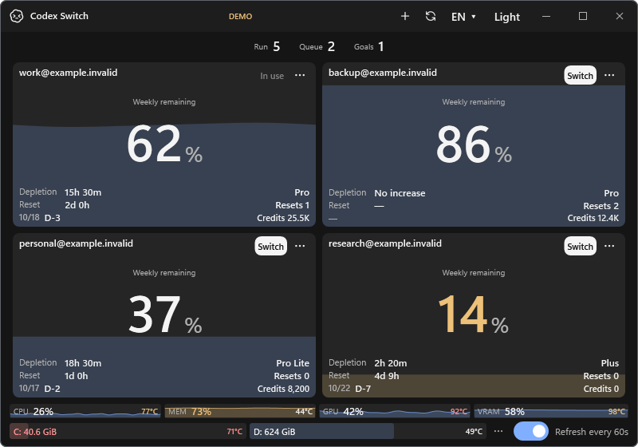
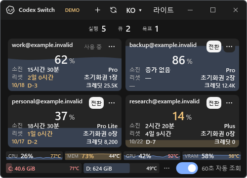
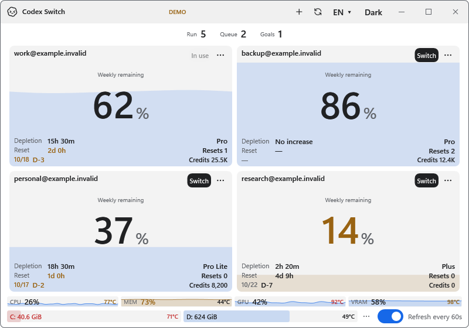

# Account date warning colors

Related [issue #23](https://github.com/Gaebabi/codex-switch/issues/23), introduced in source **1.29.2**. Subscription expiry dates and D-day text use the theme's warning color when the known expiry is between now and 72 hours away, inclusive. The selected quota's reset countdown uses the same warning color between now and 48 hours away, inclusive. This includes expiry at two/three days and reset at one/two days. Missing, past and farther deadlines retain their previous default colors.

Both platforms use one shared elapsed-time rule; colors update on the existing one-second countdown tick. The current language, KST date/D-day labels and selected quota remain unchanged. Elapsed hours determine warning eligibility; calendar D-day labels can differ near midnight. Expiry highlighting also works when quota data is missing.

| Before: 1.29.1 program components | After: 1.29.2 program components |
| --- | --- |
|  |  |

The same fictional cases show expiry/reset at three/two days and two/one days, a farther deadline, and missing dates. These are actual Windows WPF application components with fictional account/session/sensor inputs; no private original pixels, recoverable blur or personal metadata are present. They do not certify real-account switching or native Mac GUI acceptance.

| Minimum Korean 500×360 | Light theme |
| --- | --- |
|  |  |

The renderer's private receipts record actual text/brush values. Observations use the public card countdown update at explicit fixture times: just outside the threshold, on the threshold, and after it passes, including a no-quota expiry. Number/action/resource geometry and native-size exports were checked; screenshots were visually inspected. The disconnected off-screen renderer does not assert its existing `IsVisible`-based metadata flag as native window acceptance. Receipts remain ignored.

```text
python scripts/render-demo.py --deadline-preview --temperature-preview --output artifacts/date-warning-ui.png
python scripts/render-demo.py --deadline-preview --theme light --output artifacts/date-warning-light.png
```

Windows internal checks93/93 and disposable SQLite/WAL23/23 pass; Mac compiles and nine existing packs remain structurally complete at353 messages. Issue #23 records the formal PR, exact-head remote checks, author review and authorized merge. Current published downloads remain1.27.6; source/build/native platform evidence is kept distinct.
