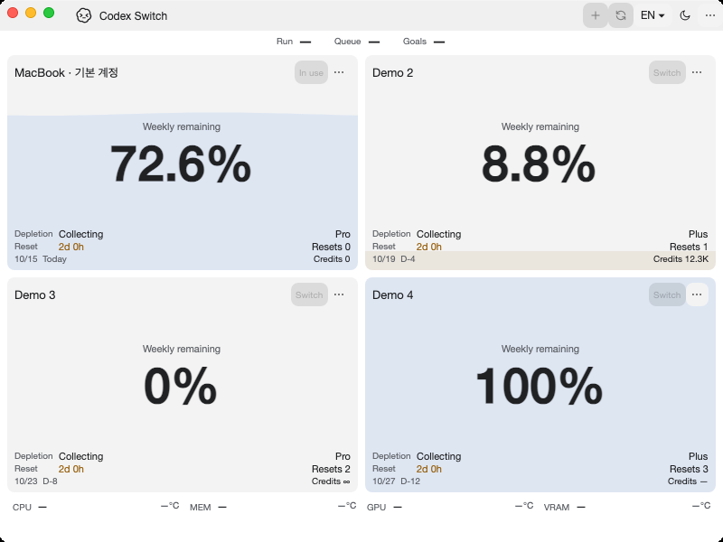

# Native desktop client extraction

Tracks [issue39](https://github.com/Gaebabi/codex-switch/issues/39), [PR40](https://github.com/Gaebabi/codex-switch/pull/40) and remaining provider issue3. Program windows use only synthetic accounts. No personal account/chat/desktop/home, installed client launch/quit or Release is included.

| Windows before: source1.31.0 | Windows after: source1.31.1 |
| --- | --- |
|  |  |

| Mac Apple Silicon before | Mac Apple Silicon after |
| --- | --- |
|  |  |

| Mac Intel before | Mac Intel after |
| --- | --- |
|  |  |

Before source12d73d0/app1.31.0 is the original security checkpoint; main878c479a has the same code. After source `903fdc073573a58cde73110d816b7c2c7a5088de`/app1.31.1 extracts the client assembly. Windows uses the same local host/200% display scale/software renderer; the dark PNGs are byte-identical. Mac native macOS15 hosted runner screenshots use software evidence rendering and can differ in focus/water animation. These are native own HWND/NSWindow captures, not managed mockups. [Windows receipt](windows/evidence.json), [Apple Silicon receipt](mac-arm64/evidence.json), [Intel receipt](mac-intel/evidence.json) preserve source/runtime/architecture/dimensions/SHA256; metadata is stripped.

The new UI/domain-independent `CodexSwitch.DesktopClient` owns RuntimeLocator/CodexInstallation, Windows normal shutdown/owned-child lifetime and Mac discovery/lifecycle/peer verification. RuntimeHome remains in integration code. MacDesktop/OwnedProcessJob, Windows shutdown body and supported discovery/launch algorithms are source-preserved; only unsupported-OS routing adds explicit refusal before a Windows fallback. Package inspection requires the new DLL. No OS/credential/client identity or success criterion changes.

Standalone client tests check real assembly ownership and refusal paths without discovering or launching an installed client. Linux additionally exercises unsupported discovery/running/launch/thread-open/shutdown rejection, not Linux client support. Existing Windows native parent/child tests use real Restart Manager and production coordinator with disposable processes; backend credentials/resume endpoints are synthetic and do not establish real-account acceptance. Mac's moved lifecycle code is unchanged; native bootstrap/layout/refusal regressions do not prove real login/quit/reopen/resume.

[Capture checkpoint run38657071888](https://github.com/Gaebabi/codex-switch/actions/runs/38657071888) passes all four jobs at903fdc0. Windows client5/internal93/SQLite23/handoff5/security10, Mac client4/security16 and native UI21 each, Ubuntu unsupported-client7 and existing core/language/temperature contracts pass. Six selected after PNGs are inspected and metadata/hash checked. PR40 owns final complete-head CI, author review and promotion. Remaining authenticated observation/SQLite/resource-provider extraction and Linux5/6/7 gates stay open. Published binary packages remain1.27.6.
