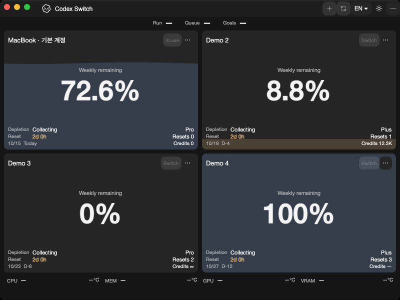
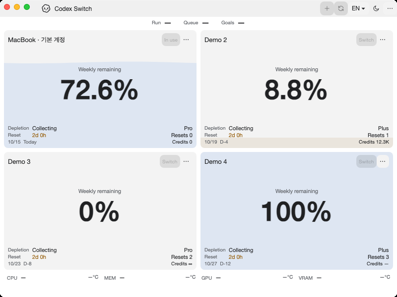

# Shared application and desktop composition

Tracks [issue45](https://github.com/Gaebabi/codex-switch/issues/45), [PR47](https://github.com/Gaebabi/codex-switch/pull/47) and the final composition part of issue3. Actual published app windows contain synthetic profiles only. No private identity, chat, credential, home or personal desktop is captured.

| Windows before: source1.31.3 | Windows after: source1.32.0 |
| --- | --- |
|  |  |

| Mac Apple Silicon before | Mac Apple Silicon after |
| --- | --- |
|  |  |

| Mac Intel before | Mac Intel after |
| --- | --- |
|  |  |

Before source2e7f8f0/app1.31.3 is the hardware checkpoint; main86b37631 has the same code. After exact source `385fa40113fc6f059c7a2af55c01cc0a0a590f78`/app1.32.0 builds account integration and shared UI as separate assemblies. [Windows receipt](windows/evidence.json), [Apple Silicon receipt](mac-arm64/evidence.json), [Intel receipt](mac-intel/evidence.json) retain source/runtime/architecture/dimensions/SHA256. Final PNGs are visually inspected and contain no metadata. Windows uses the same local host/200% display scale/software renderer; native Mac uses hosted macOS15/software evidence rendering. Mac focus/water/date differences do not establish behavior changes; production rendering remains unchanged.

Eight former app-linked account/storage/runtime/switch/language-write files now have one Application owner, with source bodies and existing serialization/data/key/IPC identities unchanged. Five unadapted view bodies are source-preserved. Shared Desktop owns Avalonia views/themes/visual resources and accepts host data/home/title, resources, optional menu factory, command modifier, root-volume label, font/reduced-motion and diagnostic callbacks. Mac entry/native menu/appearance/capture/diagnostics remain in its host. The UI assembly has no direct native imports or concrete Mac host type; existing Mac values preserve its behavior. Avalonia remains11.3.22 and its Dependabot owner moves to `src/desktop`.

The screenshot mode proves app bootstrap/layout and synthetic account presentation. Separate composition checks verify assembly/resource/appearance boundaries. The native composition probe shows the actual shared window without a tray, invokes ordinary close and checks exit/resource disposal without creating a data/home directory. Its pending-resource fixture does not claim physical sensors or real account/handoff acceptance. Initialize the native Avalonia platform before constructing themed objects in that probe; otherwise the earlier unbound dispatcher cannot run the native event loop.

Implementation385fa40 [Verify run38662200903](https://github.com/Gaebabi/codex-switch/actions/runs/38662200903) passes all four jobs: composition/native trayless close7Windows/eachMac, portable composition4Ubuntu, Windows93/SQLite23/handoff5, native Mac SQLite23/UI21 and existing language/temperature/key/client/protocol/hardware regressions. Six selected after PNGs are inspected and metadata/hash checked; Windows same-host dark PNGs are byte-identical. Full packages require Application.dll on both OSs and Desktop.dll on Mac; each omission is rejected and the owned folders restored. PR47 owns complete-head CI, author self-review and promotion. Linux5/6/7 and real-account native handoff remain separate completion gates. Source1.32.0/publicbinary1.27.6; no installed-app replacement, personal client/account action or new Release.
