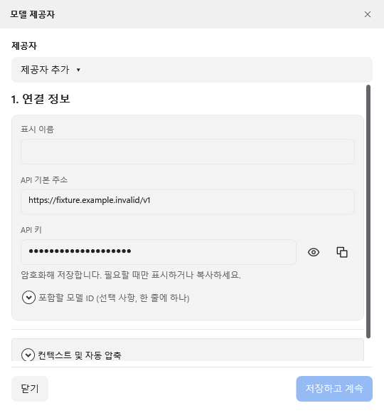
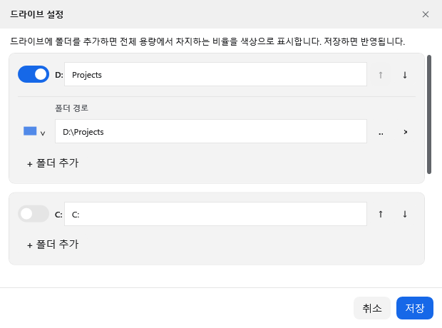
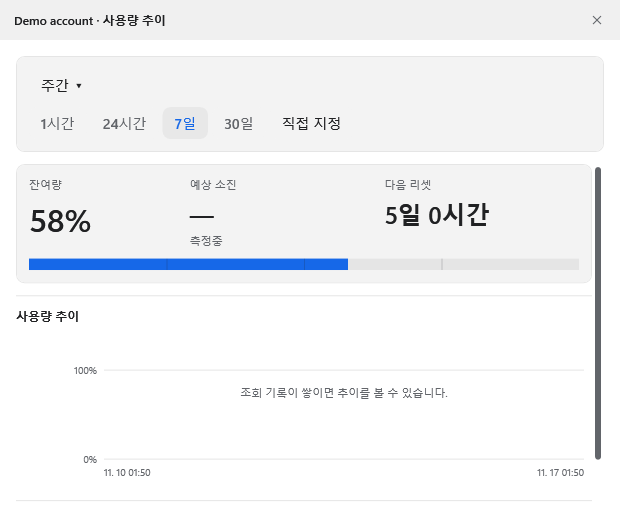
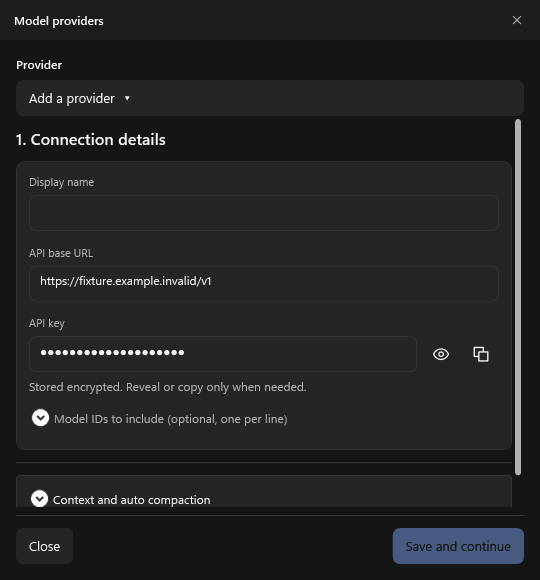
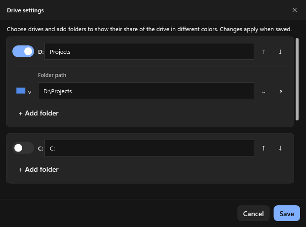
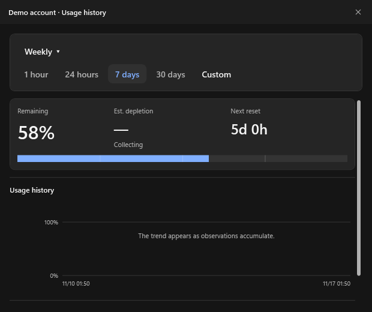
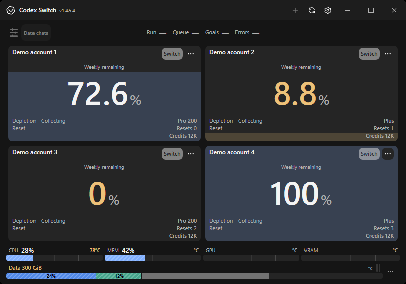
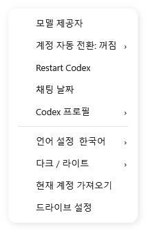

# Desktop status, settings and bounded storage follow-up

The native desktop26.1111 state stream changed to13; accepting the specifically examined schema restores status without treating an unavailable connection as zero work. Queue2/3 identities retain deduplication and ownership checks. Windows models move to the titlebar, Add/Refresh share the toolbar, and Date chats moves to Settings.

Folder allocation uses a global32-query-per-second schedule and at least four query-times of rest. This covers visible initial scans and failures, preserves complete allocated-size semantics, and reports active drive measurement through a capacity-adjacent spinner. It does not certify a whole-volume activity percentage.

Settings share caption/body/field/metric scales and surfaces. Provider details separate credentials, model capacity and context options; drive sections group their folder tables; history separates filters, summary, gauge and chart. Values and actions remain production controls.

## Evidence boundaries

The new images below are **production WPF components rendered offscreen with fictional data**. They are not owner screenshots, native Codex-picker acceptance or a disk benchmark. The before image is an actual prior hosted Windows app window. Native after confirmation is pending final-head CI. [Image hashes and local-source provenance](evidence.json).

| Provider connection | Drive/folder settings | Usage history |
| --- | --- | --- |
|  |  |  |
|  |  |  |

| Actual native baseline | Scan indicator / Settings action placement |
| --- | --- |
|  |   |

Local validation passes58hardware/folder contracts,171production UI checks and100package self-tests. Read-only owner observation confirms status and settings RPC on both Windows systems while original Codex/backend processes and stable owner preferences remain intact. Raw diagnostics and personal data remain private. Public downloads still refer to the separately verified1.45.4 release.
