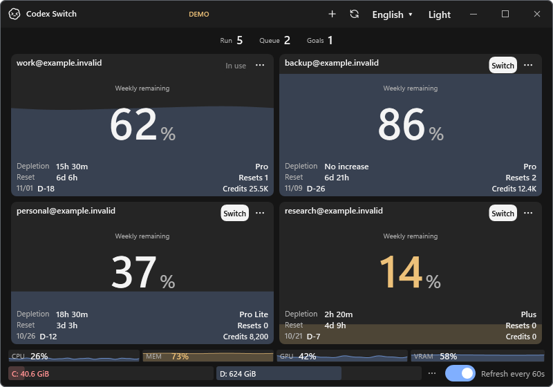

# Documentation image refresh

Tracks [issue33](https://github.com/Gaebabi/codex-switch/issues/33). These are actual Windows WPF UI component renders with fictional account/resource inputs, not a personal desktop or screenshots of real account switching.

| Before: source 1.27.6 | After: source 1.30.2 |
| --- | --- |
|  |  |

The after image shows the vector sun theme action, temperature availability labels and the always-on refresh layout. Both PNGs are lossless 800×560, with no image text/EXIF metadata or private source pixels. Addresses are reserved `example.invalid` fixtures; blur is unnecessary because real identities never enter the render. [Previous receipt](before.json) / [current version/revision/digest receipt](../../media/demo.json).

README's comparison link previously opened the historical repository-foundation comparison. It now opens the current scrollbar/theme comparison; the evidence index keeps the old foundation record under an explicit historical heading. CI's current-image link and all four README captions now lead to the current platform gallery. All original relative file destinations exist; missing files were not found. A stronger check additionally validates local Markdown heading fragments, reference-definition targets and HTML links.

Fresh native Windows/macOS15 arm64/Intel capture and all four CI jobs pass at `1a2cc586c15a0f772b2e96617fb2e2e1fe0e43e7` in [run38633951637](https://github.com/Gaebabi/codex-switch/actions/runs/38633951637). Six inspected native PNGs and their selected-image provenance are in the [gallery](../../media/README.md#native-platform-gallery). The README illustration was rendered at `8ae49d0a1a10a7be9de779a6967c1bd11489a1f1`; the native app sources are unchanged between these documentation/tooling checkpoints. The linked PR owns final complete-head CI, author review and promotion. Binary downloads remain 1.27.6. No Release, installed-app replacement or real account/Codex action is included.
