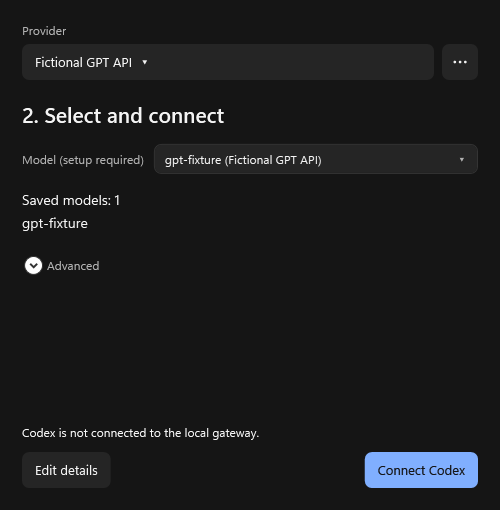
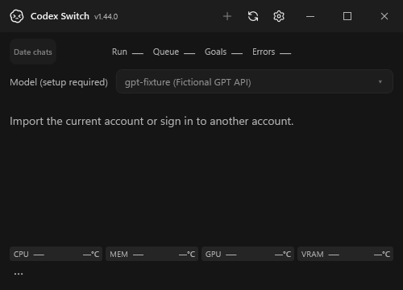

# Fixed model and actual-model dropdown

The source change keeps one `codex-switch` model in Codex and moves actual OpenAI/custom Responses model selection to Switch. The saved selection applies to new virtual-model requests across chats; upload, stream and retry snapshots preserve requests already admitted. First connection/legacy upgrade still needs one owner-idle Codex restart. Later selections and newly saved providers do not require another restart.

## Application component evidence

The pictures render the production Windows WPF controls offscreen with fictional provider data. The before and after setup pictures use the same500×510viewport and fictional provider. Home is500×360. No personal account, Codex window or native desktop picker was operated for these images. They verify the actual dropdown/rendered setup, not real external-provider inference.

- [Before setup](../provider-connection/saved-connection-ko-dark.png), from the reviewed provider onboarding source.
- After setup: [English](setup-en.png) / [Korean](setup-ko.png).
- Home dropdown: [English](home-en.png) / [Korean](home-ko.png).

## Runtime contract

`tests/model-providers` uses an explicitly reviewed official Codex executable, disposable homes and fictional upstreams. After initial fixed-model configuration, the same app-server process and chat complete requests through A, B and original OpenAI while its model list stays fixed. The fixture also adds a provider after startup and changes a saved reasoning default. Separate actual loopback HTTP cases cover selection during body upload, an A stream continuing alongside a new B request, retained507retry credentials/routes, duplicate-client refusal, persisted/deleted choices and image compatibility refusal.

The source/input hashes, contract counts and narrow evidence scope are in [verification.json](verification.json). No real desktop picker, owner conversation, authenticated external provider or public binary release acceptance is claimed. The earlier per-model catalog path remains covered for existing connections.
