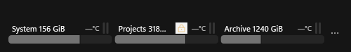
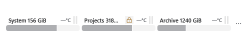

# Persistent index and permission controls

The Windows folder index preserves completed work across app restarts and replays NTFS changes. The lock explains missing access, starts selected-drive Windows setup on request, and disappears only after ordinary access is verified. Activity is independent of permission waits and clears when work becomes idle.

These compact strips are production WPF controls rendered offscreen with fictional drive/index data. They confirm layout and the D: lock action at500px in Korean/dark and English/light, not a real OS window, actual UAC consent or personal-folder completion. [Hashes and scope](evidence.json).

The normal UI contracts verify the selected drive, busy/cancel recovery, granted access, active-drive-only activity, idle clearing and unsupported states. Native1.45.6 CI separately captures the actual full app window with fictional lock/work states in both themes. That version-specific native confirmation is a release gate; the final verification archive records its exact source and image hashes.

[Index architecture](../../development/FOLDER_INDEX.md) · [Behavior and support limits](../../FOLDER_MONITORING.md) · [Release gates](../../development/RELEASE_1_45_6.md).
