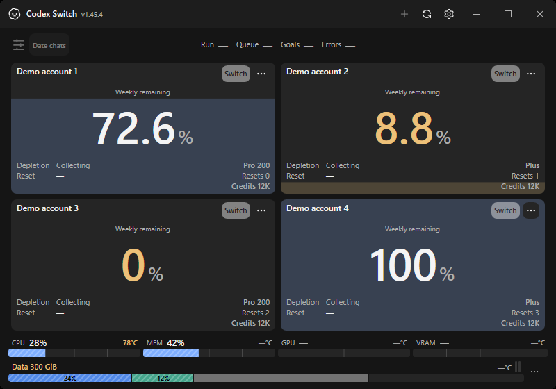

# Windows folder-monitor stabilization

The native Windows app continues to display allocated folder segments. The change is in measurement scheduling: retained directory snapshots, filesystem invalidation, unchanged-root reuse and pause/resume while hidden or minimized.

| Before | After |
| --- | --- |
|  |  |

The baseline is the actual 1.45.3 Windows app captured on disposable hosted Windows at source `1a896e508ed6a195b732d6616655932fb0b6d53a`, the reviewed tree published as 1.45.3. It uses fictional accounts and folder sizes, with private metadata removed. These images verify native presentation, not a disk benchmark or native account switching.

The after image is the actual 1.45.4 Windows app captured at source `23ad7e5a14ae6524f7d961648c74bbaca0c6e43d` in [hosted native verification](https://github.com/Gaebabi/codex-switch/actions/runs/43804177489), with the same fictional inputs. Folder bars remain visible with the new measurement scheduler. Only evidence and documentation were added afterward; the release verification archive carries fresh captures for the final reviewed head. [Capture hashes and revisions](evidence.json).

Scheduling acceptance is covered by the hardware/folder contracts: idle monitoring beyond sixty seconds, root-query and directory-enumeration counts, real filesystem notifications, allocated storage and hard links, hidden startup, cancellation and resume. The hosted disk-counter receipt records actual read-only counter availability without device identities. [Release scope and limitations](../../development/RELEASE_1_45_4.md).
