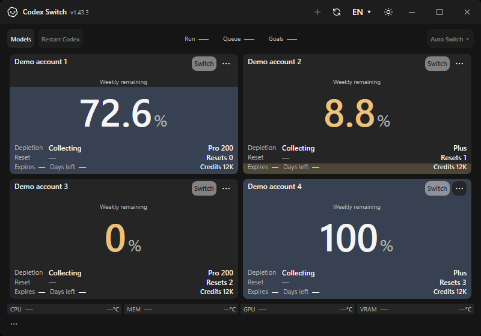

# Concurrent gateway load

Issue149 improves image-heavy concurrent chats without increasing the512MiB per-request limit. The gateway previously allowed two large uploads and used payload-sized pooled JSON metadata; custom routing also rebuilt the complete mutable history. Request arrays now share a1GiB capacity budget, eight large uploads can proceed within it, and48response streams leave upload capacity available. Token validation and sliced forwarding preserve history/images without a second body tree.

## Actual application evidence

| Current main | Load-resilience implementation |
| --- | --- |
|  |  |

These are actual hosted native Windows own-window apps with fictional accounts. The baseline is source `9741e6ee202f4938ccdb8caf49ae5bc998e89941`, [Verify41302434623](https://github.com/Gaebabi/codex-switch/actions/runs/41302434623), artifact13081834051. The implementation is `19cc3666c2d2f2000122b5ffc263ad43771614bc`, [Verify41306288667](https://github.com/Gaebabi/codex-switch/actions/runs/41306288667), artifact13083975412. Both original800×560 images have SHA256 `320049d86e415b3991ed0525e353b855d15949d0f76f1f45bf6c66044e4b9ee8`. They confirm application continuity, not network throughput. [Exact hashes and measurements](evidence.json). Final-head protected CI remains required after this evidence update; production code is unchanged. Raw private chats and account evidence are excluded.

## Isolated behavior and load measurements

Local Windows official CLI0.163.0/fictional-upstream verification passes184checks. Generated-byte stress runs separately in a fresh process and passes74checks. The stress input uses fixed fictional bytes; its upstream consumes streams without buffering another copy. No external inference or owner home is used.

| Scenario | Observed result |
| --- | --- |
| Exact512MiB Responses request | HTTP200, complete536,870,912bytes forwarded |
| Exact512MiB chunked compaction | HTTP200, complete536,870,912bytes forwarded |
| Exact512MiB image edit | HTTP200, complete536,870,912bytes forwarded |
| Eight simultaneous65MiB custom uploads |8/8HTTP200,545,259,184forwarded bytes;527ms in this local fake-upstream run |
|48open response streams | All admitted; model discovery remains available;49th generation refuses503 before inference |
|16incomplete uploads/disconnected overload clients | Bounded overload; listener recovers and releases slots |
| Aggregate byte-budget saturation | Refuses before reading the next body; small-request reserve remains usable |

The measured run took9,170ms. Peak managed heap was1,013,850,160bytes; after forced collection between near-limit inputs it retained at most3,821,384bytes from a2,848,064byte baseline. A diagnostic predecessor using JsonDocument retained payload-sized metadata, reaching4,580,629,248peak bytes in a comparable run. Measurements depend on runtime, host load and the sampling interval; the1GiB budget bounds request-array capacity, not all process allocations or total RSS. Timing is not an external API throughput promise.

`GatewayLoadContracts` also verifies escaped duplicate property names, nested duplicates, malformed JSON, cancellation/budget release, exact unchanged history slices, opaque-reasoning filtering, Retry-After and overload recovery. The normal Windows protected workflow runs the generated-byte stress mode after ordinary provider/official-client checks. No test weakens authentication, provider provenance or encrypted-compaction refusal.

The Windows self-contained package includes runtime10.0.13, contains494files and passes99self-tests. Source verification, hosted native app continuity, protected final-head CI, an installed process and authenticated upstream acceptance remain separate gates. No new public binary release is part of this change.
