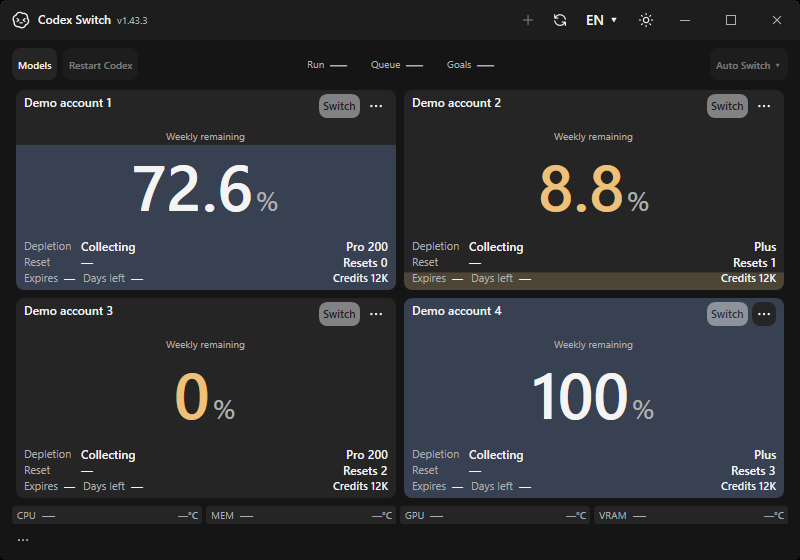

# Image-heavy chat payloads

After the image-route hotfix, an image-heavy full-input conversation still received a Switch-generated413 before reaching its original OpenAI upstream. The64MiB intermediary limit was smaller than the accumulated input. The follow-up accepts bounded512MiB bodies, preserves the complete input and reuses the original buffer for unchanged OpenAI requests.

## Application evidence

| Current-main baseline | Follow-up application |
| --- | --- |
|  | Pending hosted capture of this implementation. |

The baseline is an actual hosted Windows own-window capture with fictional accounts at main `d4725801fd21f9b57a9bcce882f78a1602efebe9`, from [Verify41284301154](https://github.com/Gaebabi/codex-switch/actions/runs/41284301154), artifact13074960359. Its original SHA256 is `320049d86e415b3991ed0525e353b855d15949d0f76f1f45bf6c66044e4b9ee8`; dimensions800×560. It confirms the unchanged account application baseline, not the payload error. The after capture remains pending until this implementation's hosted native run completes. Gateway regressions and private authorized resumption provide separate behavior evidence.

## Verification

- Local Windows official CLI0.163.0 and fictional-upstream verification passes120 checks. A65MiB full-input Responses request, chunked compaction and image edit retain their entire body. Declared sizes above512MiB refuse before upstream. Exact-bound/overflow/cancellation cases use the same reader with a small test bound.
- Two incomplete chunked uploads occupy the large-body admission slots; a third receives503 before upstream while a small request remains usable. Duplicate routing/history fields, an invalid model type and a non-object request refuse before inference. Original provider/account history guards remain in the suite.
- The initial authorized local payload package passes99 self-tests with self-contained runtime10.0.13. An existing chat previously blocked at64MiB resumes, returns assistant text and completes subsequent commands. Its product work is still in progress. The final strict-JSON package is verified separately before installation.
- No owner Codex restart, account switch, deleted image/history, implicit compaction or new public binary release is part of this correction. Source, local installation and protected-CI delivery remain separate evidence states.

The [OpenAI image input guide](https://developers.openai.com/api/docs/guides/images-vision?api-mode=responses) documents up to512MB total payload for the public API. This does not guarantee the same limit on every authenticated Codex/custom upstream. Payloads above Switch's512MiB bound still fail explicitly. Private transcripts, account data, generated product assets and raw local diagnostics are excluded from public evidence.
