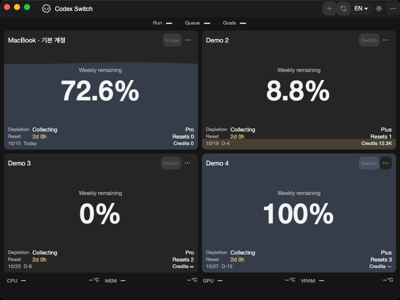
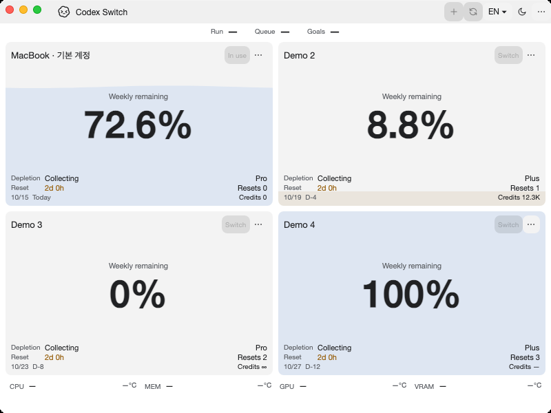

# Native hardware provider extraction

Tracks [issue43](https://github.com/Gaebabi/codex-switch/issues/43), [PR44](https://github.com/Gaebabi/codex-switch/pull/44) and remaining provider/composition issue3. Program screenshots contain only synthetic accounts and app-owned HWND/NSWindow pixels. No private identity, chat, credential, home or personal desktop is captured.

| Windows before: source1.31.2 | Windows after: source1.31.3 |
| --- | --- |
|  |  |

| Mac Apple Silicon before | Mac Apple Silicon after |
| --- | --- |
|  |  |

| Mac Intel before | Mac Intel after |
| --- | --- |
|  |  |

Before source5520523/app1.31.2 is the protocol/SQLite checkpoint; main0d0419a3 has the same code. After exact source `2e7f8f000f72f886b148075bfec0528f8bb03365`/app1.31.3 extracts Hardware. [Windows receipt](windows/evidence.json), [Apple Silicon receipt](mac-arm64/evidence.json), [Intel receipt](mac-intel/evidence.json) preserve revision/runtime/architecture/dimensions/SHA256. Metadata is stripped and final PNGs are visually inspected. Windows uses the same local host/200% display scale/software renderer; native Mac uses hosted macOS15/software evidence rendering. Focus/water/date differences do not establish behavior changes; production rendering remains unchanged.

The pictures demonstrate app bootstrap/layout and preserved unknown resource presentation with synthetic account inputs. They do not demonstrate physical sensor availability. Independent native hardware checks sample the actual machine read-only without exporting device identities/measurements. Existing temperature tests cover valid zero/negative values, malformed descriptors, multi-disk coverage, exact GPU mapping, unavailable states and colors. No driver, elevation, fallback temperature or Linux sensor support is introduced.

`CodexSwitch.Hardware` owns existing Windows/Mac sampling, drives and temperature providers with core/security references and no UI/client/protocol dependency. Supported native algorithm bodies, intervals and sensor selection are source-preserved. Only the unchanged DrivePreference model moves to core; vault defaults/format and existing saved settings remain integration code. Wrong-OS native starts/samplers/WMI refuse before library/host-port/background operations; a valid Windows disk root on another OS reports PlatformUnsupported without Celsius. Full-folder package checks require Hardware.dll and reject its omission. System.Management10.0.13 and its Dependabot update directory move with their owning code.

Implementation checkpoint2e7f8f0 [Verify run38660081487](https://github.com/Gaebabi/codex-switch/actions/runs/38660081487) passes all four jobs: hardware8Windows/9eachMac/10Ubuntu, temperature29 eachOS, Windows93/SQLite23/handoff5, native Mac SQLite23/UI21 each and existing core/language/security/client/protocol checks. Six selected native after images are visually inspected and metadata/hash checked; same-host Windows dark PNGs are byte-identical. Missing-Hardware.dll package rejection is verified against the owned publish folder, then the DLL is restored. PR44 owns final complete-head CI, author self-review and authorized promotion. Shared desktop composition and Linux5/6/7 are still incomplete. Source1.31.3/publicbinary1.27.6; no installed-app replacement, personal client/account action or Release.
