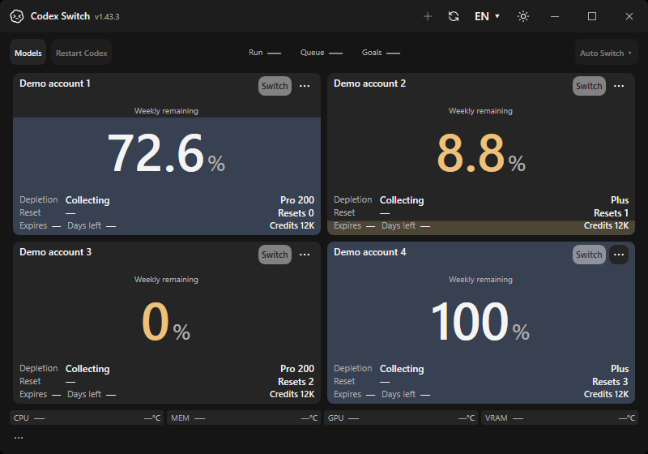
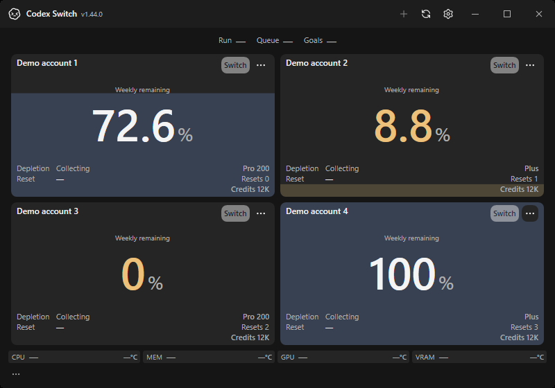
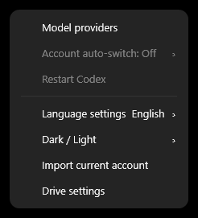
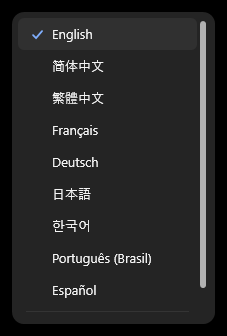
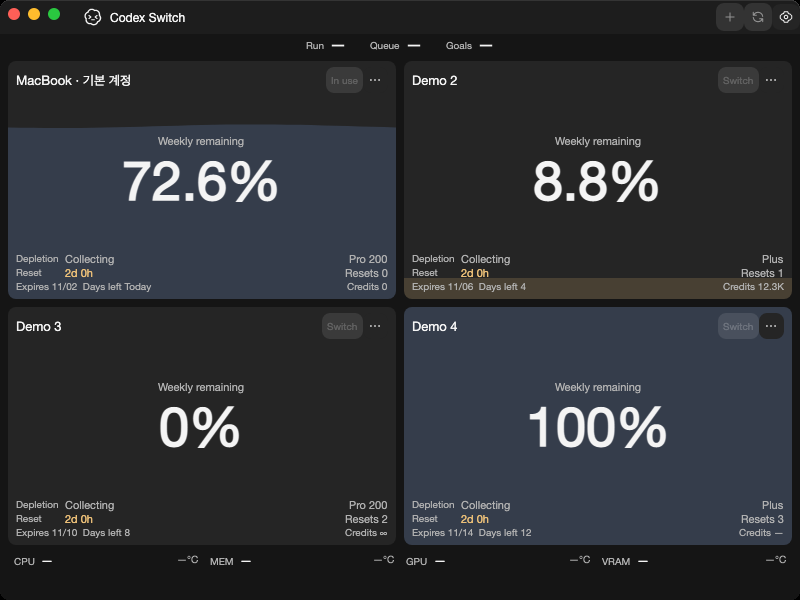
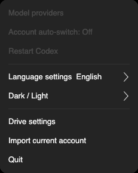
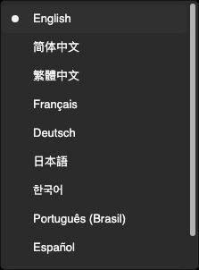
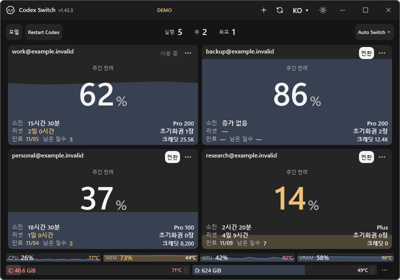
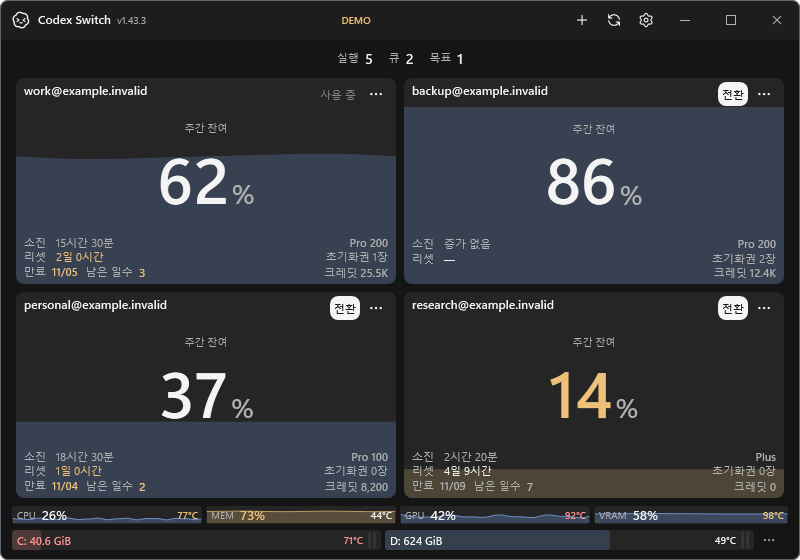
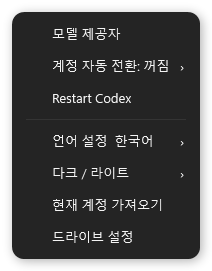

# Home simplification evidence

The core account tanks, percentage display and direct Switch/Recover actions are preserved. Global actions move into one titlebar gear; Add account and Refresh remain beside it. Secondary metadata is quieter and missing subscription dates no longer add empty rows. [Behavior and limits](../../development/HOME_SIMPLIFICATION.md).

## Actual application windows and menus

| Before: Windows1.43.3 | After: Windows1.44.0 |
| --- | --- |
|  |  |

These are original own-application window/popup captures from disposable hosted native workers, with fictional accounts and no owner desktop or credentials. [Source revisions, workflow/artifact digests, dimensions and original PNG hashes](evidence.json) bind the baseline main revision and implementation revision. Windows exports38images; each Mac architecture exports20. Windows Settings keyboard focus, language overflow/visible scrollbars on both platforms and existing account/credit/recovery checks pass on the captured implementation. Linux ordinary installed UI passes71checks using the new Add and Settings paths. All six final-head protected checks and public package/download verification passed; [the publication record](../../development/RELEASE_1_44_0.md) identifies exact sources/runs. Native UI evidence does not establish authenticated provider or account-switch acceptance.

## Earlier local component preview

| Before | Local preview |
| --- | --- |
|  |  |

These earlier images are windowless renders of the actual maintained WPF controls with fictional account/resource data, not native application-window screenshots. The titlebar preview's DEMO marker is supplied only by the documentation renderer. The before source is the pre-change main tree; the after was captured from the local implementation before its first commit. No real account, Codex restart, provider switch or installed package was exercised by this renderer.

The UI harness passes54checks, including0/1/4/8accounts at two sizes in English/Korean and dark/light themes. Long names, warning actions, tank/number/metadata containment, the Settings path, persisted language/theme/automatic choices, busy restart refusal and vertical access to the last of eight accounts are covered. The standard preview renderer also exports600×400. Publication and owner installation require the separate [release gates](../../development/RELEASE_1_44_0.md).
