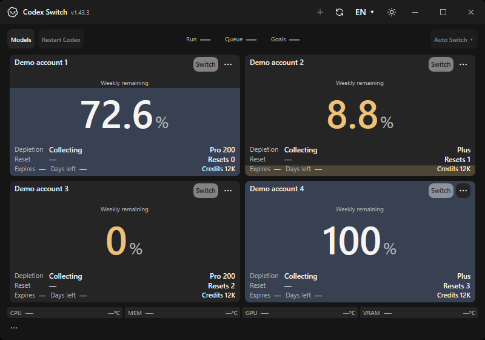

# Built-in image routing and large conversation requests

The gateway previously returned404 for built-in `images/generations` and `images/edits` calls. A long full-input chat could also fail with `A bounded JSON Responses request is required` after exceeding16MiB. The hotfix forwards image JSON through the original OpenAI account, preserves image references and request IDs, and accepts bounded64MiB bodies. Size/media errors are now distinct413/415 responses.

## Application evidence

| Main1.43.3 baseline | Hotfix application |
| --- | --- |
|  |  |

These hosted native Windows own-window captures use fictional accounts and have identical bytes. The baseline is main `62d87ac196b71dbd2aa97faf8ebf08fbaf870998`; the after capture is implementation `07128055607e474f9bb6c156d318b5e7e54a21df`. They confirm application continuity, not the image-route failure or an authenticated handoff. The independent checks below establish image and body-size behavior. [Exact workflow/artifact/image hashes](evidence.json).

## Behavior verification

- Official CLI0.163.0 and fictional upstreams pass109 local checks, including both image endpoints, original ChatGPT/API-key identities, exact request-body preservation, request IDs, no custom-provider credential use, unchanged conversation-route records, anonymous/browser refusal, failure sanitization and no retry.
- A17MiB conversation and a17MiB image-edit body retain their full bytes. A declared body above64MiB receives413 before contacting upstream. Incorrect media receives415. The normal reader also bounds chunked inputs.
- The authorized local Windows package passes99 self-tests and contains the reviewed self-contained runtime10.0.13. One diagnostic transparent-image generation succeeds. The originally failing chat resumes and completes two more built-in image generations and subsequent commands without another gateway/turn error during the observed interval.
- Real image-edit acceptance was not exercised. Actual desktop-picker, broader external-provider compatibility and the originally reported controller-exit cause remain in their existing issues. No new binary release is part of this PR.

Private account data, chat text, generated product assets, local paths and raw diagnostic captures are excluded from this public evidence. Capture [Verify41282507176](https://github.com/Gaebabi/codex-switch/actions/runs/41282507176) supplies the after frame; [Verify41227072128](https://github.com/Gaebabi/codex-switch/actions/runs/41227072128) supplies the main baseline. Final-head protected CI remains required after this evidence-only update and the restored UTF-8 test-fixture text; production gateway bytes are unchanged.
