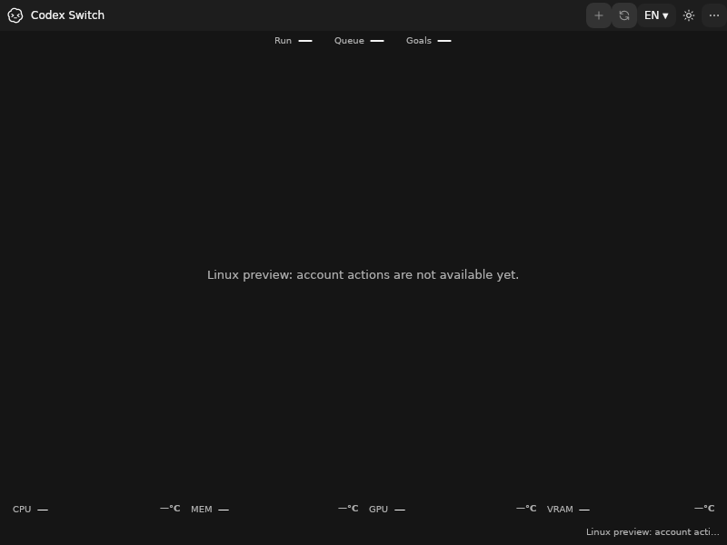
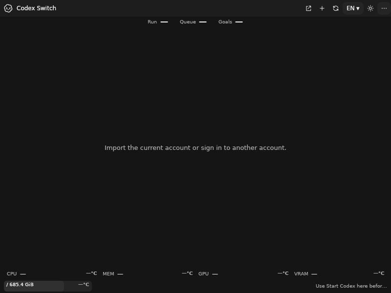
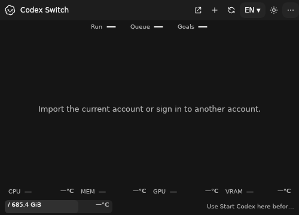
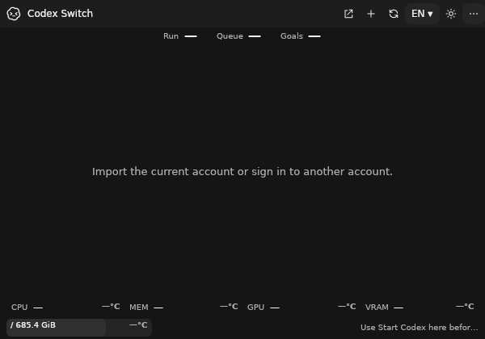
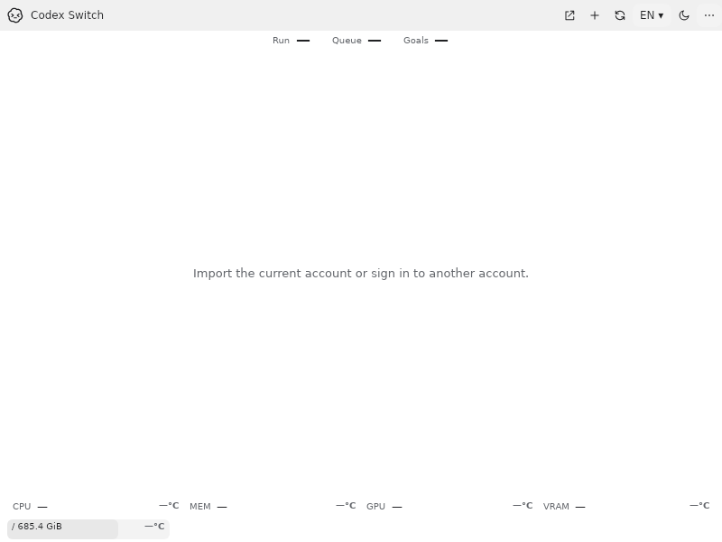
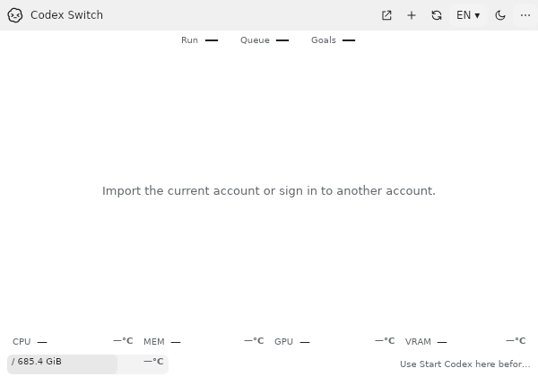
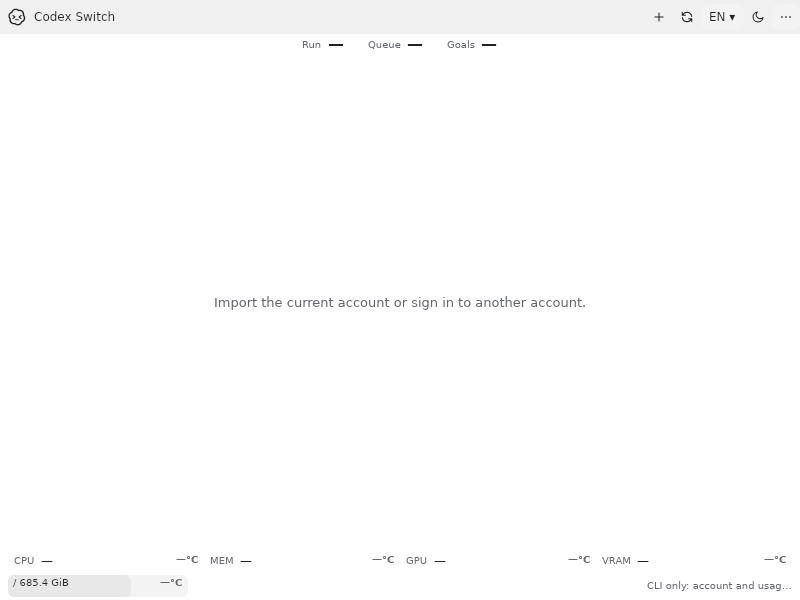

# Linux account and managed desktop integration

Issue [74](https://github.com/Gaebabi/codex-switch/issues/74) / [PR75](https://github.com/Gaebabi/codex-switch/pull/75), within5/6/7. Actual installed source **1.40.0**, code `d0893e5a593db31d37052bf8d9a6999656b776b8`, runtime **.NET10.0.13**, native x64 Debian13/Xfce userspace on Docker Desktop's Linux kernel. The pinned upstream package is26.1007.71326 / embedded CLI0.162.0-alpha.17.2.

Ordinary account/usage UI, explicit checksum CLI-only selection and managed desktop lifecycle now connect to the existing encrypted switch/recovery/eligible-Continue coordinator. Switching stays manual. Existing file credential/context policy is required; an external unmanaged client is never adopted or stopped. Real authenticated two-account handoff remains pending.

## Actual application before and after

| Before: source1.39.1 account UI gated | After: source1.40.0 account UI ready |
| --- | --- |
|  |  |

Both are actual native own-window captures from ordinary installed programs, with empty account homes. The after image has enabled account controls, a manual Start Codex action and the configured-volume/capability status. The native test actually clicks Start Codex, verifies its approved original desktop child and performs normal application Quit. No `--verify-ui`, fake account injection or fixture result API is used for these windows.

| Minimum500×360 | Medium600×420 |
| --- | --- |
|  |  |

| Actual theme button: light800×600 | Fresh ordinary reopen600×420 |
| --- | --- |
|  |  |

| New CLI-only confirmation800×600 | Actual approved client offline splash1280×820 |
| --- | --- |
|  |  |

CLI-only startup exposes account/usage actions and omits the desktop-start action; it cannot claim desktop chat resumption. The upstream splash proves actual client startup only, without authenticated chat or inference. Account/Continue acceptance is not inferred from an empty window or splash.

## Verification and privacy

The final local run passes **42 orchestration checks /36 overlapping native assertions**, including the **eight production integration contracts**. These counts overlap and must not be added. [Exact session, native phases, image dimensions/hashes and isolation](session.json), [complete three-format candidate provenance/checksums](candidate.json), [baseline receipt](before/evidence.json).

- Production account/backend/coordinator uses fictional local credentials to verify application, previous-login backup, cancellation, encrypted checkpoint reload/recovery and completion without desktop or inference in CLI-only mode.
- Actual upstream trusted-project workspace policy refuses an incompatible selected account before credential mutation. Thread contexts are checked before naming, again before application and before eligible continuation.
- Actual approved CLI persists and verifies a renamed offline thread. The managed original desktop accepts a validated GUID-only thread-open request; production discovery, normal close, same-home relaunch and another runtime's ownership refusal pass.
- Ordinary installed UI reaches observed configured-volume and capability-status pixels before capture. Native UI input exercises Start Codex, resize, theme, refresh, trayless close/reopen and a separate explicitly checksum-selected CLI-only launch.
- Real GNOME Keyring roundtrip/concurrency/lock/unlock/restart preserves original key/ciphertext. Redirected and PTY self-uninstall succeed; opaque owned markers remain unchanged. Original native application Quit works with US/French mappings and preserves an independent CLI/neutral window.

Every selected exported PNG was inspected individually, is lossless and has no private metadata. The windows originate from fresh empty or explicitly fictional test homes; no personal identity, authentication, private chat, host display or pointer pixels enter them. Seven after images and one baseline are published. Earlier initialization frames and raw diagnostics stay private.

The runtime container has no host mounts, Docker socket, network or published ports; it uses UID1000, all capabilities dropped,2CPUs/2GiB and a PID limit. Its outer seccomp profile allows Chromium user namespaces; the actual client sandbox remains enabled. No forced termination, stale endpoint removal, plaintext fallback, credential backend rewrite or original-key replacement is introduced.

Run the [source-bound desktop recipe](../../development/LINUX_DESKTOP_SESSION.md) with complete verified candidates. Final exact-head Windows/Mac/repository and both native Linux CI jobs, author self-review and expected-SHA promotion are tracked in PR75. Complete x64/ARM64 tar.gz/deb/rpm CI candidates remain unsigned previews. Real two-account active identity, original chat settings and one eligible Continue, full GNOME/KDE/XWayland/Wayland/accessibility/booted-VM coverage and supported Release promotion remain open in5/6/7.
