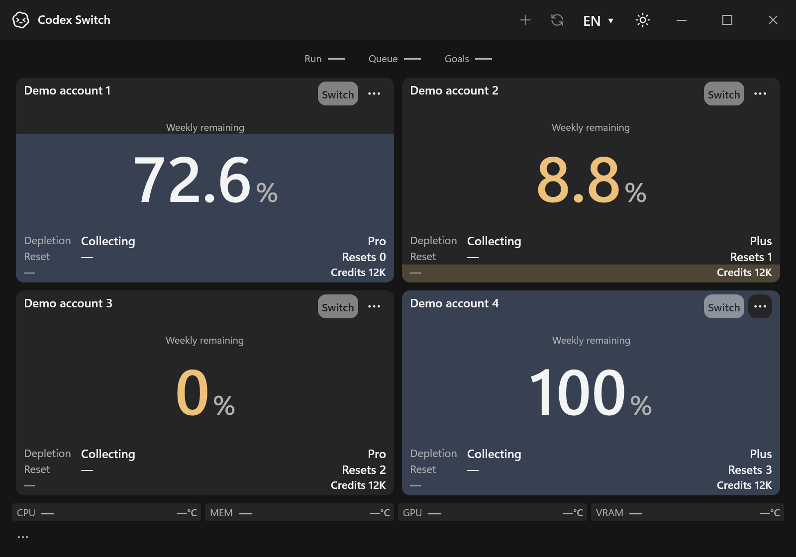
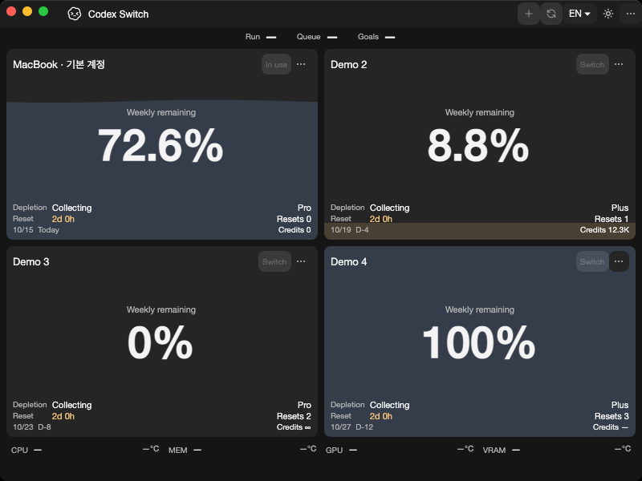
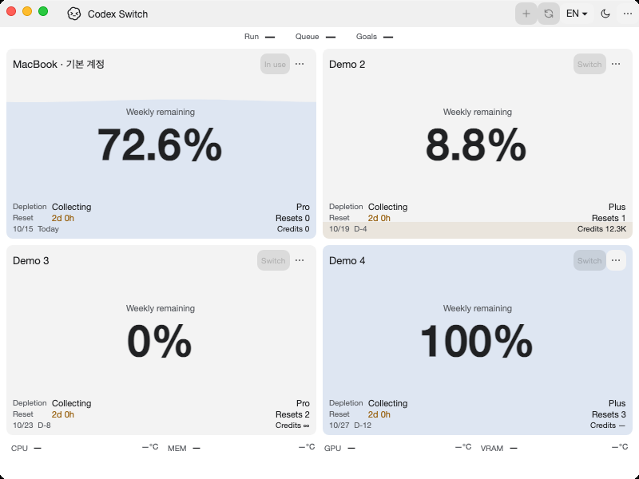

# Linux context-aware account policy and native program comparison

Tracks [issue54](https://github.com/Gaebabi/codex-switch/issues/54), [PR57](https://github.com/Gaebabi/codex-switch/pull/57) and parent5. Source1.35.0 connects verified native client/context policy to ordinary AccountService APIs. Normal Linux account GUI, desktop lifecycle/peer/IPC/handoff and authenticated acceptance remain separate gates. This does not complete KWallet55, full manual switching/continuation6 or clean packages7.

## Actual program before and after

| Linux x64 before: source1.34.0 | Linux x64 after: source1.35.0 |
| --- | --- |
|  |  |

| Linux ARM64 before | Linux ARM64 after |
| --- | --- |
|  |  |

| Windows before | Windows after |
| --- | --- |
|  |  |

| Mac Apple Silicon before | Mac Apple Silicon after |
| --- | --- |
|  |  |

| Mac Intel before | Mac Intel after |
| --- | --- |
|  |  |

Before images bind sourceb01be7c/app1.34.0. All ten selected after images bind exact source `ce2c2583ea4771f738a88cdb3cb9ab4c2c5c76e9`/app1.35.0: [Linux x64](linux-x64/evidence.json), [Linux ARM64](linux-arm64/evidence.json), [Windows](windows/evidence.json), [Mac ARM64](mac-arm64/evidence.json), [Mac Intel](mac-intel/evidence.json). Each includes a minimum-size confirmation. All ten lossless PNGs are visually inspected, metadata stripped and dimensions/SHA256 verified. They contain only authored synthetic profiles/aliases, with no personal identity/home/account/chat/pointer/desktop. Same-host Windows200% dark is byte-identical.

Native Ubuntu24.04 x64/ARM64 runs the actual published preview on private X11/Xvfb/software rendering and captures only its owned visible XID. Each architecture passes12 EN/KO/dark/light/500×360/600×420/800×600 captures with geometry/text/scroll assertions. Native Mac15 arm64/Intel uses software evidence rendering and its own window; Windows captures its own HWND. These prove source UI bootstrap/regression, not the new nonvisual account-policy behavior. The independent native API tests below prove that behavior. They do not certify authenticated accounts, full GNOME/KDE/Wayland, running desktop peers or handoff.

## Ordinary native account API evidence

Sourcece2c258 passes all four [Verify jobs38680686014](https://github.com/Gaebabi/codex-switch/actions/runs/38680686014) and both [Linux native jobs38680685946](https://github.com/Gaebabi/codex-switch/actions/runs/38680685946). Each actual Linux architecture passes28 provider/account assertions across13 lifecycle phases: the previous18 genuine GNOME Keyring/private-file contracts plus10 new ordinary account-policy checks. The normal checksum-pinned official client is installed only on a disposable native runner. Account tests run inside the owned private file-socket D-Bus/GNOME session with isolated XDG paths; no personal keyring/home is used.

Actual AccountService APIs verify non-file initialization refusal; blocked current import/read/login/refresh/apply before input parsing, runtime creation, browser or encrypted-cache changes; synchronous bypass refusal; genuine CADL1 empty initialization; synthetic local identity import with original bytes preserved; workspace/API refusal before stale-runtime cleanup or vault mutation; policy reread on a reused real session; trusted project policy overriding a file-compatible home; actual isolated child policy; and continued desktop-metadata refusal before unverified Linux lifecycle/peer access. Synthetic JWT-shaped input and localhost-only setup are not authenticated login, rate-limit, switch or continuation proof. No desired user action/result is supplied through a fixture API: ordinary files and production APIs drive the observed decisions.

The separate native client suite passes120 assertions per architecture, including15 native binary/report-protection checks and actual trusted/untrusted project scope in addition to user/system/managed backend/login/workspace/provenance cases. Original config/auth/system/project input bytes remain unchanged. Approved descriptors stay open through child creation; Linux query children do not force storage/provider settings and validate their actual isolated policy. Canonical/runtime auth reads use private no-follow files. Current policy is checked again before refresh credential writeback. No plaintext fallback, migration, silent chmod repair or caller-supplied raw executable fallback is introduced. [Implementation and remaining context limits](../../development/LINUX.md#trusted-client-inspection--source1340).

Existing Linux SQLite/WAL26/protocol10/source-app12 and Windows93/SQLite23/handoff5/protocol9 remain green. Native Mac SQLite23/protocol9/UI21/key16 and existing language/temperature/client/hardware/composition/package regressions pass. All9 catalogues now contain371 messages, including typed account-policy failures. Local Windows93, language42, compilation and scoped repository/link/privacy checks pass. Public binaries remain1.27.6; no installed user utility/live Codex, real login/inference/personal credentials, history rewrite (#29), new Release or signing is involved. PR57 owns final complete-head six-job CI, author self-review and expected-SHA promotion before this checkpoint is complete.
