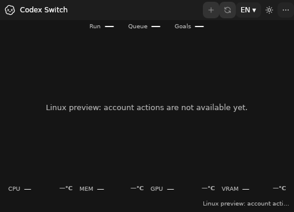
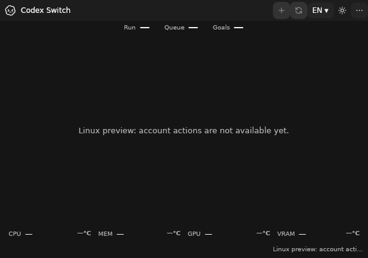
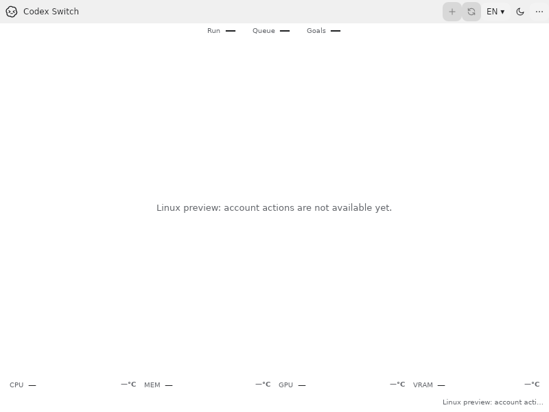
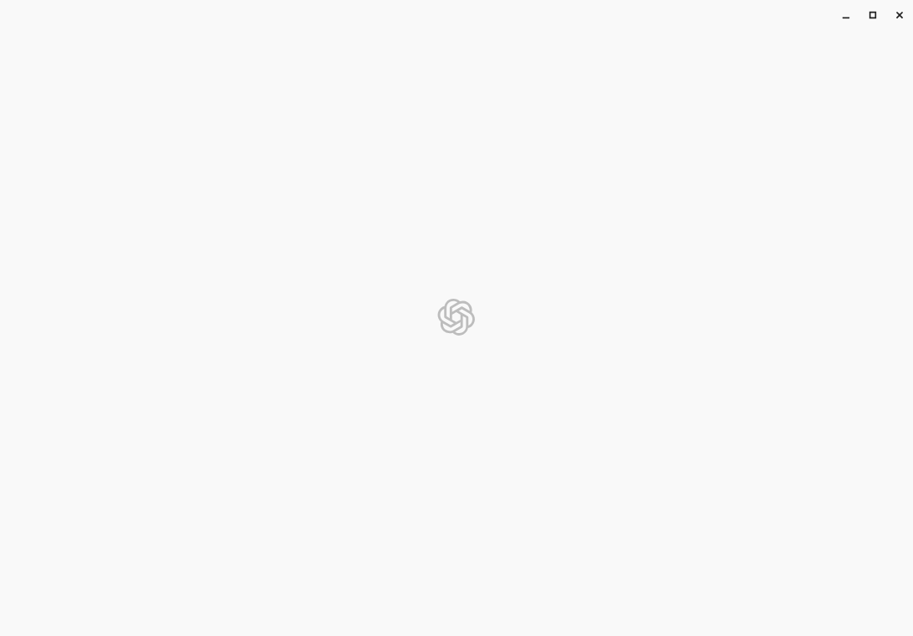

# Local Linux desktop-session evidence

Issues [68](https://github.com/Gaebabi/codex-switch/issues/68)/[70](https://github.com/Gaebabi/codex-switch/issues/70)/[71](https://github.com/Gaebabi/codex-switch/issues/71)/[72](https://github.com/Gaebabi/codex-switch/issues/72), [PR69](https://github.com/Gaebabi/codex-switch/pull/69). This is actual local x64 Docker Desktop verification with Debian13, xfce4-session, xfwm4, panel, private D-Bus and GNOME Keyring. The per-user installed program is launched through the native GIO desktop entry, without `--verify-ui`, fake accounts or injected results. Candidate/test source `dc320a86053629cd316a30105e16db5054af06d3` / `dc320a86053629cd316a30105e16db5054af06d3`, app1.39.1/runtime10.0.13. Final complete-head CI/review/promotion is tracked by PR69.

| Actual ordinary app before1.39.0 | Actual ordinary app after1.39.1 |
| --- | --- |
|  |  |

The self-uninstall failure is nonvisual: the earlier installed process removed its runtime and aborted while lazily initializing Console's missing Microsoft.Win32.Primitives dependency. Further verification also identified JsonSerializer's post-removal System.IO.Pipelines dependency. Source1.39.1 prepares core file-descriptor output/error streams and the actual buffered Utf8JsonWriter response before mutation, completes the real retained-item count after removal and publishes success only then. It preserves the removal/security algorithm and returns valid JSON after complete self-removal through both redirected output and a real PTY. These windows establish real application execution, not removal success; [native receipts](session.json) establish result/exit/file/key preservation. Same-environment dark before/after PNG bytes identical: **true**. [Sanitized earlier failure and image identity](before/evidence.json) do not count the incomplete earlier session as passing.

| Ordinary installed500×360 | Ordinary installed600×420 |
| --- | --- |
|  |  |

| Ordinary theme-button interaction | Ordinary close/reopen |
| --- | --- |
|  |  |

The first startup's chrome-only frame was inspected and withheld from the gallery because it had no meaningful client content yet. Its raw capture identity remains in the native receipt; no functioning-client UI claim is made from that frame.

The original upstream client's offline startup/splash is not a signed-in chat or continuation proof. Its native IPC handshake, original-peer identity, actual normal application Quit/captured-child exit and preserved independent genuine CLI are exercised twice in the same home, with independently verified US and French key mappings. Window-close keeps the tray process alive; the corrected adapter invokes the pinned application's default Quit accelerator through bounded, original-window-targeted XCB events after native activation/focus acknowledgement. It does not use XTEST/global keyboard state, clipboard, process signals, force kill or quit-confirmation overrides. A separate neutral native window remains alive. Relaunch waits for an actual listening Unix stream socket inode also present in the original process's FDs before the existing private socket/pidfd authentication; merely retaining ipc.sock is insufficient, and no stale endpoint is deleted or repaired by the switcher. Existing production GNOME contracts exercise encrypted roundtrip/concurrency/lock/unlock/restart and original-key/CADL1 ciphertext preservation before and after the ordinary UI/client/install lifecycle. The run passes **35 orchestration checks** and **28 nested native assertions**; these overlap and are not added together. No global .NET host/SDK/runtime is installed.

All seven selected PNGs are lossless own-XID app windows, stripped of metadata and checked against source/runtime/dimensions/SHA256. They were individually visually inspected before publication; the blank initial upstream frame was excluded. No personal account/home/chat/key/pointer/desktop pixels are captured; fixture homes, raw logs and keyring data remain private. [Candidate source/runtime/package hashes](candidate.json) and the [session recipe/isolation contract](../../development/LINUX_DESKTOP_SESSION.md) provide reproduction details.

Runtime uses UID1000, no host mounts/ports/networking, all capabilities dropped, private IPC and bounded2CPU/2GiB/512PIDs. The original Chromium sandbox remains enabled; only the outer disposable-container seccomp profile permits its user-namespace calls. This is real desktop userspace over Docker's Linux VM kernel and X11/Xvfb, **not** a booted desktop VM, login manager/PAM, native GPU, GNOME/KDE/Wayland, ARM64 or actual account Switch/one-Continue acceptance. Ordinary Linux account/handoff integration and parent5/6/7 remain open. Existing Windows apps/accounts and stable Release are untouched.
