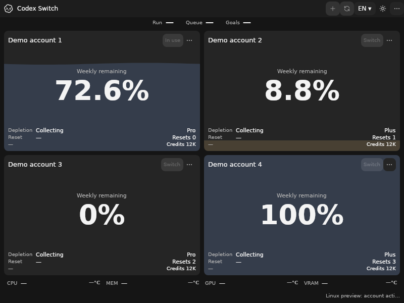
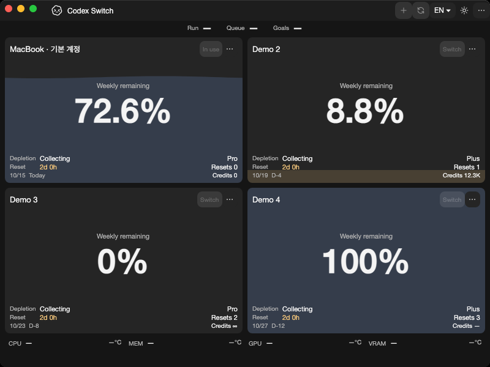
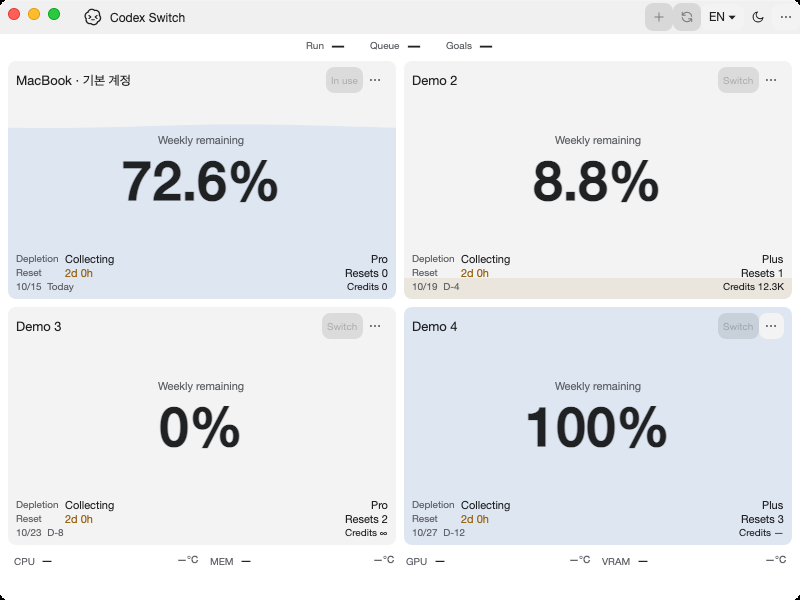
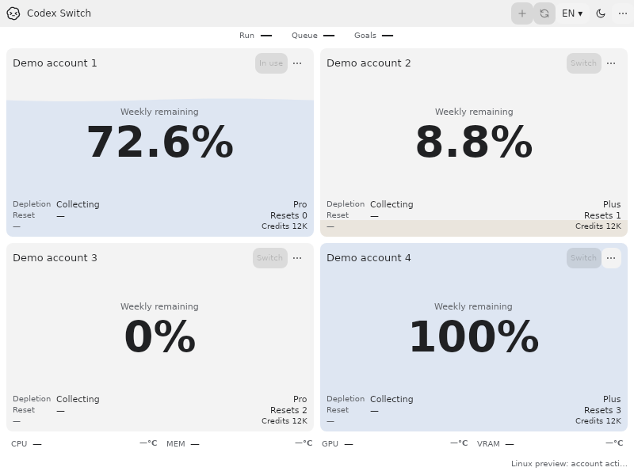

# Native Linux lifecycle and installation preview evidence

For [issue66](https://github.com/Gaebabi/codex-switch/issues/66), [PR67](https://github.com/Gaebabi/codex-switch/pull/67) and parent5/6/7. Source **1.39.0**, exact code `fc548875557efb3af98430ef42684545d7c46580`, passes all four [Verify jobs](https://github.com/Gaebabi/codex-switch/actions/runs/38710642548) and both actual-architecture [Linux native jobs](https://github.com/Gaebabi/codex-switch/actions/runs/38710642681). [Machine-readable source/runtime/image/native package/CI artifact hashes and receipts](native-results.json). Final complete-head CI, author self-review and expected-SHA promotion are recorded in PR67; self-review is not independent approval.

## Complete unsigned candidates

The native workflow's **linux-preview-candidates-linux-x64** and **linux-preview-candidates-linux-arm64** [artifacts](https://github.com/Gaebabi/codex-switch/actions/runs/38710642681#artifacts) each contain a complete tar.gz, deb and rpm plus SHA256SUMS, runtime/dependency/license/SBOM/provenance records. [Use/build/security/remaining acceptance](../../development/LINUX_PACKAGES.md). The per-user installer needs no Python or .NET installation. These are unsigned install/UI previews: **ordinary account/handoff actions remain gated**. They are not a supported Linux account-switching Release. The1.38.99 same-source compiled upgrade fixture is not published in candidate assets.

Each actual architecture passes18 real official-client socket/process/startup/normal-close checks, all six declared KDE6 providers' existing34/18 phases, GNOME29/KWallet5 31 and existing client/context120/SQLite26/source UI plus Windows/Mac regressions. The intended original native client exits normally after an own-window WM_DELETE request and captured children exit without force, while a separately running real Codex CLI remains alive. No account/inference/chat action is exercised.

## Actual installed program on fresh package targets

All six target cases install/remove their real native package on a digest-pinned fresh minimal image with **no globally installed .NET host/runtime/SDK**. Each passes9 system-package contracts, preserves owned pre-existing account/vault marker bytes/modes and renders12 actual installed-source own-window PNGs. These are native X11/Xvfb/software-rendering program windows, **not complete GNOME/KDE desktop sessions or VMs**. All profile/resource inputs are fictional; the source preview's disabled account/handoff state is visible.

| Fresh target | Native x64 confirmation | Native ARM64 confirmation |
| --- | --- | --- |
| Ubuntu24.04 / deb |  [Minimum light](ubuntu24-x64/en-light-500x360-native.png) · [Native9](ubuntu24-x64/system.json) · [Image hashes](ubuntu24-x64/evidence.json) |  [Minimum light](ubuntu24-arm64/en-light-500x360-native.png) · [Native9](ubuntu24-arm64/system.json) · [Image hashes](ubuntu24-arm64/evidence.json) |
| Debian13 / deb |  [Minimum light](debian13-x64/en-light-500x360-native.png) · [Native9](debian13-x64/system.json) · [Image hashes](debian13-x64/evidence.json) |  [Minimum light](debian13-arm64/en-light-500x360-native.png) · [Native9](debian13-arm64/system.json) · [Image hashes](debian13-arm64/evidence.json) |
| Fedora44 / rpm |  [Minimum light](fedora44-x64/en-light-500x360-native.png) · [Native9](fedora44-x64/system.json) · [Image hashes](fedora44-x64/evidence.json) |  [Minimum light](fedora44-arm64/en-light-500x360-native.png) · [Native9](fedora44-arm64/system.json) · [Image hashes](fedora44-arm64/evidence.json) |

Native package/version/kernel/image fields are retained in the receipts. Debian-family query rows without a version are uninstalled alternative package names, not installed dependencies. Package bootstrap does not establish actual account compatibility on that distribution.

## Per-user update and preservation

Each architecture passes544 checks:518 exact extracted-file SHA256/mode checks across two real compiled versions and26 lifecycle/operational checks. Ordinary native entry points install/update/reinstall/remove the actual package, retain the previous version, reject writable ancestors/program-root symlinks/overlapping credential home/relative XDG configuration/unmanaged menu/concurrent lock, parse and execute the installed program through the real desktop launcher in a Unicode/special-character path, refuse removing a live installed utility, and preserve modified/unmanaged files and existing private marker data. Metadata inspection is separate from the actual installed GUI evidence below.

| Native x64 updated installation | Native ARM64 updated installation |
| --- | --- |
|  [Minimum light](per-user-x64/en-light-500x360-native.png) · [Lifecycle544](per-user-x64/lifecycle.json) |  [Minimum light](per-user-arm64/en-light-500x360-native.png) · [Lifecycle544](per-user-arm64/lifecycle.json) |

Native GUI testing reproduced a real bundled/system HarfBuzz object-layout collision (`hb_font_create` in the bundled engine reached an incompatible system function and aborted). The Linux host now binds its own engine in a private ELF scope before framework initialization. The same real installed GUI checks pass on all six fresh targets; no quality threshold, account guard or renderer acceptance is relaxed, and no system library/loader environment is replaced.

## Existing targets: before and after

The source1.38 Linux preview provides the earlier application baseline; the new installed Ubuntu images above provide the after state. Windows uses its verified native CI100% baseline from that source rather than comparing incompatible display scales. Before/after dark bytes are identical. Native Mac captures remain macOS15 program windows with fictional profiles.

| Target | Before | After | Additional confirmation |
| --- | --- | --- | --- |
| Windows x64 |  |  | [Minimum light](windows/en-light-500x360.png) · [Hashes](windows/evidence.json) |
| Mac Apple Silicon |  |  | [Minimum light](mac-arm64/en-light-500x360-native.png) · [Hashes](mac-arm64/evidence.json) |
| Mac Intel |  |  | [Minimum dark](mac-intel/en-dark-500x360-native.png) · [Hashes](mac-intel/evidence.json) |
| Linux x64 |  |  | [Minimum](ubuntu24-x64/en-light-500x360-native.png) |
| Linux ARM64 |  |  | [Minimum](ubuntu24-arm64/en-light-500x360-native.png) |

## Original official-client confirmation and privacy

| Native x64 original client | Native ARM64 original client |
| --- | --- |
|  · [Controlled lifecycle18](official-x64/peer-summary.json) |  · [Controlled lifecycle18](official-arm64/peer-summary.json) |

Official-client images show the owned, original-PID **offline startup/splash**, before normal close. They do not show a signed-in account or resumed chat. Nonvisual kernel/lifecycle/package behavior is established by separate native receipts.

All25 selected PNGs were individually inspected. Only native HWND/NSWindow/XID-owned windows are captured; no personal desktop, identity, home/chat/key material, private source pixels or pointer enters the image. Metadata is stripped and dimensions/SHA256 checked against exact-source receipts and CI artifact digests. No blur is required because fictional profiles/empty authentication are used from capture time. Raw logs/debugger output and fixture homes remain private; upstream official client binaries are not redistributed.

Parent5/6/7 remain open. Ordinary Linux account/lifecycle/metadata integration, real target identity, preserved chat settings/IDs, one eligible Continue/recovery/cancellation, broader displays/desktops/accessibility, clean VMs and trusted Release/signing are separate gates. Personal installed utilities/credentials/live Codex and published1.27.6 downloads are unchanged.
