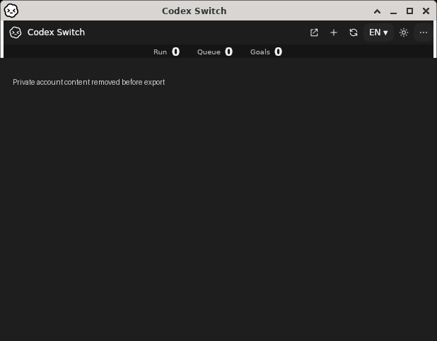
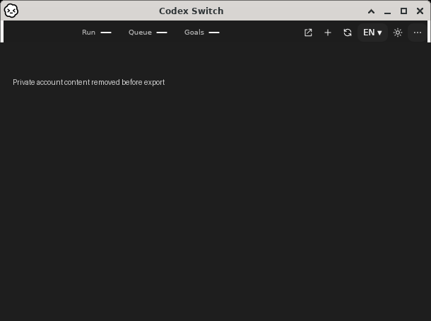
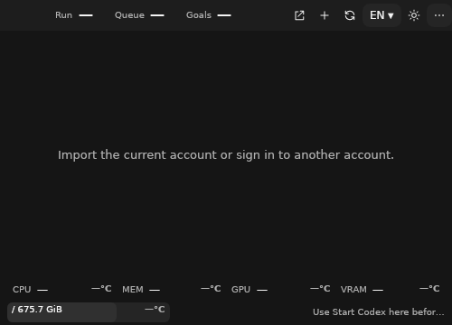
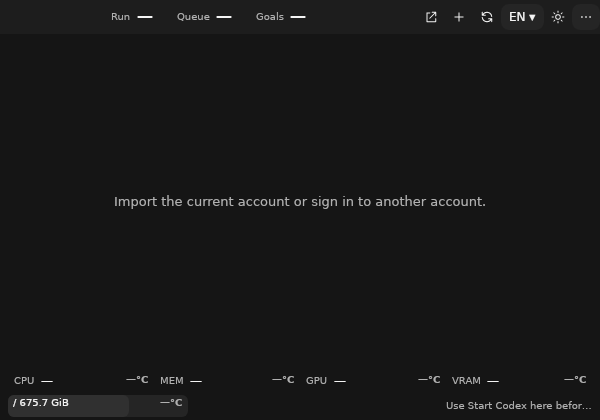
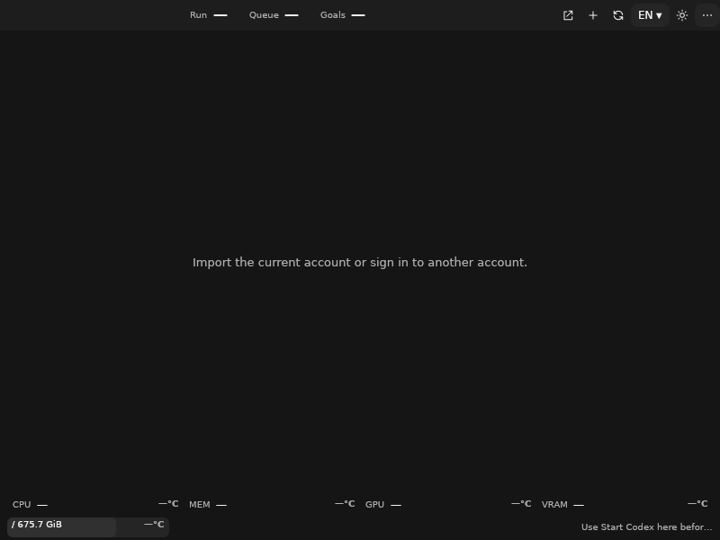
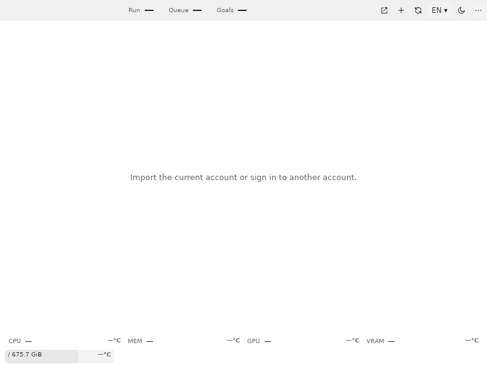
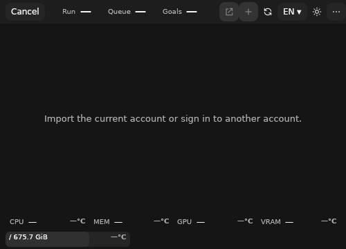
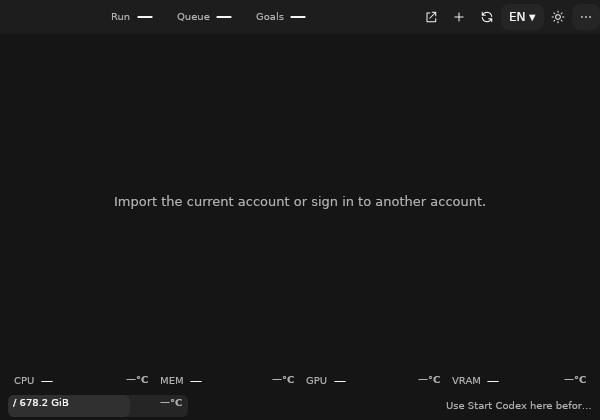

# Owner-operated Linux desktop acceptance

[Issue76](https://github.com/Gaebabi/codex-switch/issues/76), within #5/#6/#7; [PR77](https://github.com/Gaebabi/codex-switch/pull/77). Baseline source1.40.0/code d0893e5a and final source1.40.1/code960d3d9, original approved upstream26.1007.71326, actual native x64 Debian13/Xfce/X11 userspace on the owner's Docker Desktop. [Interactive recipe and isolation](../../development/LINUX_INTERACTIVE_DESKTOP.md).

| Before: source1.40.0 | After: source1.40.1 |
| --- | --- |
|  |  |

The final after candidate960d3d9 retains one native WM caption/buttons and combines session counters with the toolbar, reserving a separate column for pending-login cancellation. It was opened normally with the same encrypted home/keyring/account, followed by repeated native single-account checks. Earlier candidate3a1f8132 also exercised actual Start Codex input: the approved desktop remained the original child/PID/start for202seconds with zero new OOM kills, then normally Quit. The [receipt](one-account.json) distinguishes those source revisions. This establishes controlled authenticated startup and data preservation, not cross-account handoff or a Continue result.

The owner directly created a password-protected native default keyring and authenticated one account in Linux Firefox. No Windows credentials, host browser profile or host home was mounted or copied. A bounded private read-only probe through the production vault/client/protocol/usage assemblies passed [eight semantic checks](one-account.json): existing CADL1 encryption, one registered identity, matching active credentials, actual upstream file policy, native `account/read`, authenticated `account/rateLimits/read` parsed by the production usage model, original-key reopening and unchanged active identity. The receipt exports no identity or upstream payload; it is local acceptance evidence, not an authenticated public-CI test.

Only **one** account is available. Cross-account switching, original chat settings and one eligible automatic Continue remain **unverified** and do not close #6. The owner reported a disabled Add button during an unfinished second login; ordinary Cancel restored Add while preserving the original account. This is the login concurrency gate, not evidence of a second registered account.

The initial3GiB container limit produced six kernel OOM kills of original client children. Stopping only an empty owned secondary smoke desktop and raising this desktop's limit to4GiB stopped additional OOM kills; no client flag, sandbox, credential policy or data format was relaxed. This is a verification environment capacity correction, not an application crash fix. Production app initialization succeeded after the owner provisioned the previously absent native default collection and normally reopened the utility. No root cause for an application retry defect is claimed.

The screenshots include only the original application and its own native WM frame. All account/chat rows, status text and device/path pixels were replaced with solid pixels before export. Metadata is absent. Raw frames stay private. The native WM retains its minimize/maximize/close/resize behavior; the application does not remove window-manager decorations or replace system controls.

## Offline installed-app and native setup confirmation

Code960d3d9/candidate1.40.1 and test d4c46ad7 pass [45 offline orchestration checks with36 overlapping native assertions](session.json), including the ordinary **+ → pending login → Cancel** flow at500×360, restored ready controls, three sizes, real light-theme input, normal close/reopen, actual approved client launch/normal Quit, original-key/ciphertext preservation, US/French layouts and eight production handoff/recovery contracts with fictional local credentials. No real account or inference is used in this session. A subsequent final-head CI assertion additionally requires byte-identical encrypted vault contents across login cancellation; that specific strengthened assertion remains pending final CI here.

|500×360|600×420|800×600|
|---|---|---|
||||

The [interactive runner's separate six native setup checks](interactive-setup.json) at test9c8ea071/base candidate3a1f8132 verify an actual system gcr-prompter, generated disposable test-password input through the ordinary keyboard, same-connection GLib prompt completion, default collection, CADL1 empty vault and ordinary app startup. Owner authentication is not entered or captured in this case. [Image hashes and dimensions](gallery.json) / [complete local x64 three-format candidate provenance](candidate.json).

Docker/Xvfb userspace is not a booted desktop VM, PAM/login-manager, full GNOME/KDE, native GPU, XWayland/pure Wayland, ARM64 or accessibility/scaling acceptance. Complete unsigned package previews and native CI remain separate from supported binary Release promotion.
