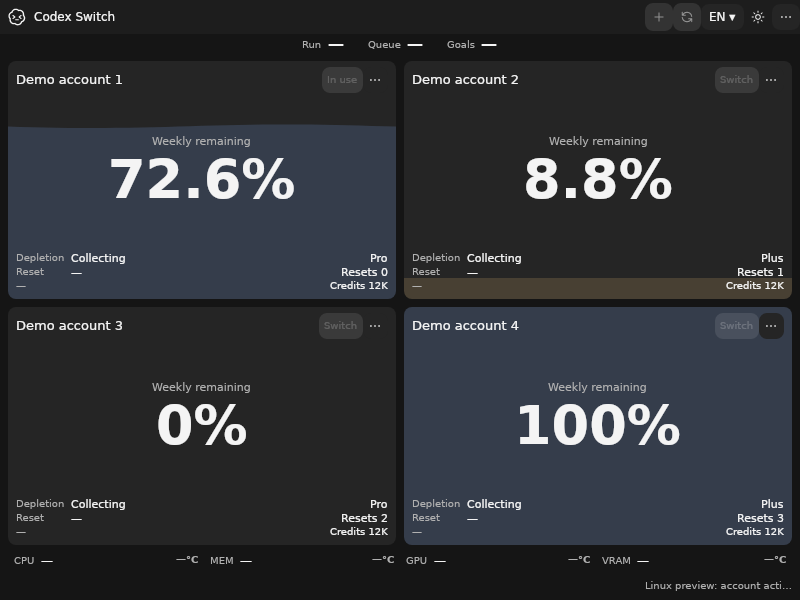
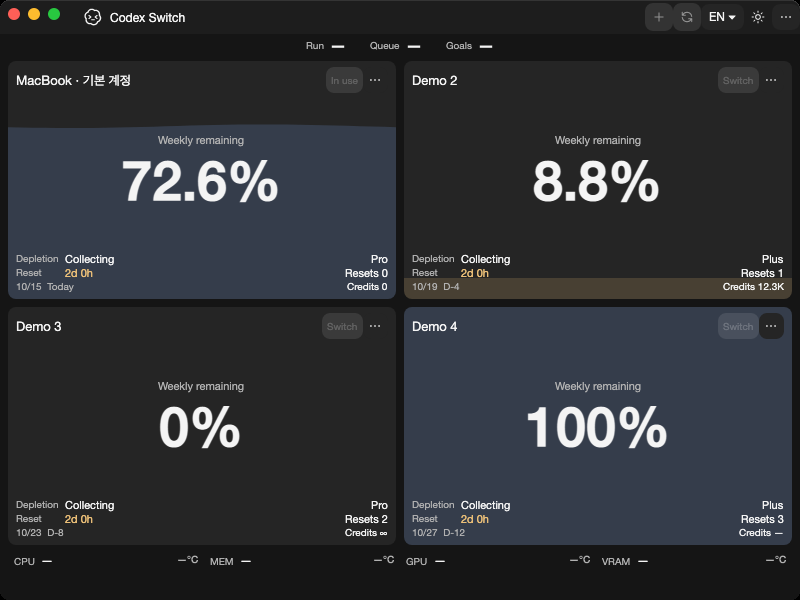
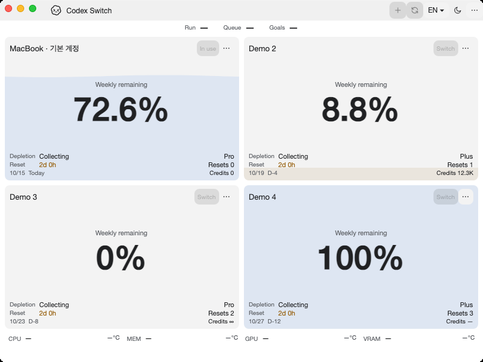

# KWallet6 and KSecrets native verification

For [issue #60](https://github.com/Gaebabi/codex-switch/issues/60), [PR #61](https://github.com/Gaebabi/codex-switch/pull/61) and parent #5. Source **1.37.0** supports the declared Debian KWallet6 6.13.0-1 and KSecrets 6.26.0-1/6.30.0-1 native builds on **x64 and ARM64**. This is an audited package catalog, not a claim that every distribution build is compatible. [Contract and rebuild guide](../../development/KDE_SECRET_SERVICE.md).

All captures and provider results below bind exact source `b46b382ed07d9eeef219edd8dd8b892faac23324`, .NET 10.0.13. All four [Verify jobs](https://github.com/Gaebabi/codex-switch/actions/runs/38693933551) and both [Linux native jobs](https://github.com/Gaebabi/codex-switch/actions/runs/38693933602) passed. [Machine-readable provider, source/patch/library hashes, package versions, architecture and image receipts](provider-results.json). PR #61 records final-head CI, author self-review and expected-SHA promotion; self-review is not independent approval.

## Actual app confirmations on the new KDE targets

These are the real published source application, captured from its own XID in each declared Debian image on actual native hardware. Provider tests run separately on a private bus; the capture uses another non-activating private D-Bus/HOME/XDG and owned X11/Xvfb display. The images confirm app startup/UI; native receipts establish the nonvisual encryption and data-preservation behavior. They do not demonstrate a complete KDE/Wayland desktop or authenticated Codex switching/resumption.

| Declared provider | x64 actual app | ARM64 actual app |
| --- | --- | --- |
| KWallet6 6.13.0-1 |  [500×360 light confirmation](kwallet6-x64/en-light-500x360-native.png) · [Native receipt](kwallet6-x64/provider.json) · [Image hashes](kwallet6-x64/evidence.json) |  [500×360 light confirmation](kwallet6-arm64/en-light-500x360-native.png) · [Native receipt](kwallet6-arm64/provider.json) · [Image hashes](kwallet6-arm64/evidence.json) |
| KSecrets 6.26.0-1 |  [500×360 light confirmation](ksecrets-x64/en-light-500x360-native.png) · [Native receipt](ksecrets-x64/provider.json) · [Image hashes](ksecrets-x64/evidence.json) |  [500×360 light confirmation](ksecrets-arm64/en-light-500x360-native.png) · [Native receipt](ksecrets-arm64/provider.json) · [Image hashes](ksecrets-arm64/evidence.json) |
| KSecrets 6.30.0-1 |  [500×360 light confirmation](ksecrets-current-x64/en-light-500x360-native.png) · [Native receipt](ksecrets-current-x64/provider.json) · [Image hashes](ksecrets-current-x64/evidence.json) |  [500×360 light confirmation](ksecrets-current-arm64/en-light-500x360-native.png) · [Native receipt](ksecrets-current-arm64/provider.json) · [Image hashes](ksecrets-current-arm64/evidence.json) |

KWallet6 uses Qt 6.8.2/QCA 2.3.10 offscreen in a pinned Debian trixie image. KSecrets uses Qt 6.11.2/QCA 2.3.12 in a pinned Debian sid image with the explicitly pinned wallet packages. Exact architecture-specific package revisions, GLib/libgcrypt and image digests are in the receipts. Early KSecrets uses Qt offscreen. KSecrets 6.30 uses its real password dialog on a separately owned Xvfb display; the receipt requires the original provider PID and a successful in-place GUI unlock. This is an isolated provider session, not a full KDE desktop.

## Existing app targets: before and after

The before images retain source 1.36.0 from merged PR #59/main `495ec615`. All after images use source 1.37.0 at the exact revision above. Windows same-host 200% dark exports are byte-identical. Mac captures are actual native macOS 15 windows; Ubuntu captures use native X11/Xvfb/software rendering. A minimum-size opposite-theme confirmation is retained for every target.

| Target | Before | After | Minimum size and receipt |
| --- | --- | --- | --- |
| Windows x64 |  |  | [500×360](windows/en-light-500x360.png) · [Receipt](windows/evidence.json) |
| macOS15 ARM64 |  |  | [500×360](mac-arm64/en-light-500x360-native.png) · [Receipt](mac-arm64/evidence.json) |
| macOS15 Intel |  |  | [500×360](mac-intel/en-dark-500x360-native.png) · [Receipt](mac-intel/evidence.json) |
| Ubuntu24.04 x64 |  |  | [500×360](linux-x64/en-light-500x360-native.png) · [Receipt](linux-x64/evidence.json) |
| Ubuntu24.04 ARM64 |  |  | [500×360](linux-arm64/en-dark-500x360-native.png) · [Receipt](linux-arm64/evidence.json) |

All **22 selected PNGs across 11 targets** were individually inspected for actual app content and privacy. Fictional profiles only: no personal identity, account/chat, home, desktop, pointer, credential or key material. The exporter verifies exact source/runtime/version, dimensions/SHA256 and empty PNG metadata; copies retain the original lossless pixels. The complete artifacts validate 12 frames per Linux environment, 16 per Mac target and 14 Windows exports, including two separately labelled tooltip-component renders that are not selected here.

## Actual storage and security acceptance

| Provider | Native x64 | Native ARM64 | Environment |
| --- | --- | --- | --- |
| KWallet6 6.13.0-1 | 34 contracts / 18 phases | 34 / 18 | Qt offscreen; private bus/HOME/XDG |
| KSecrets 6.26.0-1 | 34 / 18 | 34 / 18 | Qt offscreen; private bus/HOME/XDG |
| KSecrets 6.30.0-1 | 34 / 18 | 34 / 18 | Owned Qt password dialog on private Xvfb; original PID retained |
| Existing GNOME Keyring | 29 / 13 | 29 / 13 | Independent Ubuntu 24.04 private session |
| Existing KWallet5 | 31 / 15 | 31 / 15 | Independent Ubuntu 24.04 private Qt session |

Every provider runs 1,024 independent encrypted binary-key sessions, preserves exact 32-byte/NUL/non-UTF8 keys and existing CADL1 ciphertext under the original key, saves/reopens the actual application vault, and checks tamper/truncation/foreign formats, private/no-follow/FIFO/ownership rules, concurrent creation, ambiguous/malformed/missing keys, locked read/save refusal, in-place unlock, orderly provider restart, bounded timeout/recovery and offline data preservation. Each provider also passes 10 ordinary AccountService policy contracts with the actual pinned official client; synthetic local import does not prove authenticated login or switching. KDE6 additionally rejects forged version evidence and the wrong original process image before key access, then reopens the unchanged data with the original provider.

The legacy and normalized encodings are selected **before the single encrypted handshake** from the original unique-owner UID/PID, root-owned no-follow native ELF, exact executable SHA256 and advertised version. KDE's upstream normalization changed in [307db626](https://invent.kde.org/frameworks/kwallet/-/commit/307db62637ac2ca78ff670d746433be9381a923b), first included in 6.25.0. Mutable version/service names alone are insufficient. The same verifier remains shared with client trust. No alternate derived-key retry, plaintext downgrade, implicit production unlock, provider replacement or credential migration is introduced. Original vault/item identities and private libsecret ABI1 remain stable; [complete LGPL source/relinking and encrypted-only behavior](../../../src/platforms/security/native/README.md).

The native C checks compile the exact patched upstream session source: deterministic RFC5869 legacy and normalized leading-zero vectors, unchanged GNOME derivation, and 1,024 public-key encodings with actual high-bit cases. Both sync/async plaintext fallbacks remain removed and enforced FIPS refuses the inherited DH group. Existing native client/context, SQLite/protocol, full runtime/license, language/hardware/composition and Windows/Mac checks remain green.

KSecrets 6.30 removed the old PAM D-Bus control. Test-only startup now uses its real PAM pipe/socket API and real password-dialog input, with synthetic passwords only on stdin and hashes only on inherited pipes. Test salts, buses, files, daemons and Xvfb belong to disposable fixtures; failures cannot bypass owned cleanup. The first app-container capture hang was reproduced without a session D-Bus and corrected by providing a proper private desktop session, with no app/deadline relaxation.

Full KDE/Wayland/XWayland coverage, authenticated Linux Codex GUI/peer/handoff (#6), clean-machine packages (#7), a new binary Release/signing and history audit (#29) remain separate. Published binaries remain 1.27.6. No personal app/account/keyring/live Codex or system provider configuration is changed.
