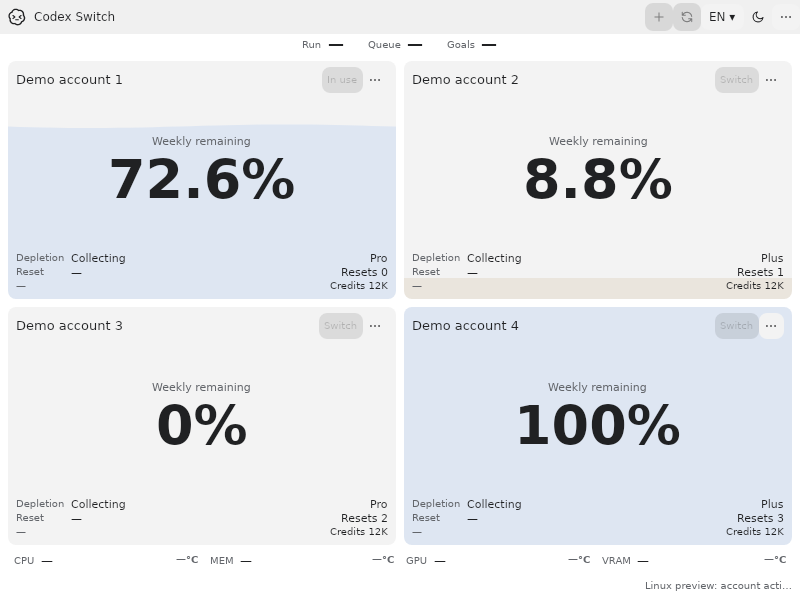
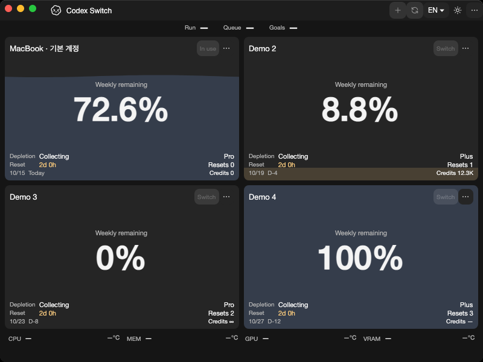
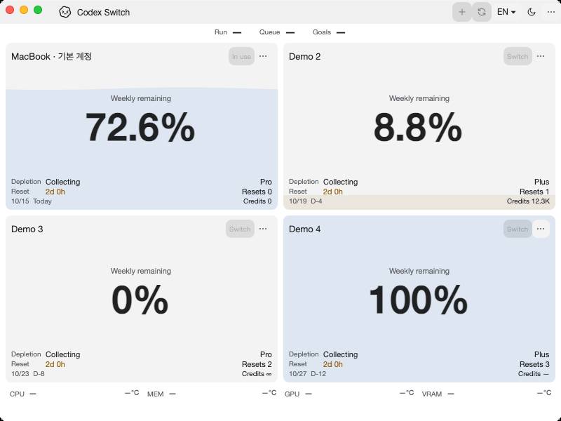

# KWallet5 encrypted storage and actual program confirmation

Tracks [issue55](https://github.com/Gaebabi/codex-switch/issues/55), [PR59](https://github.com/Gaebabi/codex-switch/pull/59) and parent5. Source1.36.0 restores **positive KWallet5 encrypted storage** on the declared native Ubuntu24.04 x64/ARM64 environment. It replaces the prior source1.35.1 refusal-only checkpoint. KWallet6/KSecrets, full KDE/Wayland desktop, authenticated Codex GUI/peer/handoff6 and clean packages7 remain separate gates.

## Actual program before and after

| Linux x64 before: source1.35.1 | Linux x64 after: source1.36.0 |
| --- | --- |
|  |  |

| Linux ARM64 before | Linux ARM64 after |
| --- | --- |
|  |  |

| Windows before | Windows after |
| --- | --- |
|  |  |

| Mac Apple Silicon before | Mac Apple Silicon after |
| --- | --- |
|  |  |

| Mac Intel before | Mac Intel after |
| --- | --- |
|  |  |

Before images retain0199c43/996b4f9/app1.35.1. All ten lossless after PNGs bind exact source `b2f5b25499ca7f92f99f7342700c4a65066fef0f`/app1.36.0, including a minimum-size confirmation on each target: [Windows](windows/evidence.json), [Mac ARM64](mac-arm64/evidence.json), [Mac Intel](mac-intel/evidence.json), [Linux x64](linux-x64/evidence.json), [Linux ARM64](linux-arm64/evidence.json). Each has been visually inspected and checked for dimensions/SHA256/stripped metadata. Fictional profiles contain no personal identity/home/account/chat/pointer/desktop. Windows same-host200% dark is byte-identical.

Native Ubuntu24.04 x64/ARM64 publishes the actual self-contained app and captures only its owned X11/Xvfb window with software rendering; each verifies12 EN/KO/theme/size/text/scroll frames. Native macOS15 arm64/Intel captures its own window with software evidence rendering; Windows captures its own HWND. These are application bootstrap/UI regression images. The nonvisual encryption/data-preservation behavior is established separately by the actual native provider tests below. Neither image nor private Qt offscreen provider acceptance proves a complete KDE/Wayland desktop or authenticated Codex switching/resumption.

## Root cause and repaired transport

Three representation differences cause the legacy KWallet5/libsecret failures: the minimum128-byte public-key size, QCA's signed BigInteger interpretation of high-bit keys, and minimal-versus-padded shared-secret input to HKDF. Fixing width/shared-secret alone still failed the1024-session regression and was not accepted. The corrected KWallet5 public value has128 group bytes plus a zero positive-sign prefix, retaining the same unsigned integer. Only the UID/unique-owner-verified KWallet5 provider uses QCA's minimal shared-secret representation; GNOME keeps its original padded derivation. No failed-handshake retry or padding-error recovery is used.

The app-private LGPL libsecret0.21.8.2 build pins the official source SHA256, applies the complete published patch and retains upstream libgcrypt primitives. Both sync/async plaintext fallbacks are removed. The loader uses an absolute local library path and ABI1 without substituting system libsecret; the runtime package requires native architecture and the LGPL license. System libraries/providers, CADL1 AES-GCM format, native key identity/attributes and stored bytes are preserved. Enforced FIPS refuses this inherited DH protocol. [Full source patch/license/rebuild/relink/security scope](../../../src/platforms/security/native/README.md).

## Actual native acceptance

Codeb2f5b25 passes all four [Verify38689110229](https://github.com/Gaebabi/codex-switch/actions/runs/38689110229) and both [Linux native38689110385](https://github.com/Gaebabi/codex-switch/actions/runs/38689110385) jobs. Each actual architecture passes **KWallet31 assertions/15 phases** and **GNOME29 assertions/13 phases**. Actual providers are KWallet5.115.0-0ubuntu3 and GNOME46.1-2ubuntu0.2, inside separate owned private file-socket D-Bus/HOME/XDG fixtures. [Sanitized provider and native-library source/patch/binary receipts](provider-results.json) export only versions/architecture/counts/hashes, never raw provider state or keys.

Both providers exercise1024 independent encrypted binary-key sessions with exact opaque32-byte/NUL/non-UTF8 comparisons; an independently constructed valid legacy CADL1 envelope reopens under its original existing native key, retaining ciphertext/key bytes and exactly one matching item; real application vault save/reopen/private modes; authenticated tamper/truncation/foreign-envelope refusal; no-follow/FIFO/insecure/foreign-owned files; concurrency; ambiguous/malformed keys; locked read/save refusal; actual in-place provider unlock/original PID; orderly process restart persistence; bounded timeout/recovery; missing-key no-replacement; and offline ciphertext preservation. KDE's test-only PAM plus standard collection unlock stays out of production. Failed startup/persistence cannot bypass owned-process cleanup.

Ten ordinary AccountService policy checks run under **each** provider and the actual checksum-pinned official client: incompatible store/login/workspace/project policy refuses before mutation/browser/runtime; compatible empty initialization and synthetic local import use the real encrypted vault; policies are reread and synchronous bypass remains blocked. Synthetic input/import is not real authenticated login/usage/switch proof. The native build separately compiles the exact patched upstream C for RFC5869 leading-zero and independent padded-GNOME vectors, plus1024 unsigned/sign-safe public-key encodings.

Native Linux client/context120, SQLite26/protocol10/source-app12, Windows93/SQLite23/handoff5/protocol9 and native Mac SQLite23/protocol9/UI21/key16 retain their prior contracts. The complete native package and LGPL dependency are inspected. Existing language/temperature/hardware/composition/provider checks pass;9x372 catalogues, four cleanup contracts, local compilation and tracked-tree/privacy/link/whitespace checks pass. Final proof head requires all six exact-head jobs, author self-review (not independent approval) and expected-SHA merge before issue55 is closed.

No personal credentials/keyring/home/live Codex, installed utility replacement, real login/inference, new binary Release/signing or history rewrite is performed. Public binaries remain1.27.6; this is source-native KWallet5 storage acceptance, not a supported Linux account-switch download.
