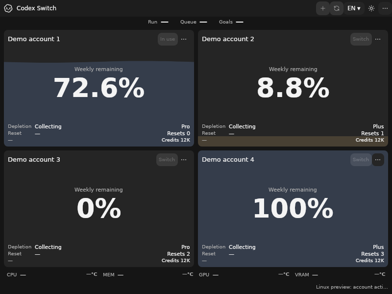
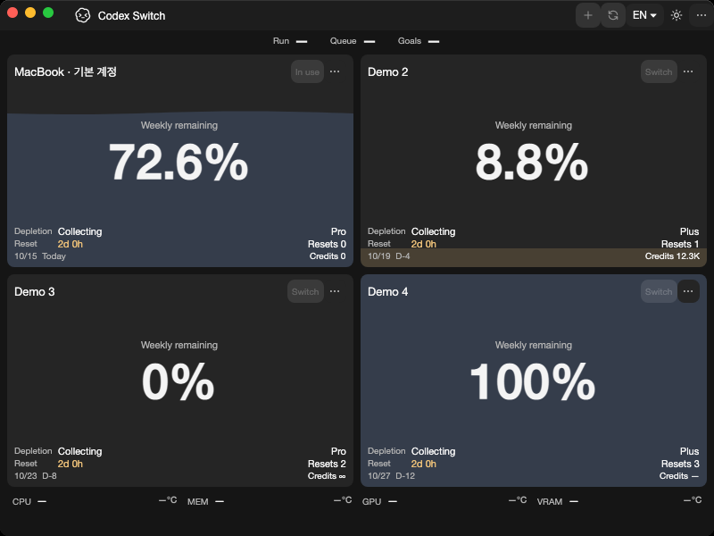
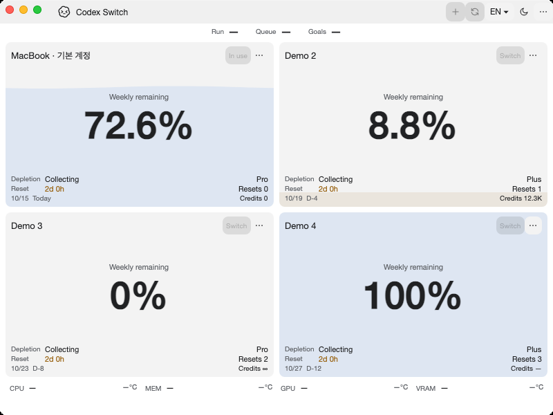

# KDE compatibility refusal and actual application comparison

Tracks [issue55](https://github.com/Gaebabi/codex-switch/issues/55), [PR58](https://github.com/Gaebabi/codex-switch/pull/58) and parent5. Source1.35.1 reports **KWallet unavailable** before encrypted-session/key access. This is an incompatibility/data-preservation checkpoint, not positive KWallet account storage support. Issue55 remains open for an upstream-compatible encrypted stack and full positive provider acceptance. Native Linux peer/lifecycle/IPC/account switching6 and clean packages7 also remain open.

## Actual program before and after

| Linux x64 before: source1.35.0 | Linux x64 after: source1.35.1 |
| --- | --- |
|  |  |

| Linux ARM64 before | Linux ARM64 after |
| --- | --- |
|  |  |

| Windows before | Windows after |
| --- | --- |
|  |  |

| Mac Apple Silicon before | Mac Apple Silicon after |
| --- | --- |
|  |  |

| Mac Intel before | Mac Intel after |
| --- | --- |
|  |  |

Before images retain capturece2c258/app1.35.0. Ten inspected lossless after PNGs include a minimum-size confirmation on each target. Windows captures bind0199c43/app1.35.1; Mac/Linux captures bind996b4f9/app1.35.1. The latter adds only a sanitized provider-summary log to the original implementation. [Windows](windows/evidence.json), [Mac ARM64](mac-arm64/evidence.json), [Mac Intel](mac-intel/evidence.json), [Linux x64](linux-x64/evidence.json), [Linux ARM64](linux-arm64/evidence.json) receipts bind exact source/runtime/architecture/dimensions/SHA256. Metadata is stripped; authored synthetic profiles contain no personal account/home/chat/pointer/desktop. Same-host Windows200% dark is byte-identical.

The actual self-contained Windows app captures only its owned HWND; each native macOS15 runner captures its own window with software evidence rendering. Native Ubuntu24.04 x64/ARM64 uses owned X11/Xvfb windows/software rendering and verifies12 EN/KO/theme/size/text/scroll captures each. These screenshots prove source-app bootstrap and layout regression. They do not display or prove the nonvisual provider guard: the independent native contracts below establish that behavior. Qt offscreen is not a full KDE desktop, and Xvfb is not native Wayland/XWayland acceptance.

## Independent native behavior

Code996b4f9 passes all four [Verify38684297973](https://github.com/Gaebabi/codex-switch/actions/runs/38684297973) and both [Linux native38684297967](https://github.com/Gaebabi/codex-switch/actions/runs/38684297967) jobs. The Mac Intel capture attempt passed application checks but GitHub CreateArtifact timed out after five requests; that terminal upload-only failure was inspected and only the failed job was rerun at the same source. [Sanitized actual provider results](provider-results.json) retain versions, native architecture, compatibility and counts without raw keyring state. Each native architecture passes GNOME28 positive provider/account assertions across13 phases and **KWallet19 incompatibility/refusal assertions across11 phases**. Four portable process-cleanup contracts are separate from native evidence.

The actual KWallet5 test uses its own private file-socket D-Bus, isolated HOME/XDG and test-only ephemeral PAM hash. Standard Secret Service unlock connects the already-open native wallet to its actual collection; original foreground PID is checked after unlock. A deterministic public-key request reproduces the upstream size rejection. Ordinary production APIs refuse before key creation; preserve existing synthetic CADL1-format bytes; reject normal AccountVault.Save; and retain that refusal while locked, after in-place unlock and after orderly daemon restart. The preservation fixture has a CADL1 header and random payload; it does not claim successful KWallet encryption or authenticated decryption. Timeout/offline refusal remains bounded; no secret item is created. Failed startup/persistence cannot skip owned-process termination. These tests do not establish usable KWallet encryption, missing-key restoration, positive concurrent save/reopen or full desktop acceptance.

Repeated pre-guard binary-key sessions exposed intermittent failure after an initially successful run; this is why a single positive attempt was rejected as evidence. [Implementation, upstream sources and remaining work](../../development/LINUX.md#kde-encrypted-session-compatibility--source1351). The production guard compares KDE names with the verified **unique active Secret Service owner**; it does not select a different provider or change system configuration. No plaintext fallback, retry-until-success, custom crypto, implicit unlock, key replacement or permission repair is introduced.

Native GNOME includes64 independent binary-key reads with exact opaque32-byte/NUL/non-UTF8 checks, plus existing authenticated save/reopen/tamper/lock/unlock/restart/concurrency/missing/ambiguity/timeout/offline and10 actual AccountService policy contracts. Linux client/context120, SQLite26/protocol10/source-app12 and Windows93/SQLite23/handoff5/protocol9 are retained. Native Mac SQLite23/protocol9/UI21/key16, package and other provider regressions pass. All9x372 catalogues, local language42, compilation, tracked-tree/privacy/link/whitespace checks pass. Final proof head still requires all six exact-head jobs, author self-review (not independent approval) and expected-SHA merge.

Public binaries remain1.27.6. No real login/inference/credentials, personal keyring/home/live Codex, installed utility replacement, new binary Release/signing or history rewrite is performed.
