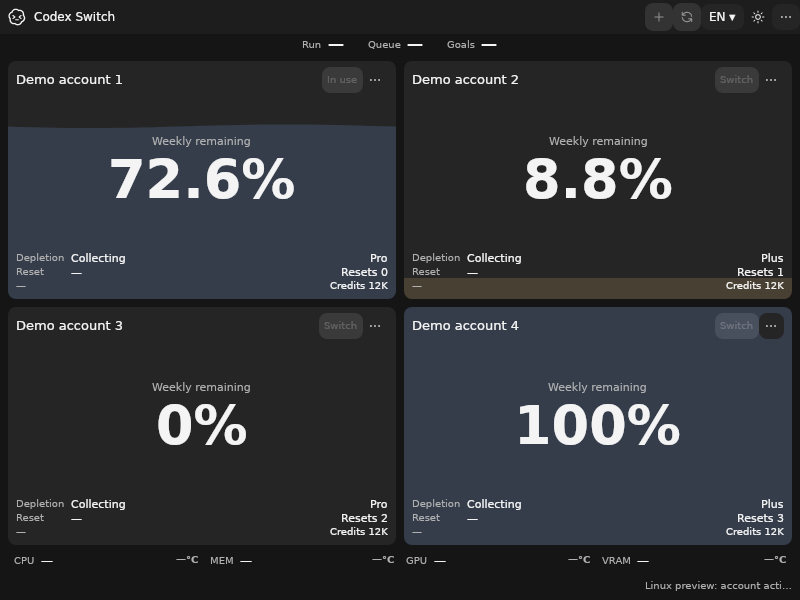
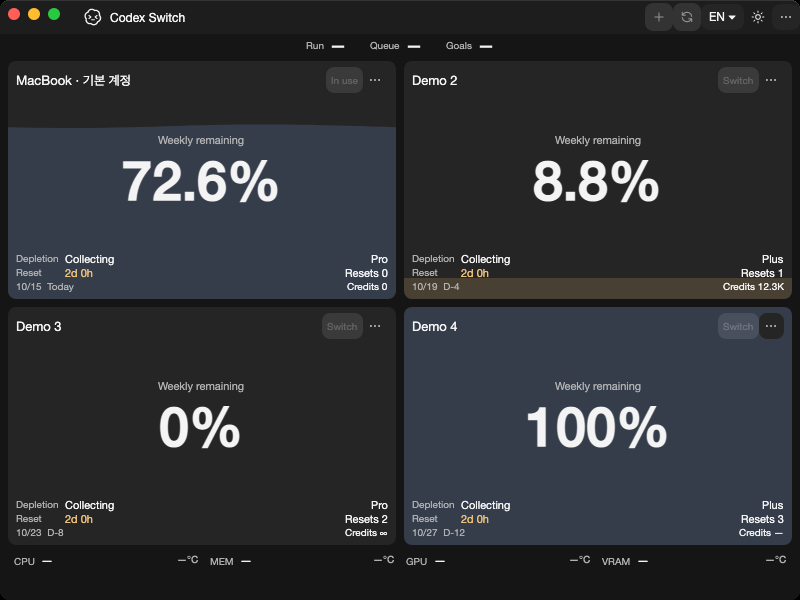
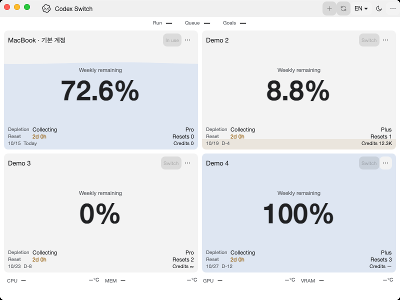

# Native Linux read-only metadata and application comparison

Tracks [issue52](https://github.com/Gaebabi/codex-switch/issues/52), [PR53](https://github.com/Gaebabi/codex-switch/pull/53) and parent5. Source1.33.1 adds Linux system SQLite and the existing explicit-home headless queue diagnostic. Account/client/IPC/handoff actions remain disabled in the Linux source preview. This checkpoint does not complete KWallet/client/backend, full manual switching/resumption or clean packages in #5/#6/#7.

## Actual program before and after

| Linux x64 before: source1.33.0 | Linux x64 after: source1.33.1 |
| --- | --- |
|  |  |

| Linux ARM64 before | Linux ARM64 after |
| --- | --- |
|  |  |

| Windows before | Windows after |
| --- | --- |
|  |  |

| Mac Apple Silicon before | Mac Apple Silicon after |
| --- | --- |
|  |  |

| Mac Intel before | Mac Intel after |
| --- | --- |
|  |  |

The before images bind source6480524/app1.33.0; all ten selected after images bind exact source `a726ab50d9006c911fabc640fd958205d004cb6f`/app1.33.1. [Linux x64](linux-x64/evidence.json), [Linux ARM64](linux-arm64/evidence.json), [Windows](windows/evidence.json), [Mac ARM64](mac-arm64/evidence.json) and [Mac Intel](mac-intel/evidence.json) record source/runtime/architecture, dimensions and SHA256. Each also includes a visually inspected minimum-size image. All ten lossless PNGs are inspected with no personal identity, home, account, chat, pointer or desktop pixels; profiles are authored synthetic data, including the Mac alias. Metadata is stripped. Windows uses the same local200% scale and its dark image is byte-identical.

These are actual self-contained program windows. Linux uses native Ubuntu24.04 x64/ARM64, X11/Xvfb and software rendering, capturing only each owned visible XID. Mac runs on native macOS15 arm64/Intel with software evidence rendering; Windows captures its own HWND. Linux12 captures per architecture cover EN/KO, both themes and500×360/600×420/800×600, with strict geometry/text/scroll assertions. This is source UI regression evidence; the new headless SQLite path has no dashboard action, so screenshots do not prove database behavior. They do not establish full GNOME/KDE/Wayland, live accounts or handoff acceptance.

## Native database behavior

Sourcea726ab5 passes all four [Verify jobs38671549717](https://github.com/Gaebabi/codex-switch/actions/runs/38671549717) and both [Linux native jobs38671549887](https://github.com/Gaebabi/codex-switch/actions/runs/38671549887). Each actual Linux architecture passes26 SQLite/WAL assertions and7 protocol assertions. The published Linux executable invokes the ordinary metadata reader before GUI/vault/keyring/client initialization, with an explicit disposable home. Native fixtures verify committed WAL-only additions, invisible uncommitted changes, saved/server dedup, child/CLI exclusion, removal, absent/corrupt/unsupported unknown states and unchanged database/WAL presence and SHA256 before/after every read. A non-root runner also reads committed rows while all database/WAL/SHM files and the containing directory lack write permission; the explicit reports subdirectory stays writable. SHM read coordination is not claimed byte-immutable. No immutable-mode shortcut, client configuration rewrite or real client/account mutation is used.

Native protocol checks bind Unicode parameters, reject a prepared direct write and preserve an empty schema; absent databases are not created and corrupt bytes remain unchanged. Production uses fixed SELECT metadata queries: statement read-only status does not promise to sandbox arbitrary SQL. Linux resolves distribution libsqlite3.so.0; existing Windows/Mac library selection and read-only open/busy-timeout algorithms are retained. Missing/incompatible native libraries report unavailable, not a zero queue. [Contracts and primary SQLite references](../../development/LINUX.md#read-only-linux-sqlitewal).

Both Linux architectures also retain18 actual GNOME Keyring checks across12 lifecycle phases and complete runtime/package inspection. Windows93/SQLite23/handoff5/protocol6 and native Mac SQLite23/protocol6/UI21/key16 pass, alongside existing language/temperature/client/hardware/composition regressions. Local Windows SQLite23/protocol6, complete source cross-publish/runtime and tracked-tree privacy/link/catalogue checks pass. Public binaries remain1.27.6; no installed utility, personal Codex/account or new Release/signing is involved. PR53 owns final complete-head six-job CI, author self-review and focused promotion.
