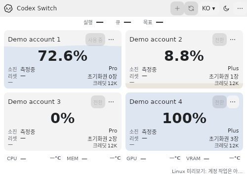
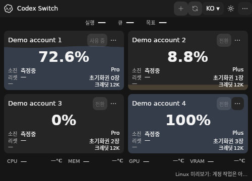

# Linux native storage and source UI confirmation

Tracks [issue50](https://github.com/Gaebabi/codex-switch/issues/50), [PR51](https://github.com/Gaebabi/codex-switch/pull/51) and parent5. Source1.33.0 adds native Secret Service/private-file protection and a shared Linux source UI preview. This does not complete Linux client/SQLite/KWallet, actual manual switching/resumption or installation/package acceptance in #5/#6/#7.

| Linux x64 confirmation | Linux ARM64 confirmation |
| --- | --- |
|  |  |
|  |  |

These are actual published source previews on native Ubuntu24.04 x64/ARM64, captured from their own visible XIDs on private X11/Xvfb displays with software rendering. EN/KO, both themes and500×360/600×420/800×600 pass actual geometry, text-containment and no-unexpected-scroll assertions:12 images per architecture. Account actions are explicitly unavailable and resources remain unknown, not zero. The screenshots show bootstrap/layout, not real account/client/handoff or full GNOME/KDE/native Wayland acceptance. The independent actual provider suite below establishes storage contracts.

## Existing supported-host regression

| Windows before: source1.32.0 | Windows after: source1.33.0 |
| --- | --- |
|  |  |

| Mac Apple Silicon before | Mac Apple Silicon after |
| --- | --- |
|  |  |

| Mac Intel before | Mac Intel after |
| --- | --- |
|  |  |

Before source385fa40/app1.32.0 matches mainaee22785 code. All after images come from exact source `648052426614d054cdacc0b9c8fc95218b6f4958`/app1.33.0: [Windows](windows/evidence.json), [Mac ARM64](mac-arm64/evidence.json), [Mac Intel](mac-intel/evidence.json), [Linux x64](linux-x64/evidence.json), [Linux ARM64](linux-arm64/evidence.json). Ten selected lossless PNGs are visually inspected, metadata stripped and dimensions/SHA256 verified. Windows uses the same local200% display scale; its dark image is byte-identical. Native Mac uses hosted macOS15/software evidence rendering; focus/water/date variations do not establish behavior changes. No personal identity, home, account, chat, pointer or desktop appears. Synthetic profiles avoid private source pixels entirely.

## Provider and workflow evidence

Source6480524 passes all four [Verify jobs38668709259](https://github.com/Gaebabi/codex-switch/actions/runs/38668709259) and both [Linux native jobs38668709256](https://github.com/Gaebabi/codex-switch/actions/runs/38668709256). Each native Linux architecture passes18 genuine GNOME Keyring checks across12 phases: missing service, binary key/envelope/tamper/private JSON, file modes/links/foreign ownership, ambiguity/malformed keys, independent-process concurrency, lock/in-place unlock (original PID), unlock/restart/timeout recovery, missing key and offline byte preservation. The owned D-Bus/XDG session never connects to a personal keyring; temporary passwords, keys and raw sandbox files are not exported. KDE/KWallet remains a separate native provider gate.

Protection uses distinct authenticated `CADL1`,32-byte OS-held keys, same-UID owner pinning, no-follow descriptor-relative private files and serialized creation. Missing/locked/ambiguous keys never cause plaintext fallback, implicit unlock, repair or replacement for existing ciphertext. Existing Windows DPAPI/Mac CADM1 algorithms/identities remain unchanged. [Format, memory-cache policy, isolation and implementation decisions](../../development/LINUX.md).

Existing Windows93/SQLite23/handoff5, native Mac UI21/SQLite23/key16, portable/native language42-43, temperature29, client/protocol/hardware and shared composition checks pass. Complete self-contained packages require all runtime/project DLLs; omission of Linux security/application/desktop dependencies rejects and owned outputs are restored. Local source cross-publishing and the optional isolated Docker debug run are separate from the native CI authority above. PR51 owns final complete-head six-job CI, author self-review and promotion. No personal Codex/account/installed app or new binary Release/signing is involved.
