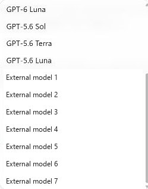

# Actual native Windows model menu

This is a cropped capture of the actual native Codex menu from the installed local implementation on2026-11-13. The visible native entries and seven custom rows share the same menu. Private registration labels were removed with an opaque rectangle and replaced with numbered generic text; those replacement labels are not product copy. Surrounding chat/sidebar pixels are excluded.

[Capture and redaction receipt](capture.json) binds the observed candidate fingerprint and image hashes. This pre-release capture used native CLI0.167.0-alpha.4.1. Final release packaging/version and native CI evidence are separate; this image does not claim a final-release binary capture or prove inference by itself. Owner inference and tool execution were independently verified without publishing credentials or conversation text. [Architecture and verification](../../DESKTOP_MODEL_BACKEND.md) / [release gates](../../development/RELEASE_1_45_0.md).
