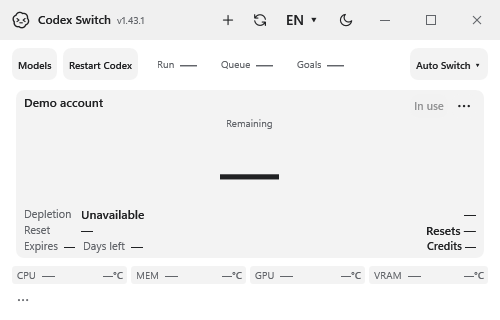
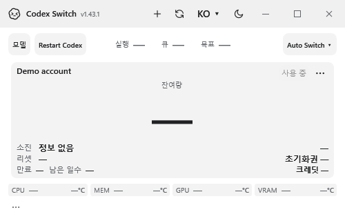
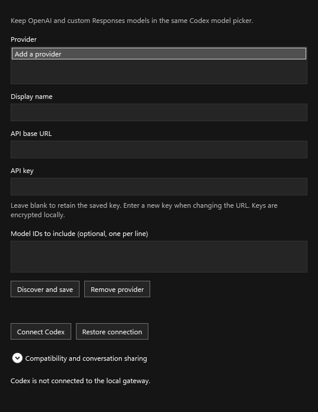
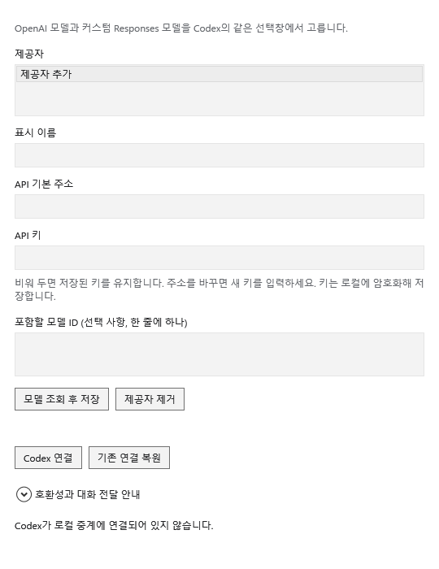

# Model provider verification

The implementation originated as local work for [issue138](https://github.com/Gaebabi/codex-switch/issues/138), based on main1331c46. Its original checkpoint evidence is retained below. PR142 merged the source after protected CI; native combined-picker confirmation and external-provider acceptance remain open.

## Restart action checkpoint, October31

The main window includes Restart Codex beside Models on Windows. The shared desktop places it in the footer. It preserves the login and chat titles while reusing durable close/launch/resumption recovery. Seven fictional-backend restart checks bring account/history coverage to264. The production WPF main layout was rendered offscreen at its500px minimum width in English and Korean; the action is enabled when ready and disabled while busy. No restart was invoked in the owner desktop.

| English main window | Korean main window |
| --- | --- |
|  |  |

The latest local package passes99 self-tests and494-file verification with runtime10.0.13. Provider checks pass60 with reviewed Codex0.163.0. A first0.164.0 run timed out during startup and a first package test also recorded a SQLite cleanup lock; those failures are retained separately from the successful0.163.0 run. The explicitly authorized owner utility update preserves accounts, saved providers, configuration and active Codex processes. This is local installation evidence, not public delivery or native restart acceptance. The original October30 records below remain the evidence for that earlier source checkpoint.

## Production editor component

| English dark | Korean light |
| --- | --- |
|  |  |

These are actual production WPF component renders with an empty disposable provider store. No window was shown, activated or photographed. The field masking, reachable actions and English/Korean dark/light layouts were checked. This evidence is separate from an actual native window, saved-provider interaction, authenticated account use, and the Codex combined model picker.

## Routing and configuration

The contract suite verifies encrypted keys, add/edit/filter/remove behavior, provider-qualified aliases, account/header separation, concurrent routes, streaming before completion, tool-history replay, explicit upstream failures, no gateway retry, an in-flight key snapshot, next-request key updates, persistent mixed-route state, and safe configuration restoration.

The official Codex0.163.0 and0.164.0 app-server probes use fictional authentication and a separate selected-workspace control-plane fixture matching the public routing contract. They discover the union and change models without restarting the app-server or chat, retain a custom route on the next turn without an override, and exercise a second thread with the original OpenAI provider identity. No real API key, owner home, installed utility replacement or desktop restart is involved.

The generic catalog must include a real instruction template; an unsupported apply-patch enum and missing instructions were found and corrected against the upstream schema. Codex's stable request-compression feature is disabled in the reversible connection settings because the relay consumes bounded JSON. These are production compatibility corrections, not relaxed trust checks.

## Remaining acceptance

An actual isolated Codex desktop picker screenshot, external Responses-provider tool/stream/follow-up compatibility, workspace-managed routing and native macOS/Linux provider management remain separate gates. Published packages before1.43.3 do not contain this source work.
