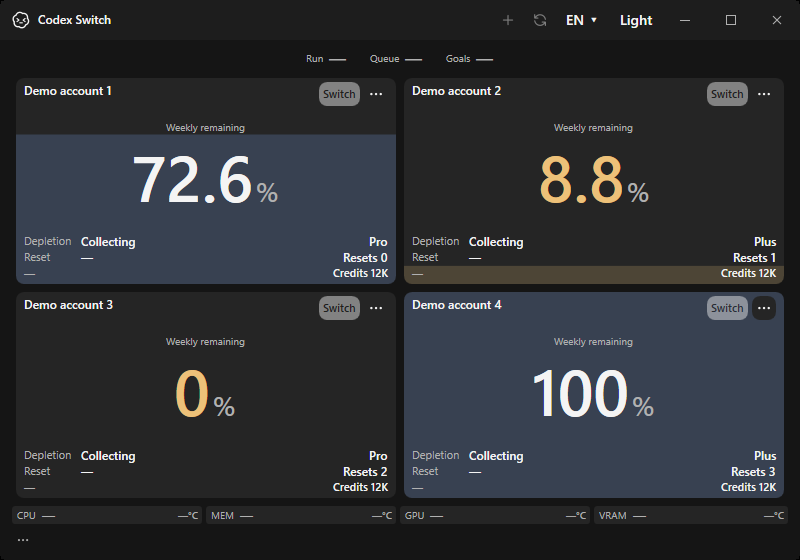
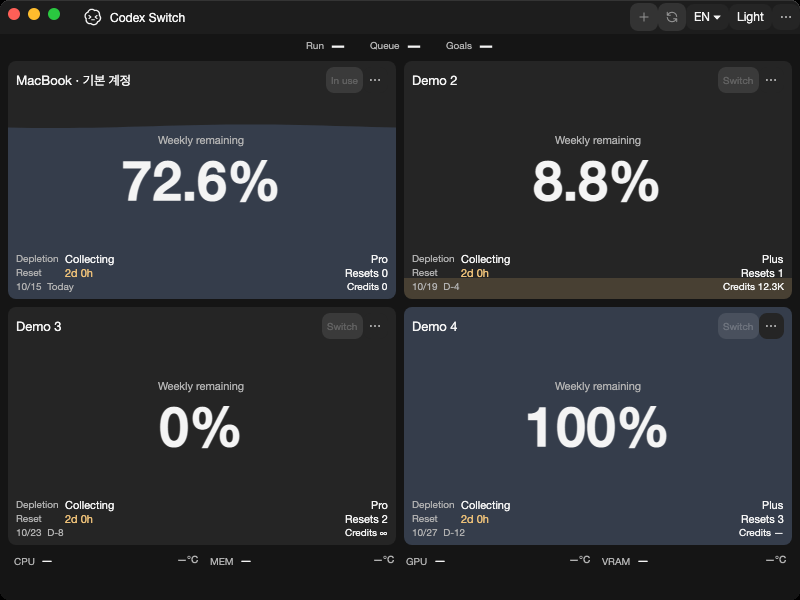
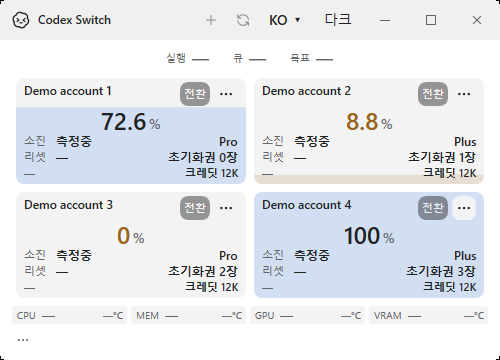
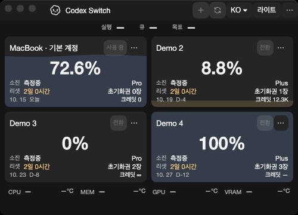

# Native runtime migration evidence

Tracks [issue4](https://github.com/Gaebabi/codex-switch/issues/4) and [PR27](https://github.com/Gaebabi/codex-switch/pull/27). These are lossless screenshots of the actual self-contained application running on the stated OS. They contain fictional accounts only; no private credentials, chats, home directories, hardware observations or personal desktops enter the capture.

| Windows .NET8 before | Windows .NET10 after |
| --- | --- |
|  |  |

The two English800×560 images are byte-identical: runtime migration preserves this dashboard's layout. Before: app1.29.3/.NET8.0.32, source `9e15fe0c9bbad1a6a49547fcba5b74d1b0ea966f`, [Windows job in run38620215260](https://github.com/Gaebabi/codex-switch/actions/runs/38620215260). That run's Mac jobs failed; it provides Windows baseline evidence only. After: app1.30.0/.NET10.0.13, source `07efba62066b123ac0ed39f43879130e85bc9858`, [run38622544372](https://github.com/Gaebabi/codex-switch/actions/runs/38622544372).

| macOS15 Apple Silicon | macOS15 Intel |
| --- | --- |
|  |  |

Both Mac applications report .NET10.0.13/app1.30.0 on their native architecture. Evidence mode explicitly uses Avalonia software rendering on hosted virtual runners. It does not establish Metal rendering, physical sensor support, Keychain/login, real-account switching/resumption, notarization or install/update acceptance. A pre-migration native Mac image is unavailable; these are confirmation screens, not a fabricated before/after pair.

| Minimum Windows500×360 | Minimum Mac500×360 |
| --- | --- |
|  |  |

Native Mac verification exposed a2px overflow: two126px rows plus4px outer grid margin required256px inside a254px viewport. Reserving2px vertical grid margin now fits four cards while preserving their118px minimum visible height. Strict no-scroll/no-clipping checks pass; eight accounts still scroll. No older native Mac failure screenshot was published.

## Receipts and verification

- [Windows baseline manifest](windows-before/evidence.json), [Windows upgraded manifest](windows-after/evidence.json), [Apple Silicon manifest](mac-arm64/evidence.json), [Intel manifest](mac-intel/evidence.json) record exact source revision, runtime, architecture, image dimensions and SHA256. All40 native PNGs have metadata stripped and are stored with these receipts.
- Windows uses `PrintWindow` after validating the app's own HWND/PID. Mac uses `screencapture -x -o -l` on the app's own NSWindow ID. Neither captures a desktop, cursor, another app or menu-bar background. Raw diagnostics remain private.
- Windows publish/internal93, SQLite/WAL23, normal-shutdown/handoff5, localization39 and temperature29 checks pass. Both native Mac jobs pass SQLite/WAL23, localization39, temperature29 and19 UI/menu/count assertions. English/Korean, dark/light and all advertised diagnostic sizes are captured.
- Complete private Windows x64/Mac arm64/x64 folders contain .NET10.0.13; package inspection rejects a mismatched TFM/RID/runtime. Cross-built Mac ZIPs preserve every bundle byte and executable modes; bundle version1.30.0, minimummacOS15.0 and existing bundle ID are checked. They are unsigned local outputs, not newly published releases.
- Avalonia remains11.3.22; System.Management is10.0.13. Direct/transitive NuGet vulnerability review reported no known vulnerable packages for either app at this checkpoint. Public downloads remain1.27.6.

The latest PR head must independently pass all four CI jobs before merge. This checkpoint adds supported-runtime and native UI evidence; core/platform extraction and Linux account/handoff acceptance remain in issues3/5/6/7.
