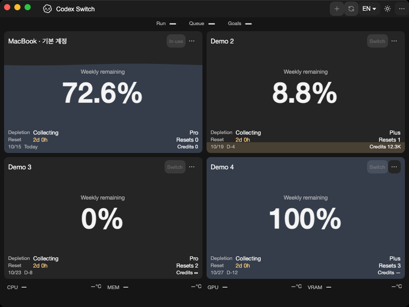
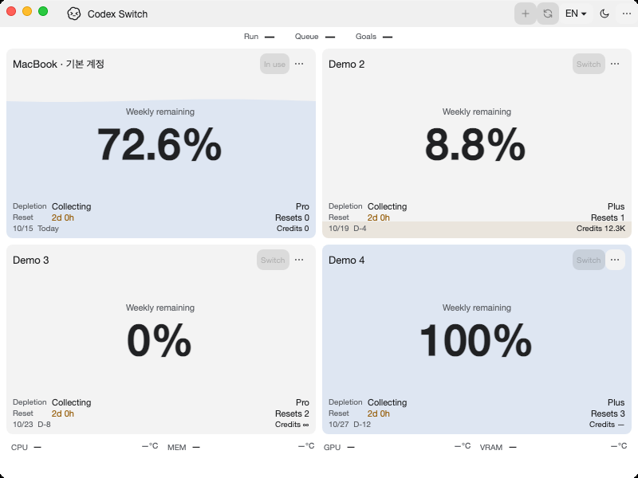

# Native platform security extraction

Tracks [issue37](https://github.com/Gaebabi/codex-switch/issues/37), [PR38](https://github.com/Gaebabi/codex-switch/pull/38) and remaining provider issue3. Native OS screenshots contain only app-owned windows and synthetic accounts; no personal screen, identity, credential or home path is captured. This is one provider checkpoint, not Linux enablement or account/handoff acceptance.

| Windows before: app1.30.3 | Windows after: app1.31.0 |
| --- | --- |
|  |  |

| Native Mac Apple Silicon before | Native Mac Apple Silicon after |
| --- | --- |
|  |  |

| Native Mac Intel before | Native Mac Intel after |
| --- | --- |
|  |  |

Windows before/after are freshly captured on the same local host at the same display scale; logical800×560 appears as1600×1120 pixels at200%. They are native own-HWND captures, not resized bitmaps. Both sides use the same WPF software evidence renderer. Mac images use native macOS15 hosted runners with software evidence rendering; focus/water animation/date changes do not represent behavioral changes. Production rendering selection is unchanged.

Before capture source `386cde7cc6136903a1c5ce7cea9118550c4b2046`/app1.30.3 is the original tooltip checkpoint; baseline mainc658f408 differs only in documentation. After source `12d73d05528491d9a8bfa7cf40f97554e333b894`/app1.31.0 extracts the security project. [Windows before receipt](windows-before/evidence.json), [Windows after receipt](windows/evidence.json), [Mac arm64 receipt](mac-arm64/evidence.json), [Mac Intel receipt](mac-intel/evidence.json). Selected exports preserve exact source/runtime/architecture/dimensions/SHA256 and have metadata stripped.

## Invisible security contracts

`VaultProtection`, Mac Keychain/CoreFoundation helpers, SecureFiles and WindowsProtection algorithm source is byte-preserved after normalizing repository UTF-8 line endings. The source move changes assembly ownership; both apps/tests now consume one native security assembly. `AccountVault` serialization remains in integration code. DPAPI description, Keychain service/account hash, CADM1 authenticated envelope, private file modes, atomic write semantics and existing data paths are unchanged. Complete runtime inspection requires the security DLL and all declared project assets.

Native contracts use unique disposable storage and synthetic plaintext only. Windows10 checks cover real DPAPI roundtrip/cache release, ciphertext independence, tamper/truncation rejection, UTF-8 atomic creation/replacement and assembly boundaries. Mac16 adds actual Keychain reload/missing-key refusal, envelope identity, POSIX0700/0600 and linked-directory/file rejection. Ubuntu exercises file/POSIX behavior and rejects unsupported vault encryption; it is not Linux vault support. Keychain lock/UI authorization matrix, real-account migration, installed-app replacement and signed packages remain outside these results.

[Capture checkpoint run38655891808](https://github.com/Gaebabi/codex-switch/actions/runs/38655891808) passes all four jobs at source12d73d0: Windows93/SQLite23/handoff5/security10, native Mac security16 on each architecture and native UI/SQLite regressions, plus Ubuntu portable/security refusal contracts. Windows dark comparison PNGs are byte-identical on the same host/scale. PR38 owns final complete-head CI, author review and promotion. Source1.31.0; published binary1.27.6 remains unchanged. No real Codex process/login/switch/resume or new Release is performed.
