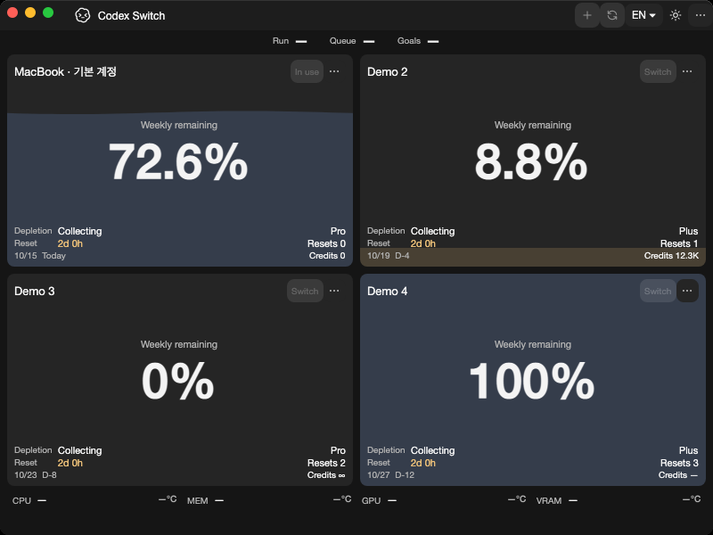
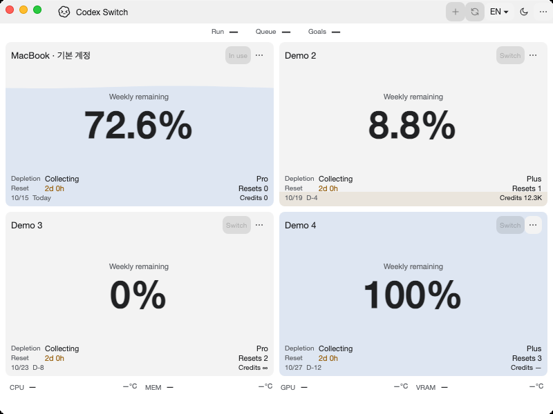

# Codex protocol and read-only SQLite extraction

Tracks [issue41](https://github.com/Gaebabi/codex-switch/issues/41), [PR42](https://github.com/Gaebabi/codex-switch/pull/42) and remaining provider issue3. Program screenshots contain only synthetic accounts and app-owned HWND/NSWindow pixels; no private identity, chat, credential, home or personal desktop is captured.

| Windows before: source1.31.1 | Windows after: source1.31.2 |
| --- | --- |
|  |  |

| Mac Apple Silicon before | Mac Apple Silicon after |
| --- | --- |
|  |  |

| Mac Intel before | Mac Intel after |
| --- | --- |
|  |  |

Before source903fdc0/app1.31.1 is the client extraction checkpoint; main05840d1b has the same code. After exact source `5520523e6add8e98ef94408521b3a3e7089cbfd0`/app1.31.2 extracts Protocol/Sqlite. [Windows receipt](windows/evidence.json), [Apple Silicon receipt](mac-arm64/evidence.json), [Intel receipt](mac-intel/evidence.json) retain original revision/runtime/architecture/dimensions/SHA256. Metadata is stripped; screenshots are visually inspected. Windows uses the same local host/display scale/software renderer; native Mac uses hosted macOS15/software evidence rendering. Focus/water/date differences do not prove functional changes. Production rendering is unchanged.

Codex RPC/desktop requests/session ledger/queue projections now have one UI-independent Protocol owner, referencing core/client/native SQLite. SQLite has no UI/domain dependency and owns its loader/read-only wrapper. Supported algorithms, versions, IDs, queue filtering/deduplication, read-only open/query flags, WAL visibility and cancellation are source-preserved. The RPC version still comes from the shared managed version, now via the Protocol assembly. Unsupported IPC start and SQLite construction reject before unverified Unix/Windows fallback; this does not implement Linux trust.

Standalone protocol contracts check module ownership, unstarted observations remaining unavailable, unsupported platform refusal and absent/corrupt read-only database rejection without file creation/byte changes. Existing native SQLite/WAL23 fixtures exercise the actual extracted code through the published app. Existing Windows93 and native disposable shutdown/coordinator tests remain required. Native app pictures prove packaging/bootstrap/layout; they do not prove private chat authentication or real account/handoff acceptance.

[Capture checkpoint run38658393998](https://github.com/Gaebabi/codex-switch/actions/runs/38658393998) passes all four jobs at5520523. Protocol boundary/refusal tests pass5 on Windows/Mac/Ubuntu; Windows93/SQLite23/handoff5 and both native Mac SQLite23/UI21 plus existing security/client/catalogue/temperature checks pass. Six selected native after images are inspected and metadata/hash checked; same-host Windows dark PNGs are byte-identical. PR42 owns final complete-head CI, author self-review and promotion. Remaining resource services and Linux5/6/7 are not complete. Source1.31.2/publicbinary1.27.6; no installed-app replacement, personal client/account action or Release.
