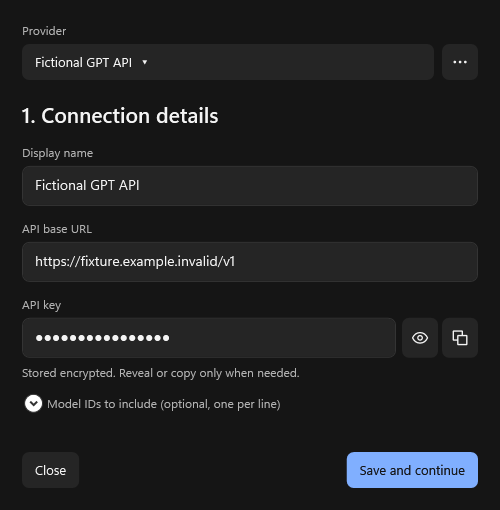
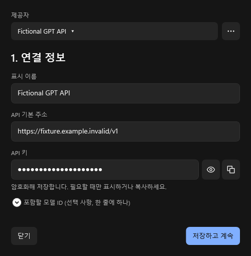

# Provider connection state

These images are production WPF components rendered offscreen with fictional provider metadata and disposable encrypted storage. The two-step flow loads saved fields, keeps keys masked, retains failed edits, and advances to Connect only after saving. Eye, copy, explicit reload/reuse and close/reopen are checked through the editor's normal controls and persistence paths. These are not native Codex picker or real-provider acceptance images.

The current native Codex app-server separately verifies visible custom models, unchanged OpenAI provider identity, per-chat routing, catalog refresh, restoration and bounded upstream retries against fictional endpoints. See [the contract](../../MODEL_PROVIDERS.md).
