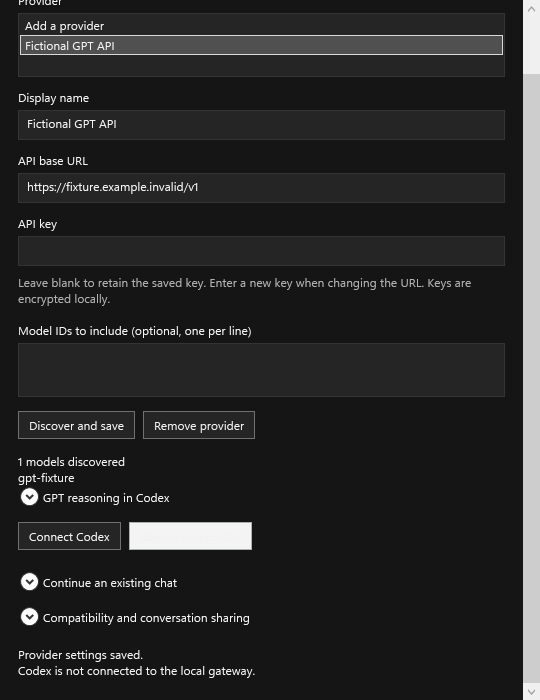
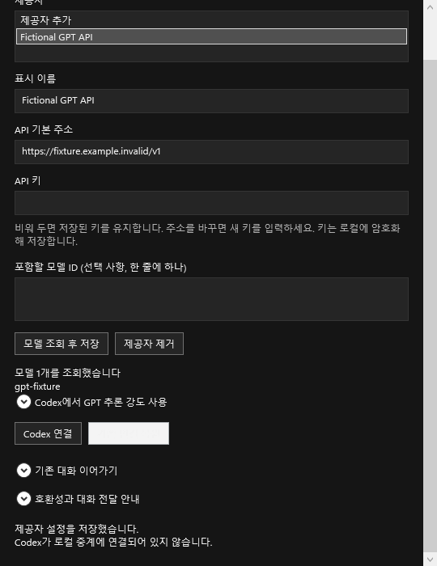

# Provider connection state

These images are production WPF components rendered offscreen after the ordinary reasoning-settings Save action, with fictional provider metadata, an empty key field and disposable encrypted storage. The saved state remains explicitly disconnected, Connect stays available, and Restore is disabled. They are not native Codex picker or real-provider acceptance evidence.

The current native Codex app-server separately verifies visible custom models, unchanged OpenAI provider identity, per-chat routing, catalog refresh, restoration and bounded upstream retries against fictional endpoints. See [the contract](../../MODEL_PROVIDERS.md).
