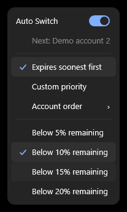
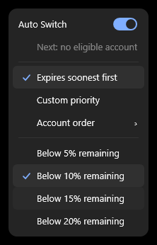
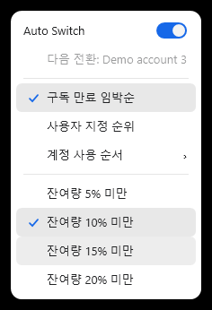
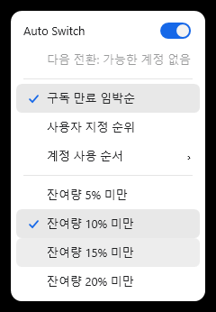
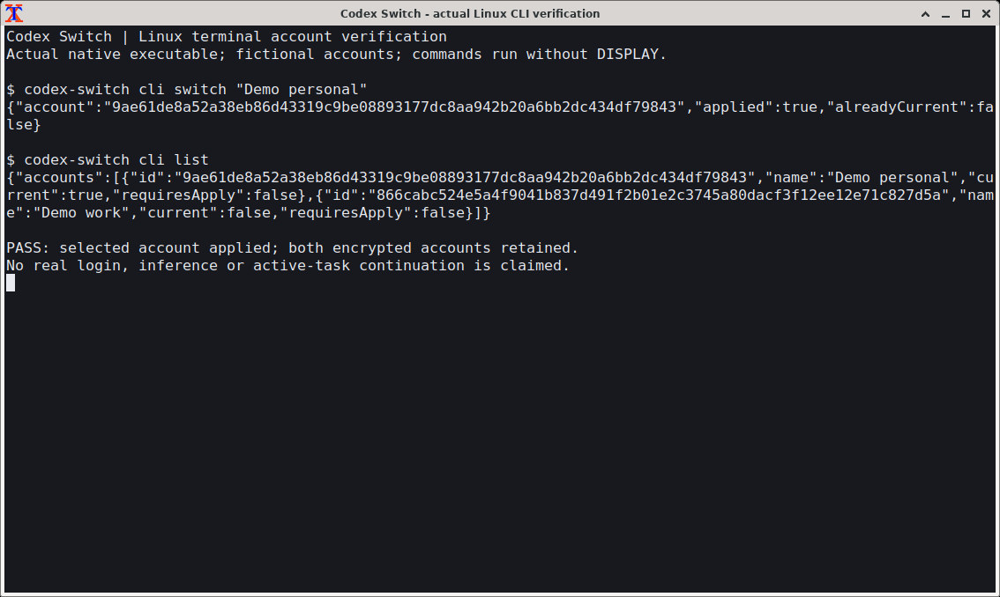

# Automatic selection with ambiguous quota IDs

[Issue120](https://github.com/Gaebabi/codex-switch/issues/120) / [PR121](https://github.com/Gaebabi/codex-switch/pull/121) / [delivery](../../development/RELEASE_1_42_6.md) / [source/image hashes](evidence.json).

|Existing healthy1.42.5 native menu|1.42.6 skips an ambiguous candidate|1.42.6 refuses an ambiguous source|
|---|---|---|
||||
|Original healthy frame; the exception is not pictured|||

The [prior healthy baseline](before.json) retains original export bytes. Separately, actual UsageSnapshot.Parse with duplicate JSON object keys reproduces ArgumentException in the unchanged1.42.5 policy. That error receipt and original policy hash establish the failure; the healthy screenshot is not presented as a crash picture.

The new hosted Windows source `0c3cefb6006968a9c0bf54a72215b90ceafd2b97`, Verify40556935313, passes44 native assertions:36 existing account/menu checks plus8 new EN/KO checks. Actual native Auto Switch popups remain usable, display Demo account3 when nearer-expiry Demo account2 has ambiguous quotas, and explicitly show no eligible account for ambiguous current observations. The original two duplicate buckets remain in the snapshot. No quota is merged, inferred or overwritten; valid alternatives retain original eligibility and expiry/custom ranking.125 policy/account/retry contracts also cover low-source refusal, empty IDs, duplicate IDs across slots, preserved data and normal selection.

The four new exported PNGs were individually inspected without scaling/pixel changes, and retain their original bytes/SHA256 with no image metadata. Inputs are fictional and the window/menu HWND belongs to the app on a disposable hosted runner; no personal screen/account, actual switch, client shutdown or Continue is used. Source/capture/native/authenticated scopes remain separate. Final evidence commits are distinct from capture source; implementation and dependency hashes bind the same code. The final release requires six final-head checks, author COMMENT self-review (not independent approval), expected-head normal merge/tree equality and verified public package downloads.

Development-only PR101/102 are integrated with original ancestry. Their official release/registry review and full native export/protocol validation are recorded in [dependency review](../../development/DEPENDENCY_REVIEW.md). The tools add no shipped runtime dependency. Existing trust checks and all original native assertions remain.

## Exact standalone CLI0.163.0 compatibility

The earlier exact-version gate correctly refused this previously unreviewed standalone CLI. Tagged0.162.1/0.163.0 initialization and credential schema fields/referenced definitions were compared before approving only exact0.163.0; credential-store passthrough still requires native behavior tests. Unknown0.163.1/0.164.0 and wrong home/platform/client headers remain refused. The installed-desktop checksum manifest and credential/workspace policy parser are unchanged.

The separate checkpoint b5fd19030075edab8f8ba5df751d924130245328/Run40559276438 passes16 actual terminal contracts on each native architecture: all15 original account/configuration/conflict/preservation cases plus actual0.163.0 initialization/effective-file-policy verification. The original owned Xfwm4 terminal frames below were individually inspected and retain original bytes/hash/metadata-free provenance. The commands use fictional accounts and no authenticated login, inference or active-task continuation. They are not full-workflow/final-head acceptance; the final six checks and source-bound package promotion remain required.134 portable contracts include nine exact-version/identity accept/refusal cases in addition to the125 quota/account/retry cases.

|Native Linux x64|Native Linux ARM64|
|---|---|
|||

## Shared terminal test-host profile correction

The new16th assertion initially hardcoded the standalone0.163.0 pin in a test executable also used for the separately approved installed-desktop CLI0.162.0-alpha.17.2. The full desktop session exposed that test-host mistake after its original earlier contracts passed. Both callers now independently declare the expected reviewed version: the standalone workflow declares0.163.0 and the desktop fixture uses the unchanged checksum-reviewed installed-client manifest. The actual handshake and file policy must match that pin; both consumers require all16 cases. No expected value is inferred from the observed result, and no production version/home/platform/workspace/checksum guard changes. Historical captured host hashes remain intact; current host hashes and unchanged production hashes are recorded separately. Final full native checks remain the acceptance gate.
