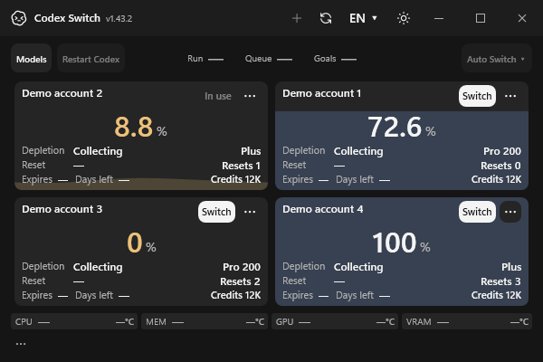

# Recovery state and Windows shutdown evidence

The native Windows frames below use fictional accounts in an isolated application window. The left frame shows a handoff that still needs recovery. The right frame shows the same saved receipt after its account, desktop and chat results are confirmed: the account offers Switch while the receipt remains stored. These are two states rendered by the changed application; the left is not a capture of the prior implementation.

| Unresolved handoff | Confirmed finished receipt |
| --- | --- |
|  |  |

The production source was rendered as Windows x64 WPF on a private Windows desktop using .NET 10.0.11. There were no real accounts, live Codex shutdowns or Continue messages. Frame SHA-256: `a4d23de06ffc8faab54a9b567783d4c569df9512e83b8e5cfe4239e7291884f0` and `0caa662794495cc981d6582419ae856d61f99c3fbdb0fb37a5ecf7441979a898`.

Independent Windows process tests exercise Restart Manager with disposable parent, child and unrelated same-name processes. The coordinator's account and resume endpoints are fictional; they do not establish authenticated desktop switching. The reported Switch exit has not been reproduced or attributed. Exact-head CI and screenshots from its hosted Windows runner remain required for the PR.
