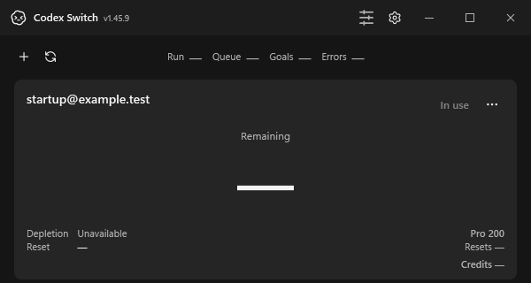

# Windows startup readiness

The production WPF window is open while the first usage refresh waits at the same point in both runs. The account is fictional. The exported images omit the drive and resource measurements at the bottom of the window.

| Released 1.45.8 | Corrected 1.45.9 |
| --- | --- |
|  |  |

The 1.45.8 control passes 12 checks and fails the ready-receipt check. The corrected build passes all 13. Its controls and tray readiness are available while the single usage refresh is still pending. The fixture uses the same refresh gate for both runs. See the [startup contracts](../../../tests/windows-startup/Program.cs) and [full changes](../../development/RELEASE_1_45_9.md).
