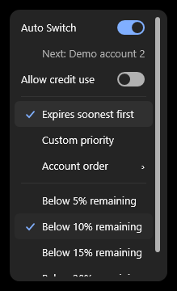
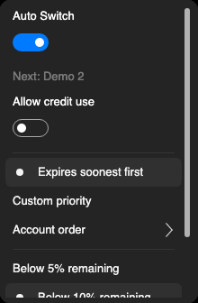
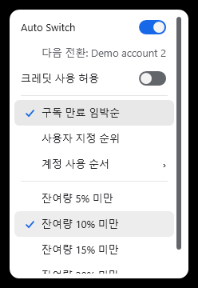

# Auto Switch at the reset boundary

Source `711c97abba9af98254d9eb7fc9e6ea96dd5f3852`, version1.43.1, runtime10.0.13. Issue136 / PR137.

A fresh quota report can still show0% when its reset timestamp has arrived. Previously this hid an otherwise eligible next account and could request a credit-protection pause. The source may now leave; destinations still need valid matching quota, reset times and headroom. No replenishment is inferred and no settings are changed.

## Actual native application evidence

| Previous ordinary menu baseline | Corrected elapsed-reset zero-source confirmation |
| --- | --- |
|  |  |

The before screenshot is an inspected **ordinary menu baseline**, not a reproduction of the old elapsed-reset refusal. The added regression fails against the original source at the exact reset boundary; the corrected215 policy/history/recovery checks pass. The new actual native menu assertions verify the elapsed source reset, next-account caption, actual policy selection and absence of an unnecessary credit pause together.

| Native Mac ARM64 | Native Mac Intel |
| --- | --- |
|  |  |

All four selected images are original app-owned popup pixels, inspected individually with metadata removed. Full native sets retain all previous cases and add four reset-boundary assertions/images per architecture: Windows45 checks, Mac46 each,32 images each (137 assertions/96 images total). English/Korean and dark/light are exercised. [Exact artifact SHA256, native receipts, selected image hashes and canonical source/checkout bindings](evidence.json) preserve provenance. Directory.Build.props may have the exact Git text=auto CRLF checkout on Windows; both hashes are recorded without changing source values.

[Capture Verify](https://github.com/Gaebabi/codex-switch/actions/runs/40927089580) / [capture Linux](https://github.com/Gaebabi/codex-switch/actions/runs/40927089474). Final documentation-only head still requires all six protected checks and author review before expected-head merge and public package verification. These hosted software-rendered/native fictional inputs do not certify owner accounts, authenticated active-chat resumption, a physical MacBook or complete Linux desktop support. No owner session, credential, home or billing state was used. Daily public release does not update the owner's installed app.
